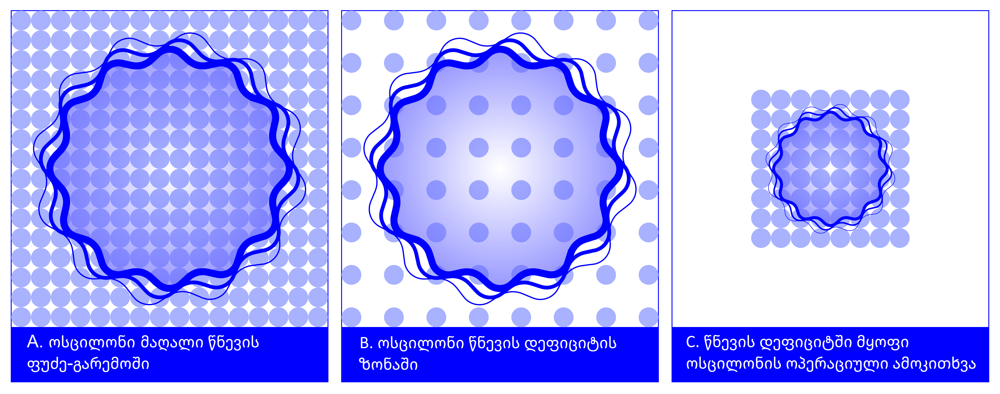

# რეფრაქციული გრავიტაცია: ონტოლოგიური სურათი და მათემატიკური ფორმალიზმის საფუძვლები

**ლოკალური სამუშაო ვერსია:** 3.7 — ერთიანი კოვარიანტული მოქმედების, ორმუხტიანი ინერციის, ძლიერი ველის $C^2$ რეგულარული ბირთვისა და გალაქტიკური $k$-essence ხიდის ჩართვა, 2026-10-25

**ავტორი:** გიორგი ლოთიშვილი

**აფილაცია:** აღმოსავლეთ ევროპის უნივერსიტეტის ასოცირებული პროფესორი

**ადგილმდებარეობა:** თბილისი, საქართველო, 2026 წ.

**ელფოსტა:** g_lotishvili@eeu.edu.ge

**Zenodo DOI:** [10.5281/zenodo.21325652](https://doi.org/10.5281/zenodo.21325652)

## სარჩევი

- წინასიტყვაობა
- შესავალი
- თავი I — ონტოლოგიური ფუძე
  - 1.1 ერთი ფუძე და მისი გამოვლენილი გარემო: სუბსტანცია, სიცარიელე და არსებობის დინამიკა
  - 1.2 ერთი არსებობიდან სიმრავლემდე: გაზომვადობისა და ოპერაციული სივრცის წარმოშობა
  - 1.3 კვანძური გადაცემა: ტალღა, დრო და თვითდაკალიბრება
  - 1.4 ლოკალური საერთო ტაქტი და რეზონანსული ჩაკეტვა
  - 1.5 ოსცილონი, წნევის დეფიციტი და მასის წარმოშობა
- თავი II — გრავიტაცია როგორც რეფრაქცია
  - 2.1 სამი ერთდროული ოპერაციული ცვლილება
  - 2.2 კვადრატული კავშირი და ფაქტორი 2
  - 2.3 რეფრაქციული მიზიდულობა, ინერცია და ხახუნის არარსებობა
  - 2.4 ლოკალური შეუმჩნევლობა და ფარდობითობის პრინციპი
  - 2.5 ისტორიული კონტექსტი და RefG-ის ადგილი
- თავი III — სამი მასშტაბი და კოსმოლოგიური ჰორიზონტები
  - 3.1 ლოკალური მასშტაბი: კომპაქტური ობიექტები, შინაგანი მდგომარეობა და გარე ამოკითხვა
  - 3.2 გალაქტიკური მასშტაბი: გრიგალური დინება და MOND
  - 3.3 კოსმოლოგიური მასშტაბი: ფუძის გაფართოება და მისი შინაგანი ამოკითხვა
  - 3.4 კვანტური შემთხვევითობა და ორდონიანი დრო
- თავი IV — ოსცილონები და მატერიის წარმოშობა
  - 4.1 ერთიანი ფუძის ტალღური კონფიგურაციები
  - 4.2 ლოკალიზებული თვითშეკავება: მასიანი და უმასო რეჟიმები
  - 4.3 თვითფორმირებადი რეზონატორები და ორდონიანი ფილტრი
  - 4.4 გლობალური რეზონატორი: მიკროსკოპული და მაკროსკოპული სპექტრების ერთიანობა
  - 4.5 დისკრეტულობა და თაობების $C_3$-სიმეტრია
- თავი V — ტოპოლოგია და კვანტური რიცხვები
  - 5.1 ფაზა, ორიენტაცია და ტოპოლოგიური კვანტიზაცია
  - 5.2 სპინი და ფერმიონული სტატისტიკა
  - 5.3 მუხტი, ფოტონი და ელექტრომაგნიტური არხი
  - 5.4 ფერის შეკავება და სამი თაობა
  - 5.5 სტანდარტული მოდელის გეომეტრიული რუკა
  - 5.6 ფუნდამენტური მუდმივები: $\alpha$ და გრავიტაციული იერარქია
- თავი VI — ონტოლოგიური საფუძვლები და შემეცნების საზღვრები
  - 6.1 ერთიანი ფუძე-გარემოს ონტოლოგიური საფუძველი
  - 6.2 სამი ოპერაციული ზღვარი
  - 6.3 მეთოდოლოგიური პრინციპი
  - 6.4 ფალსიფიკაციის კრიტერიუმები
- დასკვნა
- კვლევითი პროგრამის მიმდინარე სტატუსი
- ლიტერატურა

---

## წინასიტყვაობა

რეფრაქციული გრავიტაციის (RefG) ამოსავალია გაზომვის რელაციური პრინციპი: საათი, სახაზავი, სინათლე და თავად დამკვირვებელი ერთი და იმავე ფიზიკური სამყაროს ნაწილებია, ამიტომ ნებისმიერი გაზომვა ამავე სამყაროს შიგნით არსებული მატერიალური ეტალონებით სრულდება. ამ პრინციპზე დაყრდნობით ნაშრომი აგებს ერთიანი პირველადი ფუძისა და მისგან წარმოქმნილი გეომეტრიის, მატერიისა და დროის მთლიან ონტოლოგიურ სურათს. განსაზღვრულ დაბალენერგიულ ზღვარში იგივე რელაციური კოფრეიმი (თანმხლები ბაზისი) აინშტაინ–ჰილბერტის გეომეტრიას წარმოქმნის, ხოლო ოსცილონური მოქმედების მკაცრი ვაკუუმის კვადრატული სექტორი ამავე გეომეტრიაზე თავისუფალ კომპლექსურ სკალარულ კვანტურ ველად იკითხება. ტექსტში გადმოცემულია თეორიის კონცეპტუალური აგებულება და ფიზიკური შინაარსი; მათემატიკური ფორმალიზმისა და გამოთვლების გამოქვეყნებული ნაწილი განთავსებულია Zenodo-ს საჯარო სამეცნიერო არქივში.

ნაშრომში განხილული საკითხები დამუშავების სხვადასხვა საფეხურზეა: ნაწილი მათემატიკურად მკაცრადაა გამოყვანილი და შემოწმებული, ნაწილი ფიზიკურად ჩამოყალიბებული თეორიული კონსტრუქციაა, ნაწილი კი იმავე იდეის შემდგომი ანალიზური განვითარების მიმართულებას წარმოადგენს. თითოეული საკითხის ზუსტი სტატუსი, მოქმედების არე და გადასაწყვეტი ამოცანები სრულადაა შეჯამებული დასკვნით განყოფილებაში — „კვლევითი პროგრამის მიმდინარე სტატუსი“.

---

## შესავალი

თანამედროვე ფუნდამენტური ფიზიკა ორ ძირითად თეორიულ სისტემას ეფუძნება: ზოგად ფარდობითობასა და კვანტური ველის თეორიას. ალბერტ აინშტაინის ზოგადი ფარდობითობა გრავიტაციას სივრცე-დროის დინამიკურ გეომეტრიად აღწერს, ხოლო კვანტური ველის თეორია მატერიასა და ყალიბურ ურთიერთქმედებებს, როგორც წესი, წინასწარ მოცემულ ფონზე განსაზღვრულ ოპერატორულ აგზნებებად წარმოადგენს.

ორივე თეორიას უდიდესი ექსპერიმენტული საყრდენი აქვს, თუმცა მათი საწყისი სტრუქტურები ერთმანეთისგან განსხვავდება: ზოგად ფარდობითობაში სივრცე-დროის გეომეტრია თავად არის დინამიკური ცვლადი, ხოლო კვანტური ველის თეორიის ჩვეულებრივ ფორმულირებაში ველების დინამიკა წინასწარ ფიქსირებულ ფონურ გეომეტრიასა და გარე დროით პარამეტრს ეყრდნობა.

ამ ორი მიდგომის ერთიან სურათში მოქცევას რამდენიმე ფუნდამენტური პრობლემა უკავშირდება:

1. **სინგულარობის პრობლემა:** შავი ხვრელებისა და კოსმოლოგიური საწყისის კლასიკური აღწერა გეოდეზიურ წირთა არასრულობამდე მიდის, რასაც მნიშვნელოვან შემთხვევებში სიმრუდის ინვარიანტების უსასრულო ზრდაც (დივერგენცია) ახლავს; სწორედ აქ გადის კლასიკური გეომეტრიული აღწერის გამოყენებადობის ზღვარი.
2. **ასტროფიზიკური და კოსმოლოგიური ანომალიები:** გალაქტიკების ბრუნვის მრუდები, რადიალური აჩქარების კანონზომიერება (RAR) და ბარიონული ტალი–ფიშერის კავშირი (BTFR) სტანდარტულ კოსმოლოგიურ მოდელში ბნელი მატერიის ჰალოებისა და ბარიონული გალაქტიკათწარმოქმნის პროცესების ერთობლიობით აიხსნება, ხოლო სამყაროს აჩქარებული გაფართოება — ვაკუუმის ენერგიის კოსმოლოგიური მუდმივით. ამავე დროს, კვანტური ველის თეორიის ფორმალური გაგრძელება პლანკის მასშტაბამდე ვაკუუმის ენერგიის სიმკვრივისთვის იძლევა შეფასებას, რომელიც დაკვირვებით მნიშვნელობას დაახლოებით 120 რიგით აღემატება.
3. **სტრუქტურული და იერარქიული პრობლემები:** კვანტური გაზომვის ალბათურ ბუნებასა და დროის ისრის მიმართულებას ერთიანი სტრუქტურული ახსნა აკლია; დამუხტულ ლეპტონთა და კვარკთა მასების მკვეთრი იერარქია, უგანზომილებო ფუნდამენტური მუდმივების (მათ შორის ნაზი სტრუქტურის მუდმივის, $\alpha \approx 1/137$) რიცხვითი მნიშვნელობები და გრავიტაციული მიზიდულობის უკიდურესი სისუსტე ელექტროსუსტ მასშტაბთან შედარებით ($M_{\rm Pl}/v_{\rm EW} \sim 10^{17}$) სტანდარტულ მოდელში გარედან შემოტანილ ემპირიულ პარამეტრებად რჩება.

ერთიანი ფიზიკური საფუძვლის ძიებას თეორიული ფიზიკის ისტორიაში რამდენიმე მნიშვნელოვანი მიმართულება აქვს. აინშტაინი სიცოცხლის ბოლომდე ცდილობდა გრავიტაციის, ელექტრომაგნეტიზმისა და მატერიის ერთიან გეომეტრიულ აღწერას. ჯონ არჩიბალდ უილერი გეომეტრიის, მატერიისა და ინფორმაციის ურთიერთკავშირს იკვლევდა და ორი ცნობილი პრინციპი ჩამოაყალიბა — „მასა მასალის გარეშე“ (*Mass without Mass*) და „არსი ბიტიდან“ (*It from Bit*) (Wheeler 1955, 1990).

ანდრეი სახაროვმა გრავიტაცია ვაკუუმის კვანტური ფლუქტუაციებიდან აღმოცენებულ დრეკად პასუხად განიხილა (Sakharov 1967). ტედ იაკობსონმა აინშტაინის საველე განტოლებები ლოკალური ჰორიზონტების თერმოდინამიკური მდგომარეობის განტოლებიდან გამოიყვანა (Jacobson 1995). ერიკ ვერლინდემ მიზიდულობა ჰოლოგრაფიულ ენტროპიულ ძალად წარმოადგინა (Verlinde 2011), როჯერ პენროუზმა კი სივრცე-დროის მიზეზობრივი სტრუქტურა გრავიტაციულ კოლაფსს სინგულარობის თეორემით დაუკავშირა (Penrose 1965).

ეს მიდგომები განსხვავებულ მათემატიკურ აპარატს იყენებს. წინამდებარე ნაშრომის მთავარი ონტოლოგიური ამოცანაა სივრცის, დროის, გრავიტაციისა და ნაწილაკთა სპექტრის აღწერა ერთი პირველადი ფუძის დინამიკური გამოვლინებების სახით.

სწორედ ამ ამოცანის გადასაჭრელად არის ჩამოყალიბებული **რეფრაქციული გრავიტაციის (RefG)** ერთიანი ცნებითი და ფიზიკურ-მათემატიკური სისტემა.

### ოპერაციული საწყისი და სამი ფუნდამენტური პრინციპი

ფიზიკის ტრადიციული ფორმალიზმი, როგორც წესი, წინასწარ მოცემულ საზომ პროცედურებსა და სტრუქტურებს ეყრდნობა: გლუვ კოორდინატთა ბადეს, დროით ღერძსა და ველის ოპერატორებს. RefG პერსი ბრიჯმენის ოპერაციონალიზმს (Bridgman 1927) თავად გაზომვის ფიზიკური წინაპირობების კვლევით აგრძელებს: იგი სწავლობს იმ პროცესს, რომელიც წარმოშობს ლოკალურ გარჩევადობას და, შესაბამისად, მატერიალური სახაზავებისა და საათების არსებობისა და მუშაობის საფუძველს.

1905 წელს აინშტაინმა უარყო აბსოლუტური დროის ცნება და ერთდროულობა საათებისა და სინათლის სიგნალების მეშვეობით ოპერაციულად განმარტა (Einstein 1905). RefG-ის მიზანია იმ ფიზიკური მექანიზმის აღწერა, რომელიც თავად მდგრად საათს, მატერიალურ ნაწილაკსა და ტალღურ სიგნალს წარმოქმნის.

ამ საფუძველზე RefG სამ ფუნდამენტურ პოსტულატს ეყრდნობა:

1. **მონისტური ონტოლოგიური ფუძე:** ბუნებაში არსებობს მხოლოდ ერთი უნივერსალური, წინასივრცითი და წინასაათური ფუძე. მისი რეზონანსული თვითგარჩევა წარმოშობს ფიზიკურად გამოვლენილ გარემოს, რომლის ფაზური, წნევითი, ძვრითი, ბრუნვითი და ტოპოლოგიური რეჟიმებიც ელემენტარულ ველებად, ძალებად და ნაწილაკებად ვლინდება.
2. **მატერიის ოსცილონური ბუნება:** მდგრადი მასიანი ნაწილაკი წარმოადგენს *ოსცილონს* — გამოვლენილი გარემოს ლოკალურად თვითშეკავებულ, თვითშენარჩუნებად არაწრფივ ტალღურ სტრუქტურას, ხოლო უმასო გადამტანი რეჟიმები იმავე გარემოს თავისუფლად გავრცელებადი ტალღებია. ოსცილონის ინტენსიური შინაგანი რხევა გარემომცველ ფუძეში სტატიკური წნევის დეფიციტის მდგრად პროფილს აყალიბებს.
3. **გრავიტაცია როგორც ეფექტური რეფრაქცია (გარდატეხა):** ოსცილონური მატერია გარემოში არაერთგვაროვან წნევით დეფიციტს ქმნის. ეს დეფიციტი ეფექტურ გეომეტრიას ამრუდებს, ხოლო სინათლისა და მატერიის ტალღური ფორმები ამ გეომეტრიაში რეფრაქციულად იხრება (გარდაიტეხება). ამგვარად, გრავიტაციული მიზიდულობა სივრცე-დროის გამრუდების ფიზიკურ მექანიზმად იკითხება. რელაციურ-კოფრეიმულ აღწერაში წნევითი დეფიციტი სრული ადგილობრივი გეომეტრიის მოცულობითი სკალარული მახასიათებელია, სიმეტრიული ფორმა და ძვრა გრავიტაციის ტენზორულ აგებულებას განსაზღვრავს, ხოლო ათვლის ადგილობრივი ბაზისის (კოფრეიმის) ორიენტაცია ინერციული ყალიბური თავისუფლებაა.

### ლორენც-ინვარიანტობა და ისტორიული პარადიგმა

1887 წლის მაიკელსონ–მორლის ცდამ დედამიწის მოძრაობით მოსალოდნელი „ეთერული ქარი“ ვერ აღმოაჩინა და მე-19 საუკუნის უძრავი, მატერიისგან დამოუკიდებელი „სინათლის მატარებელი ეთერის“ მოდელი უარყო (Michelson & Morley 1887). RefG-ის ფუძე-გარემო პრინციპულად სხვა ონტოლოგიურ კლასს მიეკუთვნება: საზომი ხელსაწყოები, დამკვირვებელი და თავად სინათლე ერთი და იმავე გარემოს კოლექტიური ტალღური აგზნებებია.

რადგან დამკვირვებელი, საზომი აპარატი და სინათლე ერთი გარემოს ტალღური მდგომარეობებია, სხეულის თანაბარი და წრფივი მოძრაობა ტალღური ფორმის სიმეტრიული ფაზური გადაადგილებით აღიწერება. ლორენც-კოვარიანტულ განშტოებაზე ეს მოძრაობა უდანაკარგოდ მიმდინარეობს და „ეთერული ქარის“ ეფექტს არ წარმოშობს. ლორდ კელვინის „გრიგალური ატომების“ ჰიპოთეზასთან (Thomson 1867) ამ მიდგომას აკავშირებს ძირითადი იდეა — **მატერიის წარმოდგენა ერთიანი გარემოს ორგანიზებული მოძრაობის ფორმად**.

### ნაშრომის რვა ძირითადი საკითხი

წინამდებარე ტექსტი აყალიბებს RefG-ის ონტოლოგიურ საფუძვლებს და Zenodo-ში გამოქვეყნებულ მათემატიკურ ფორმალიზმს ფიზიკურ შინაარსთან აკავშირებს. გარემოსეული გაერთიანების მოდელებს ცნობილი წინამორბედები ჰყავს, მათ შორის ფრიდვარდტ ვინტერბერგის პლანკის ეთერის მოდელი (Winterberg 2002). RefG-ის გამორჩეული ამოსავალია თავად გაზომვადობის წარმოშობის აღწერა და მატერიის მდგრადობის პოპულაციურ-რეზონანსული მექანიზმი.

ნაშრომის ამ ვერსიაში იზოლირებული სისტემისა და კოსმოლოგიური ფაზური წყაროს დაბალენერგიული აღწერა გაერთიანებულია ერთ რეგულარულ კოვარიანტულ მოქმედებაში, რომელიც მოიცავს სრული რელაციური კოფრეიმის ტელეპარალელურ (TEGR) და აინშტაინ–ჰილბერტის გეომეტრიას, კანონიკურ კომპლექსურ ოსცილონურ ველს, კანონიკურ მაქსველის ველსა და კოლექტიურ კომპლექსურ კონდენსატურ ველს $\Psi_C$. როდესაც კოლექტიური ფონური ველი არ აღიძვრება ($\Psi_C \equiv 0$, $\Lambda_F = 0$), ერთიანი მოქმედება ნებისმიერ გამრუდებულ მეტრიკაზე ზუსტად და სინგულარობის გარეშე გადადის იზოლირებული სისტემის მოქმედებაში $S_{\rm iso}$, ხოლო აქტიურ კონდენსატურ შტოზე ($|\Psi_C|^2 > 0$) ზუსტად აღადგენს კოსმოლოგიურ ბაროტროპულ წყაროს $T^C_{\mu\nu}$. საათისა და სახაზავის კოორდინატული პასუხები ამ მოქმედების დამოუკიდებელი გეომეტრიული კომპონენტებით განისაზღვრება. პარალელურად, მოქმედების დონეზე მკაცრად არის გამოყვანილი გარემოსთან შეწყვილებული ოსცილონის „გრავიტაციულად დაჭერილი ჯიბისა“ და ორმუხტიანი ინერციის თეორემა, ძლიერი ველის უჰორიზონტო ექსპონენციალურ გარე მეტრიკასთან გლუვად ($C^2$) შეერთებული რეგულარული ბირთვის სასაზღვრო ამოცანა და გალაქტიკური დინამიკის კოვარიანტული $k$-essence ხიდი მზის სისტემის ეკრანირებით. ამ შედეგების დეტალური მათემატიკური გამოყვანა მოცემულია სამუშაო ანგარიშებში: [ფუნდამენტური გადასინჯვა](../RefG/work%203/Inertia/foundation_revision.md), [ერთიანი იზოლირებულ–კოსმოლოგიური მოქმედება](../RefG/work%203/Lagrangian_Formulation/Unified_Isolated_Cosmological_Action/unified_isolated_cosmological_action.md), [გარემოსთან შეწყვილებული ინერცია](../RefG/work%203/Inertia/unified_ambient_inertia_audit.md), [ძლიერი ველის $C^2$ ბირთვის ჩაკეტვა](../RefG/work%203/Strong_Field/W3-92_Covariant_Medium_Integration/action_derived_c2_interior_closure.md) და [კოვარიანტული გალაქტიკური ხიდი](../RefG/work%203/Galactic_Dynamics/covariant_galactic_bridge_audit.md).

ნაშრომში თანმიმდევრულად არის განხილული რვა ურთიერთდაკავშირებული საკითხი:

1. **დროის წარმოშობა და ოსცილონთა საერთო ტაქტი:** RefG-ის გენეზისის სცენარში დრო მთელ ფუძეს მომცველი უცენტრო გადასვლით იწყება. პირველი გარჩევადი ფარდობები ქმნის მოვლენათა მიმდევრობას, მათგან წარმოქმნილ ქსელში კი ჯერ ოსცილონური ჩანასახები, შემდეგ კი მდგრადი მატერია ყალიბდება. გარემოს ადგილობრივი წნევის ცვლილება ნაწილაკურ სპექტრს საერთო $\Omega_t$-ტაქტით გადააწყობს, ხოლო ოსცილონთა შინაგანი სტრუქტურა უგანზომილებო $s_i$ სპექტრულ ნიშნებსა და მათ უცვლელ ფარდობებში ინახება.
2. **მასისა და ენერგიის აღრიცხვა:** ოსცილონის საკუთარი შინაგანი ენერგია, სტატიკურ გრავიტაციულ გარემოში წითლად წანაცვლებული ენერგია და მთელი სისტემის ასიმპტოტური მასა სხვადასხვა ფიზიკური სიდიდეა. სისტემის სრული მასა აერთიანებს მატერიის საკუთარ წვლილს, გრავიტაციული ბმის (შეკრულობის) ენერგიასა და გამოსხივების ბალანსს. ამ სიდიდეების მკაფიო გამიჯვნა გამორიცხავს ერთი და იმავე ენერგიის ორმაგ აღრიცხვას.
3. **საათ–სახაზავის გეომეტრიული პასუხი და სრული 1PN თავსებადობა:** სტატიკურ იზოტროპულ გეომეტრიაში საათის ფაქტორია $p_T=N$, სახაზავის გარე კოორდინატული კვალია $p_L=A_{\rm iso}^{-1}$, ხოლო სინათლის კოორდინატული სიჩქარე $c_0p_Tp_L$-ს უდრის. სუსტი გარე ველის პირველ მიახლოებაში ეს ორი ფაქტორი ერთმანეთს ემთხვევა ($p_T \simeq p_L \simeq p$) და აღადგენს საერთო-მასშტაბურ $p/p^2$ კანონს. სრული კოფრეიმის ტელეპარალელური (TEGR) მოქმედება გრეხა–სიმრუდის იგივეობით უშუალოდ უკავშირდება აინშტაინ–ჰილბერტის მოქმედებას; შესაბამისი წყაროსა და სასაზღვრო პირობებისას მიიღება სრული სტანდარტული პირველი პოსტნიუტონური (1PN) პასუხი. ზუსტი საერთო-$p$ და ექსპონენციალური სტატიკური პროფილი თეორიის ცალკე განშტოების შედეგებად განიხილება.
4. **ერთი კოფრეიმი გრავიტაციისა და თავისუფალი კვანტური მატერიისთვის:** ოსცილონის ამპლიტუდა–ფაზის არაწრფივი მოქმედების ვაკუუმური კვადრატული სექტორი იმავე რელაციურ კოფრეიმზე ზუსტად იღებს თავისუფალი კომპლექსური კლაინ–გორდონის მოქმედების ფორმას. ფიქსირებულ მინკოვსკურ განშტოებაზე ამ კვადრატული სექტორის სტანდარტული კანონიკური კვანტიზაცია იძლევა ბოზონური ფოკის სივრცის დადებითი ენერგიის ნაწილაკურ და ანტინაწილაკურ მდგომარეობებს, შენახვად გლობალურ ფაზურ მუხტსა და მიკრომიზეზობრიობას, ხოლო თავისუფალ აგზნებებს აქვთ მასა $m$ და სპინი $0$. ამგვარად, აინშტაინ–ჰილბერტის გეომეტრია და სტანდარტული თავისუფალი კვანტური მატერია ერთსა და იმავე ოპერაციულ გეომეტრიაზე ეფუძნება.
5. **კოიდეს $C_3$ ფაზური სტრუქტურა:** დამუხტულ ლეპტონთა ($e,\mu,\tau$) მასების კვადრატული ფესვების სამფაზა პარამეტრიზაცია ზუსტად იძლევა კოიდეს $K=2/3$ თანაფარდობას, როდესაც მოდულაციის ამპლიტუდაა $A_K=\sqrt2$. RefG ამ გეომეტრიას განიხილავს ტოპოლოგიური დეფექტის მეცხრე რიგის დაბრუნების ციკლის შესაძლო გამოვლინებად, სადაც $h=2$ განშტოება ფაზურ კუთხეს $\theta=2/9$ განსაზღვრავს.
6. **ნაზი სტრუქტურის მუდმივის ($\alpha$) კვანძური ბუნება:** მუდმივა $\alpha \approx 1/137$ RefG-ში განიხილება ერთი კვანძური ქსელის ელექტრული ნაკადისა და ფოტონის განივი პასუხის უგანზომილებო თანაფარდობად. გარემოს საერთო მასშტაბური გარდაქმნისას ორივე არხი შეთანხმებულად იცვლება, რის გამოც მათი შეფარდება უცვლელი რჩება.
7. **გენეზისი, ფუძის გაფართოება და შინაგანი ამოკითხვა:** პირველი გარჩევადი ფარდობები სათავეს უდებს დროს; რეზონანსული გადაბმა ქმნის დაკავშირებულ ქსელს, ხოლო მდგრადი მატერია, გამოსხივება და ფონის ხანგრძლივი მოდუნება შემდგომ ეტაპებზე ყალიბდება. პოსტგენეზისურ ეტაპზე ფუძის კვანძთაშორისი მასშტაბის ($a$) ზრდა ამცირებს ფონურ წნევას $P_F$, წნევის კლება კი ამცირებს მატერიალური ეტალონის $p$-მასშტაბს. ნეიტრალური კოლექტიური ფაზური მუხტი გაფართოებულ სამგანზომილებიან მოცულობაში ნაწილდება: მისი შენახვა იძლევა $\eta_Fa^3=1$ კანონს, ხოლო ერთგვაროვანი მდგომარეობითი კავშირები — $P_F/P_{F,0}=a^{-3}$, $p=a^{-3/2}$ და $A=a/p=a^{5/2}$ თანაფარდობებს. შესაბამისად, შინაგანი დამკვირვებლის მიერ გაზომილი ოპერაციული მასშტაბი $A$ ერთმნიშვნელოვნად აღადგენს ნორმირებულ ფარდობით სიდიდეებს: $a=A^{2/5}$, $p=A^{-3/5}$ და $\eta_F=A^{-6/5}$. ფაზური სექტორის თერმოდინამიკური წნევა $p_C$ და ფუძის ოპერაციული წნევა $P_F$ სხვადასხვა ფიზიკური სიდიდეებია და მათი ურთიერთკავშირი ფუძის მიკროფიზიკით განისაზღვრება. იდეალურ ერთგვაროვან ფონზე $A$ აერთიანებს წითელ წანაცვლებას, სიგნალის დროით გაწელვასა და გეომეტრიულ მანძილებს. როდესაც ცივი ფაზური წყარო პლაზმას მხოლოდ საერთო გეომეტრიით უკავშირდება და ადგილობრივი უგანზომილებო ატომური და კვანტურ-ელექტროდინამიკური (QED) ფარდობები სტანდარტულ მნიშვნელობებს ინარჩუნებს, ამავე $A$-გეომეტრიაზე კოსმოსური მიკროტალღური ფონის (CMB) საწყისი ამოცანა ზუსტად იღებს აინშტაინ–ბოლცმანის, რეკომბინაციისა და ხედვის ხაზზე ინტეგრირების სტანდარტულ ფორმას.
8. **ერთი სპექტრული ოპერატორის ორი ამოკითხვა — ცენტრალური ჰიპოთეზა:** ერთიანი მოცულობითი რეზონატორის (ჰელმჰოლცის/ლაპლასის ტიპის ოპერატორის) საკუთარი ფუნქციების მოკლეტალღოვანი მოდები განიხილება მიკროსკოპულ ნაწილაკურ რეჟიმებად, ხოლო გრძელტალღოვანი მოდები — კოსმოსური ქსელისა და გალაქტიკათა გროვების მაკროსკოპულ სტრუქტურად.

### ისტორიული ხაზი და პრიორიტეტის საზღვრები

RefG-ის ცალკეული მექანიზმები უკავშირდება შემდეგ თეორიულ მიდგომებს:

- $p/p^2$ მასშტაბური კანონი ენათესავება რობერტ დიკესა და ჰაროლდ პუტჰოფის პოლარიზებადი ვაკუუმის (PV) მიდგომებს (Dicke 1957; Puthoff 2002); RefG მას კვანძთა ქსელის ონტოლოგიასა და მასის ორარხიან ბალანსს უკავშირებს.
- კოიდეს სამფაზა გეომეტრიული წაკითხვა აგრძელებს კარლ ბრანენისა და რობერტ ფუტის ხაზს (Brannen 2010; Foot 1994), ხოლო $2/9$-ის ჰოლონომიური წარმოშობა კონსტანტინ შულგას მიერ შესწავლილ ჩაკეტილ ოჯახურ ციკლებს ეხმიანება (Shulga 2026). RefG ამ სტრუქტურას აერთიანებს $\theta$-სიბრმავის არგუმენტთან და 3D მოცულობითი რეზონატორის $C_3$-სიმეტრიასთან.
- ფონური წნევის მოდუნებისა და $\Lambda$-ს შესაძლო მიკროსკოპული წარმოშობის ისტორიულ მოტივაციას ფრანს კლინკჰამერისა და გრიგორი ვოლოვიკის $q$-თეორია აძლევს (Klinkhamer & Volovik 2008); RefG შერჩეული განშტოების ფონურ დინამიკას აინშტაინ–ჰილბერტის გეომეტრიულ ენაში წერს. სივრცის სამგანზომილებიანობის მოტივაცია კვანძთა ტოპოლოგიური ჩახლართვისა და სტაბილურობის კვლევებს უკავშირდება (Whitrow 1955; Berera et al. 2017).

RefG ამ ცალკეულ ხაზებს ერთ უწყვეტ მიზეზობრივ სისტემად აერთიანებს: გაზომვადობის ოპერაციული წარმოშობიდან და ოსცილონური მასიდან — გალაქტიკურ გრიგალურ დინებამდე და კოსმოლოგიურ ჰორიზონტებამდე.

შემდგომ თავებში განხილულია ამ მექანიზმების ფიზიკური შინაარსი და ურთიერთკავშირი.

---

## თავი I — ონტოლოგიური ფუძე

### 1.1 ერთი ფუძე და მისი გამოვლენილი გარემო: სუბსტანცია, სიცარიელე და არსებობის დინამიკა

თანამედროვე ფუნდამენტური ფიზიკა სამყაროს განსხვავებულ, ურთიერთქმედ კვანტურ ველთა სისტემად აღწერს. სტანდარტული მოდელი ამ ველებს საერთო ყალიბური სიმეტრიებით, შინაგანი თავისუფლების ხარისხებითა და ურთიერთქმედების წესებით აერთიანებს. რეფრაქციული გრავიტაცია (RefG) ამ მრავალფეროვნებას ერთ ფუნდამენტურ პოსტულატს უკავშირებს: **ბუნებაში არსებობს ერთი უნივერსალური, წინასივრცითი ონტოლოგიური ფუძე.** მისი რეზონანსული თვითგარჩევა წარმოშობს გაზომვად, მრავალარხიან გარემოს. სხვადასხვა ფუნდამენტური ველი, ყალიბური ძალა და ელემენტარული ნაწილაკი ამ გამოვლენილი გარემოს ტოპოლოგიურ, ფაზურ, წნევით, ძვრითა და ბრუნვით რეჟიმებად იკითხება. შემდგომ ტექსტში „ფუძე-გარემო“ ფუძის ამ თვითგარჩეულ, ფიზიკურად გამოვლენილ მდგომარეობას აღნიშნავს.

მსგავს მონისტურ ხედვას თეორიული წინამორბედები აქვს. 1870 წელს უილიამ კინგდონ კლიფორდმა წამოაყენა ჰიპოთეზა, რომ მატერია სივრცის სიმრუდის მცირე, მოძრავ უბნებს შეესაბამება (Clifford 1876). RefG ამ გეომეტრიულ ინტერპრეტაციას ფიზიკურ მექანიზმს უკავშირებს: თვითგარჩეული გარემო გეომეტრიულ რეაქციასთან ერთად წნევით, ძვრით, ჰიდროდინამიკურ და რეზონანსულ არხებსაც მოიცავს.

ერთიანი მატარებლიდან განსხვავებული ნაწილაკური და ყალიბური რეჟიმების აღმოცენების მკაფიო თეორიულ პრეცედენტს მაიკლ ლევინისა და სიაო-გან ვენის *string-net* კონდენსაციის მოდელი იძლევა (Levin & Wen 2005). ამ მიდგომაში კოლექტიური მრავალნაწილაკური ჩახლართულობა ყალიბური ბოზონებისა და ფერმიონული აგზნებების სტრუქტურულ ანალოგებს წარმოქმნის. ლევინ-ვენის მოდელი უკვე წინასწარ სტრუქტურირებული კვანტური გისოსით იწყება; RefG კი იმავე გამაერთიანებელ პოტენციალს ერთი უნივერსალური, წინასივრცითი ფუძის თვითგარჩევას უკავშირებს.

სამყაროს ერთიანი უწყვეტი გარემოს სახით აღწერისას RefG-ის დინამიკურ სურათში ორი ასიმპტოტური ზღვარი განიხილება:

1. **სუბსტანციის აბსოლუტური მაქსიმუმი:** ზღვრული მდგომარეობა, სადაც წნევა, მასა-ენერგიის პოტენციალი და ოპერაციული სიმკვრივე მაქსიმალურია;
2. **ნულოვანი გარჩევადობის ზღვარი:** მდგომარეობა, სადაც ურთიერთქმედება და ფიზიკური გაზომვადობა ქრება.

ეს „სიცარიელე“ ლოგიკური ზღვარია, სადაც ფიზიკური გარჩევადობა ნულს უტოლდება. ობიექტური ფიზიკური რეალობა სწორედ ამ ორ ზღვარს შორის მიმდინარე შეზღუდული, არაწრფივი რხევითი დინამიკაა, რომელშიც ფუძის ლოკალური სტაბილური ერთეულები — „არსებობის კვანძები“ — ყალიბდება.

საყრდენი ფონი $\varphi=0$ ამ ორ უკიდურეს ზღვარს შორის მდებარე შეუშფოთებელი, ფიზიკურად აქტიური მდგომარეობაა. ნულოვანი გარჩევადობის ზღვარზე კვანძური ურთიერთქმედება და გაზომვადი კვალი ქრება; $\varphi=0$ კი უკვე გამოვლენილი გარემოს შეუშფოთებელ მდგომარეობას აღნიშნავს.

გამოვლენილ გარემოს მრავალარხიანი დინამიკა აქვს: მოცულობითი შეკუმშვა, ტოპოლოგიური გრეხვა, გრიგალური დინება და განივი ტალღური აგზნებები. ამგვარად, ფუძე-გარემო აერთიანებს ფაზურ, წნევით, ძვრით და ტოპოლოგიურ პასუხებს. RefG ელექტრული მუხტის, სპინისა და ნაწილაკთა სპექტრის ფორმირებას ამ მრავალარხიან დინამიკას უკავშირებს.

ფუძე-გარემოს შეუშფოთებელი მდგომარეობა, რომელსაც ფორმალურად $\varphi=0$-ით აღვნიშნავთ, ფუძის ფონური ვაკუუმური რეჟიმია. ფუძე მთელ გამოვლენილ გარემოში არსებობს; ლოკალურად იცვლება მხოლოდ მისი აგზნების ხარისხი, გარჩევადი კვანძების ოპერაციული სიმკვრივე და მათ შორის კავშირის სიძლიერე. კვანძებს შორის ოპერაციულად გაუზომავი შუალედების ზრდა ფუძეს აიშვიათებს და მის წნევით მდგომარეობას ამცირებს.

აქ „წნევა“ RefG-ის ეფექტური წნევით-ენერგეტიკული მდგომარეობის ცვლადია. $\varphi=0$ შეუშფოთებელ ფონს აღნიშნავს. მის ზემოთ $\varphi>0$ მომატებული წნევით-ენერგეტიკული განშტოებაა (კომპრესია), მის ქვემოთ კი $\varphi<0$ — დეფიციტური განშტოება (გაიშვიათება). გრავიტაციული ამოკითხვის ჯაჭვი დეფიციტური განშტოების გრადიენტულ პროფილზე იგება. კლასიკური ბერნულის წნევა ამ ენერგეტიკული ცვლადის უშუალო ფიზიკური ანალოგიაა: გარე დამკვირვებელი $\varphi$-ს ლოკალურ ცვლილებას დროის ტემპის შენელებად, სიგნალის კოორდინატული გავრცელების შეფერხებად, ობიექტის ოპერაციული ზომის ცვლილებად და ეფექტურ გრავიტაციულ მასად კითხულობს.

---

### 1.2 ერთი არსებობიდან სიმრავლემდე: გაზომვადობისა და ოპერაციული სივრცის წარმოშობა

RefG-ის გენეზისის პოსტულატით, ფუძის საწყისი მდგომარეობა სრულად გაურჩეველია: ცვლილება, მოვლენათა რიგი, ხანგრძლივობა და გეომეტრია ჯერ არ წარმოქმნილა. სამყაროს წარმოშობა პირველი ფიზიკური მოვლენაა და დროის ათვლის საწყისიც აქ ჩნდება.

RefG-ის სამყაროს წარმოშობის ყველაზე თანმიმდევრული სცენარი მთელ ფუძეს მომცველი უცენტრო გადასვლაა. ეს ერთი საერთო საწყისი პირობაა და გამორჩეული სივრცითი ცენტრი არ აქვს. სივრცე, ფიზიკური მანძილი, გავრცელების სიჩქარე და „გარე მხარე“ მნიშვნელობას მხოლოდ ამ გადასვლის შედეგად წარმოქმნილი კავშირების შემდეგ იძენს.

ამ საზღვარზე ფუძე პირველ მინიმალურად გარჩევად ფარდობებს წარმოქმნის. აქ იწყება მოვლენათა რიგი და დროის ორი ათვლა, $t=0$ და $\tau=0$. გარჩევად კავშირთა საწყისი ფენა არსებობის მინიმალური ქსელია; მატერიალური ნაწილაკები და სტაბილური ოსცილონები მის შემდგომ განვითარებაში ყალიბდება.

პირველ კავშირებზე არაწრფივი რეჟიმები ოსცილონურ ჩანასახებად ლოკალიზდება. მათი რეზონანსული ველები კავშირთა ფენაზე ვრცელდება და ერთმანეთს გადაეფარება. გარჩევადობის ფიზიკური ზღვრის გადალახვისას ეს გადაფარვა განცალკევებულ ოპერაციულ უბნებს ერთ ქსელად აბამს. ამგვარად მიზეზობრივი რიგი იწყება პირველი კავშირით და გრძელდება ლოკალიზაციითა და ქსელის გადაბმით. ადგილობრივი ჩაკეტვა და გლობალური გადაბმა შეიძლება ნაწილობრივ თანადროულიც იყოს; მათ ზუსტ მიმდევრობას რეზონანსული დინამიკა და გადაბმის ფიზიკური ზღვარი განსაზღვრავს.

გენეზისის სურათი სამყაროს ურთიერთდაკავშირებული ქსელის სახით წარმოაჩენს, რომელსაც საზღვარი და გამორჩეული ცენტრი არ აქვს. სასრული პერიოდული გრაფი ამ სტრუქტურის მარტივ მათემატიკურ მოდელს იძლევა: ქსელი სასრული და დაკავშირებული რჩება ისე, რომ არც ერთი კვანძი უნიკალურ ცენტრად არ გამოიყოფა. ფიზიკური სამყაროს განზომილებასა და ტოპოლოგიას თავად ფუძის კავშირთა აგებულება განსაზღვრავს.

საწყისი კოჰერენტული მდგომარეობის ენერგია ოსცილონურ ჩანასახებში, მათ რეზონანსულ ველებში, თავისუფალ ტალღებში, თერმულ სექტორსა და ფუძის საერთო დეფორმაციაში ნაწილდება. უწყვეტობის კანონი ენერგიის სექტორულ განაწილებასა და მათ შორის ნაკადებს ერთ მთლიან ბალანსში აღრიცხავს; ერთი სექტორის დანაკარგი მეორის მიღებად იკითხება. ამ განაწილების ფიზიკურ მიმართულებას ფაზური ენერგიები და მდგომარეობის განტოლება განსაზღვრავს.

პირველი კოლექტიური ცვლილება ფუძის თვითგარჩევას იწყებს. ოპერაციული სივრცე გაზომვადი ხდება, როდესაც კვანძებს შორის მდგრადი ფარდობა მინიმალური გარჩევადობის ზღვარს $\ell_*$ აღწევს. ორ გარჩევად კვანძს შორის შუალედი სივრცის ფიზიკური ჩანასახია. კავშირისა და სიგნალის გადაცემის დაყოვნება გაზომვად ხანგრძლივობას ქმნის, ხოლო თვითგარჩევის ლოკალური ენერგეტიკული დაძაბულობა — მასის ონტოლოგიურ ჩანასახს. ამ დაძაბულობის მიერ გარემომცველ ფუძეში შექმნილი დეფიციტური პროფილის ინტეგრალური პასუხი მოგვიანებით გრავიტაციულ მასად იკითხება.

ფიზიკური აზრი ყოველთვის შედარებას მოითხოვს. ონტოლოგიურ საწყისთან სამი განუყოფელი ელემენტი იკვეთება:

- **კვანძი:** ფუძის ლოკალურად გარჩევადი, დისკრეტული მდგომარეობა;
- **კვალი:** ენერგეტიკული და ფაზური ცვლილება, რომელსაც კვანძი გარემომცველ ფუძეში ტოვებს;
- **ფარდობა:** ერთი ლოკალური მდგომარეობის მეორესთან ოპერაციული შედარების შესაძლებლობა.

ამ სამი ელემენტის ურთიერთკავშირი აყალიბებს ოპერაციულ ქსელს, რომელსაც მაკროსკოპულ ენაზე სივრცეს, დროსა და მატერიას ვუწოდებთ.

სრულად გაურჩეველი ფუძე ერთი განუყოფელი პირველადი იდენტობაა. მისი რეზონანსული თვითგარჩევა პირველ შენარჩუნებულ განსხვავებას აჩენს; ამავე ზღვარზე წარმოიშობა რაოდენობისა და დათვლის ფიზიკური საფუძველი. გარჩევადი გამოვლინებები ცალკეულ ფიზიკურ ერთეულებად იკითხება, თუმცა ფუძე ნაწილებად არ იშლება — სიმრავლე ერთი იდენტობის მდგრადი, ურთიერთგარჩეული მდგომარეობებისგან ყალიბდება.

გაზომვის პირველადი ერთეული შენარჩუნებული ფარდობაა. სრულად გაურჩეველ მდგომარეობაში შედარების მეორე წევრი არ არსებობს. თვითგარჩევა იმავე ფუძის ორ გარჩევად მდგომარეობასა და მათ შორის პირველ კავშირს წარმოშობს; სწორედ აქ იწყება დათვლა, სივრცე და მოვლენათა მიმართებითი რიგი.

ინფორმაციულ ენაში პირველი შენარჩუნებული განსხვავება ბიტის ანალოგია: გარჩევადი კვალი „1“-ად იკითხება, მოცემულ ფარდობაში მისი არყოფნა კი — „0“-ად. ამ ორი ნიშნის მრავალგვარი წყობა რთულ სტრუქტურებს ქმნის, ისევე როგორც ფუძის ურთიერთგარჩეული მდგომარეობები ქმნის გაზომვადი სამყაროს მრავალფეროვნებას.

ერთი ფუძის მდგრადი თვითგანსხვავებები წარმოქმნის ადგილებს, რომელთა დათვლა და შედარებაც შესაძლებელი ხდება. ამ აღწერაში მრავლობითობა ერთი პირველადი იდენტობის სხვადასხვა გარჩევადი მდგომარეობით განისაზღვრება. პირველადი ფუძე დროის გარეთ განიხილება, გაზომვადი სამყაროს ასაკი კი მისგან წარმოქმნილ მოვლენათა რიგს ეკუთვნის.

ეს მიდგომა დამკვირვებელს იმავე ფიზიკურ სისტემაში განიხილავს. დამკვირვებლები და მათი საზომი ხელსაწყოები თავად წარმოადგენენ ამავე კვანძური ქსელისგან აგებულ რთულ, კომპოზიტურ ტალღურ სტრუქტურებს. ეს მიდგომა აღრმავებს პერსი ბრიჯმენის ოპერაციონალიზმის კლასიკურ პრინციპს, რომლის თანახმადაც ყოველი ფიზიკური ცნება მისი გაზომვის ოპერაციათა ერთობლიობით განისაზღვრება (Bridgman 1927). RefG ამ პრინციპს ონტოლოგიურ საფუძველს უდებს: იგი იკვლევს იმ ფიზიკურ პირობას, რომელიც თავად ამ საზომი ოპერაციების არსებობას ხდის შესაძლებელს.

გაზომვადი სამყარო ფუძე-გარემოს თვითგარჩევის უწყვეტ პროცესად იკითხება. ჩვენი ოპერაციული სივრცე სწორედ ამ გარჩევადობის კვალზე აღმოცენდება. ამ კვალის მიღმა უნივერსალური ფუძე შეიძლება კვლავაც არსებობდეს, მაგრამ როგორც ფიზიკური ობიექტი, იგი ვლინდება მხოლოდ იქ, სადაც ოპერაციულ, გაზომვად შედეგს ტოვებს.

ფუძის კვანძებს შორის აბსოლუტური მანძილი პირდაპირ არ იზომება, რადგან დამკვირვებელს გარემოს გარედან მოქმედი აბსოლუტური სახაზავი არ აქვს. გაზომვადია მხოლოდ კვანძთაშორისი შუალედის ოპერაციული კვალი. ოპერაციული სივრცე მაშინ წარმოიშობა, როდესაც მინიმუმ ორ კვანძს შორის ფარდობა ფიზიკურად გარჩევადი ხდება. ამ ზღვარს ქვემოთ განსხვავება ფუძის ლოკალურ შიდა მდგომარეობად რჩება; ზღვრის გადალახვის შემდეგ კი დროის ტემპის, ოპერაციული ზომის, მასისა და სიგნალის გავრცელების ცვლილებად იკითხება.

RefG ბუნებაში მინიმალური ოპერაციული გარჩევადობის დინამიკურ ზღვარს შემოაქვს, რომელსაც $\ell_*$-ით აღვნიშნავთ. ამ სურათში:

- $\ell_*$-ზე მცირე მასშტაბზე დამოუკიდებელი გაზომვადი ფარდობა ჯერ არ წარმოიშობა (ინფორმაცია გაურჩეველია);
- $\ell_*$ მასშტაბზე ჩნდება პირველი მდგრადი, ფიზიკურად გარჩევადი ჩანაწერი;
- $\ell_*$-ზე დიდ მასშტაბებზე კვანძთაშორისი შუალედი წნევის, დროის ტემპისა და სიგნალის გავრცელების ოპერაციული ნიშნებით იკითხება.

ამ ზღვრის ფიზიკური მოტივია მდგრადი ჩანაწერისთვის აუცილებელი სასრული გარჩევადობა. პლანკის სიგრძე $\ell_{\rm Pl} = \sqrt{\hbar G/c^3}$ ფუნდამენტური მუდმივებისგან აგებული განზომილებიანი მასშტაბია, ხოლო $\ell_*$ — მდგრადი ოპერაციული ჩანაწერის წარმოქმნის დინამიკური ზღვარი. მათ შორის კავშირს ფუძის მიკროსკოპული დინამიკა განსაზღვრავს.

სამყაროს ონტოლოგიური საწყისი სრულად გაურჩეველი პირველადი ფუძე-მდგომარეობაა. გეომეტრიული წერტილი უკვე ფორმირებული სივრცის ცნებაა; ორი გარჩევადი წერტილი და მათ შორის განფენილობა კვანძთაშორისი ოპერაციული შუალედის წარმოქმნასთან ერთად ყალიბდება. ფუძე-გარემოში აღმოცენებული ასიმეტრია სტაბილურ კვალს ტოვებს, ფარდობა ამოკითხვადი ხდება და ამავე მოვლენაში ჩნდება მრავლობითობაც და გეომეტრიაც.

RefG ამ ოპერაციულ აღწერას გრავიტაციას უკავშირებს: როდესაც ფუძე-გარემოს წნევით მდგომარეობას სივრცითი გრადიენტი აქვს, საათის ტაქტი, ობიექტის ოპერაციული ზომა და სიგნალის კოორდინატული გავრცელება შეთანხმებულად იცვლება და ეს ცვლილება გრავიტაციულ გეომეტრიად იკითხება. ერთგვაროვანი ცვლილება საერთო ფონურ თვითდაკალიბრებას ქმნის; სხეულის აჩქარებასა და რეფრაქციულ გადახრას კი სწორედ სივრცითი არაერთგვაროვნება წარმოქმნის.

---

### 1.3 კვანძური გადაცემა: ტალღა, დრო და თვითდაკალიბრება

ფუძის საწყისი თვითგარჩევა გარჩევად კავშირთა მინიმალურ ფენას წარმოშობს. თითოეული კვანძი ერთი და იმავე ფუძის ფუნქციური, ურთიერთგარჩეული მდგომარეობაა: იგი ინახავს ცვლილების კვალს და მეზობელ კვანძს გადასცემს. შემდგომი გადაცემა და, გარჩევადობის ზღვრის გადალახვისას, ოსცილონური ჩანასახების რეზონანსული ველების გადაფარვით წარმოქმნილი გადაბმა ამ ფენას ერთიან ქსელად აერთიანებს. ფიზიკური გადაბმების მდგრადი წყობიდან წარმოიშობა სივრცითი სიახლოვე და ოპერაციული მანძილი.

ტალღა ამ ქსელში მდგომარეობისა და ფაზის თანმიმდევრული გადაცემაა. სინათლე თავისუფლად გავრცელებული განივი ფაზური კვალია, ოსცილონი კი — იმავე გადაცემის ლოკალურად თვითშეკავებული, თვითშენარჩუნებადი ფორმა. მატერიის გადაადგილებისას ეს ლოკალიზებული ფორმა კვანძიდან კვანძამდე გადაიცემა და ახალ ადგილას იმავე ფაზურ მთლიანობას აღადგენს. სინათლე და მატერია ერთი გარემოს გავრცელებადი და ლოკალიზებული რეჟიმებია.

ფუძის პირველი მთლიანი თვითგარჩევა მოვლენათა პირველ რიგს ქმნის და დროის ათვლას იწყებს. უკვე წარმოქმნილ ქსელში ყოველი მომდევნო გადაცემა ამ რიგს აგრძელებს. განმეორებადი ფაზური ფარდობები პროცესულ ტაქტს აყალიბებს, მდგრადი ოსცილონური ციკლების შედარება კი საათით გაზომვას შესაძლებელს ხდის. დროის ლოკალურ ტემპს განსაზღვრავს ქსელში მდგომარეობის გადაცემისა და ოსცილონის საკუთარი ციკლის შესრულების სიხშირეთა ერთობლივი დინამიკა.

RefG კვანძთაშორისი მდგომარეობის გადაცემის ტემპს კვანძთა სიმჭიდროვესა და მათ შორის გადაბმის სიძლიერეს უკავშირებს. გარემოს გაიშვიათება ამ გადაცემას ანელებს და მატერიალური პროცესების კოორდინატულ ტემპს ამცირებს.

დამკვირვებლის სხეული, საათი, სახაზავი, სინათლე და მატერია ამავე გარემოს რეჟიმებია. დეფიციტურ ზონაში კვანძთა სიმჭიდროვე, გადაცემის ტემპი, ოსცილონური ციკლი და ოპერაციული ზომა შეთანხმებულად იცვლება. ადგილობრივი საზომებიც იმავე მდგომარეობასთან ერთად გადაეწყობა, ამიტომ საკუთარ ერთეულებში დამკვირვებელი ჩვეულებრივ ტემპს, ჩვეულებრივ ზომასა და სინათლის უცვლელ ლოკალურ სიჩქარეს კითხულობს; სხვადასხვა გარემოში გავლილი პროცესების შედარება კი დროის, ზომისა და მასის სხვაობას გამოავლენს.

ფიზიკურად დასაშვებ დაბალენერგიულ განშტოებაზე ეს გადაცემა იზოტროპულია, უდანაკარგოა და ლორენცის სიმეტრიას იცავს: სინათლის ლოკალური სიჩქარე უცვლელი რჩება, თანაბარი მოძრაობა კი ხახუნს არ განიცდის.

---

### 1.4 ლოკალური საერთო ტაქტი და რეზონანსული ჩაკეტვა

დროის წარმოშობა და ლოკალური საერთო ტაქტის ჩამოყალიბება ორი სხვადასხვა საფეხურია. RefG-ის გენეზისის სურათში დრო ფუძის პირველ მთლიან თვითგარჩევასთან იწყება. ლოკალური საერთო ტაქტი მოგვიანებით ყალიბდება, როდესაც სტაბილური მატერიალური ოსცილონების საკუთარი სიხშირეები ერთმანეთის მიმართ ფიქსირებულ, მდგრად ფარდობებში დგება. ამ კოლექტიურ მდგომარეობაში დროის ტემპს ლოკალური ქსელის შიდა კოორდინაცია და არაწრფივი ურთიერთჩაკეტვა განსაზღვრავს (კურამოტოს ტიპის სინქრონიზაციის მსგავსად).

კავშირთა ქსელის ჩამოყალიბებასთან ერთად წარმოიშობა მისი საკუთარი რხევითი მოდები და მატერიალური საათების ფუნქციონირების საფუძველი. ჩამოყალიბებული გარემო განიხილება მოცულობით რეზონატორად, რომლის კავშირის ოპერატორი და სასაზღვრო პირობები დაშვებული რეჟიმების სპექტრს განსაზღვრავს. ამ რეზონატორის სამგანზომილებიანობა RefG-ის ფიზიკური რუკის ნაწილია.

ელემენტარული ნაწილაკების სიხშირეებს ფუძის საერთო დინამიკაში მათი ურთიერთბალანსი და კოორდინაცია განსაზღვრავს. უნივერსალური ფუძე ადგენს დაშვებული მოდების სივრცეს, ხოლო ნაწილაკურ რეჟიმებს შორის ურთიერთქმედება ამ სივრცეში მდგრად, რეზონანსულად ჩაკეტილ მდგომარეობას აყალიბებს.

წნევით-გეომეტრიული მდგომარეობა კოორდინატულ დროში ქსელის საერთო ტაქტს ცვლის. ამ ტაქტს $\Omega_t(x)$-ით აღვნიშნავთ; ინდექსი $t$ მიუთითებს, რომ ეს სიხშირე კოორდინატული დროის ერთეულზე ითვლება. ამ ქვეთავში შემოტანილი საათობრივი ფაქტორი $p$ სტატიკური ადგილობრივი ათვლის სისტემისთვის $p_T=N$-ს შეესაბამება, ხოლო მისი სახაზავის ფაქტორთან გათანაბრება ($p_T = p_L = p$) საერთო-მასშტაბურ განშტოებას ეკუთვნის. საათის პასუხი იწერება სახით:

$$
\frac{\Omega_t(x)}{\Omega_{t,0}}=p(x), \qquad d\tau=p\,dt.
$$

აქ $\tau$ მატერიალური პროცესებით აღრიცხული პროცესული (საკუთარი) დროა. ამიტომ $p$-ის კლება ნიშნავს, რომ კოორდინატული დროის ერთსა და იმავე $t$-შუალედში ნაკლები მატერიალური ციკლი სრულდება. ადგილობრივი დამკვირვებელი საკუთარ $\tau$-საათს იყენებს და უშუალო გარემოში ჩვეულებრივ ტაქტს კითხულობს; განსხვავება მხოლოდ სხვადასხვა წნევითი გარემოს ან სხვადასხვა კოსმოლოგიური ეპოქის შედარებისას ვლინდება.

ოსცილონის შინაგანი გეომეტრია მის მდგრად საკუთარ მოდებს უგანზომილებო სტრუქტურული ნიშნებით ($s_i$) განსაზღვრავს. საერთო-ტაქტიანი ნაწილაკური სურათი ამ მოდებს შემდეგი თანაფარდობით აერთიანებს:

$$
\nu_i^{(t)}(x)=s_i\,\Omega_t(x), \qquad
\nu_i^{(\tau)}=\frac{\nu_i^{(t)}}{p}.
$$

აქ $s_i$ ოსცილონის შინაგან სპექტრულ აგებულებას ახასიათებს, ხოლო $\Omega_t$ — გარემოს კოორდინატულ ტაქტს. საერთო წნევითი ცვლილება მთელ სპექტრს ერთი საერთო ფაქტორით გადააწყობს, პროცესული საათი კი ამ საერთო ცვლილებას ადგილობრივ გაზომვაში აკომპენსირებს. ამის შედეგად ნაწილაკთა შორის განსხვავებები უგანზომილებო $s_i$ ნიშნებსა და მათ უცვლელ ფარდობებში ინახება.

დაბალი წნევის არეში კოორდინატული ტაქტი $\Omega_t$ მცირდება: მკვრივ, მაღალწნევიან ფუძეში კვანძთაშორისი გადაცემა უფრო სწრაფია, ხოლო გაიშვიათებულ ფუძეში კავშირი და კოორდინატულ დროში მიმდინარე მატერიალური პროცესები ნელდება.

კვანძთაშორისი სიგნალის გადაცემის შეფერხება, ფუძის წნევით-ენერგეტიკული მდგომარეობის დაქვეითება და $\Omega_t$-ის შენელება ერთი და იმავე ქსელური მდგომარეობის სამი ურთიერთშეთანხმებული გამოვლინებაა, ამიტომ რაოდენობრივ აღრიცხვაში თითოეული მათგანი მხოლოდ ერთხელ მონაწილეობს.

რადგან ადგილობრივი საათები და ატომური პროცესები გარემოსთან ერთად გადაეწყობა, დამკვირვებელი საკუთარ ტაქტს ადგილობრივად უცვლელად კითხულობს. საერთო მასშტაბური გარდაქმნა უგანზომილებო ფარდობებს უცვლელს ტოვებს; ნაზი სტრუქტურის მუდმივის დაკვირვებითი სტაბილურობა ამ პრინციპის ერთ-ერთი უმკაცრესი შემოწმებაა. ნაწილაკთა მასური ფარდობების ფიზიკური წყარო ამ სურათში ოსცილონების შინაგან $s_i$-სპექტრს უკავშირდება.

ამ რელაციური მიდგომის ისტორიული წინამორბედია ერნსტ მახის ცნობილი პრინციპი (Mach 1883). RefG მახის პრინციპს ლოკალურ, დინამიკურ შინაარსს ანიჭებს: დროის საერთო ტაქტს უშუალოდ ადგილობრივი რეზონანსული ქსელის კოლექტიური მდგომარეობა განსაზღვრავს, ხოლო შორეული მასების გავლენა სწორედ ამ ლოკალური გარემოს მდგომარეობის გავლით აისახება. ამგვარად, ფარდობითი ბუნება და ლოკალური მიზეზობრიობა ერთი და იმავე ადგილობრივი ქსელის თვისებებია.

RefG-ის სურათში ნაზი სტრუქტურის მუდმივა $\alpha \approx 1/137$ ფუძის კვანძური ქსელის ელექტრულ ნაკადსა და ფოტონის განივ პასუხს შორის ინვარიანტულ უგანზომილებო ფარდობად განიხილება. საერთო გარდაქმნის რეჟიმში იგი ადგილობრივი წნევის ცვლილებისას უცვლელი რჩება.

სინათლის სიგნალის სიხშირეს მიმღები საკუთარ ადგილობრივ ატომურ ეტალონს ადარებს. სტატიკურ გრავიტაციულ ველში უძრავ გამომსხივებელსა და მიმღებს შორის ადგილობრივად გაზომილი სიხშირეების ფარდობაა $\omega_o/\omega_e=N_e/N_o$, სადაც $N$ სტატიკური საათის ფაქტორია. საერთო-მასშტაბურ განშტოებაზე $N=p$, ამიტომ დეფიციტური არიდან შორეულ დამკვირვებლამდე გავრცელებული სიგნალისთვის $\omega_o/\omega_e=p_e/p_o<1$, რაც გრავიტაციულ წითელ წანაცვლებას იძლევა.

ერთგვაროვან კოსმოლოგიურ განშტოებაზე ქსელთან თანამოძრავი გამომსხივებელი და მიმღები იღებენ $\omega_o/\omega_e=A_e/A_o$-ს და, შესაბამისად, $1+z=A_o/A_e=(a_o/p_o)/(a_e/p_e)$. ორივე შედეგი უშუალოდ გამომდინარეობს შესაბამის ოპერაციულ მეტრიკაში სინათლის გავრცელებიდან და ადგილობრივი საათით გაზომვიდან. საერთო წნევითი პასუხი თითოეულ აღწერაში ერთხელაა გათვალისწინებული, ხოლო სტატიკური და კოსმოლოგიური ფორმულები სხვადასხვა ფიზიკურ ამოცანას შეესაბამება.

საბოლოოდ, RefG-ის მიხედვით დროის ტემპი ლოკალური რეზონანსული ქსელის ფიზიკური მდგომარეობაა. გარემოს წნევის ცვლილებისას ქსელი და მასში მიმდინარე ყველა თავსებადი პროცესი საერთო ფაქტორით იცვლება, ხოლო მათი უგანზომილებო ფარდობები უცვლელი რჩება. რადგან ნებისმიერი რეალური გაზომვა ამავე ფიზიკური ქსელის შიგნით სრულდება, დროის ოპერაციულ შინაარსს სწორედ ამ ქსელში მიმდინარე პროცესები ქმნის.

ამ პრინციპის მკაცრი ემპირიული შემოწმება უგანზომილებო მუდმივების სტაბილურობაა: **ლოკალური წნევის ცვლილებასთან სანდოდ დაკავშირებული არანულოვანი $\Delta\alpha/\alpha$ პოპულაციური საერთო ტაქტის პოსტულატს უარყოფს.**

---

### 1.5 ოსცილონი, წნევის დეფიციტი და მასის წარმოშობა

RefG ელექტრონს, პროტონსა და კვარკს **ოსცილონურ რეჟიმებად** განიხილავს. ოსცილონი უნივერსალურ ფუძე-გარემოში ლოკალურად თვითშეკავებული, თვითშენარჩუნებადი, არაწრფივი ტალღური სტრუქტურაა — თავად გარემოს მაღალორგანიზებული, კოჰერენტული რხევითი მდგომარეობა.

ამ კონცეფციის ისტორიული წინამორბედია ლორდ კელვინის (უილიამ ტომსონის) „გრიგალური ატომების“ ჰიპოთეზა (Thomson 1867). მე-19 საუკუნის მექანიკური ეთერის მოდელთან ამ მიდგომას ერთი ზოგადი პრინციპი აკავშირებს: ნაწილაკი გარემოს თვითშეკავებული, დინამიკური ტოპოლოგიური ფორმაა. ოსცილონის კონცეფცია ამ იდეას თანამედროვე არაწრფივი ველის თეორიისა და ტოპოლოგიის ენაზე ავითარებს.

როდესაც ოსცილონი ინტენსიურად ირხევა, ბრუნავს ან საკუთარ ლოკალიზებულ არეში ენერგიას აკავებს, მის გარშემო ფუძე-გარემოს სტატიკური წნევა კანონზომიერად ეცემა. ამ მოვლენის ჰიდროდინამიკური ანალოგია დანიელ ბერნულის კლასიკური კანონი (Bernoulli 1738): **სტაციონარული ნაკადის შესაბამის პირობებში დინამიკური ენერგიის სიმკვრივის ზრდას სტატიკური წნევის კლება ახლავს.** RefG-ის სუსტ, სტატიკურ გრავიტაციულ განშტოებაზე ამ ანალოგიას წნევით-ენერგეტიკული ბალანსის სქემატური თანაფარდობა შეესაბამება:

$$
\Delta P \propto -\rho_{\rm dyn}.
$$

ოსცილონის შინაგანი რხევის ენერგია და ძაბვები გარემოს გეომეტრიულ პასუხს განსაზღვრავს. სუსტ, სტატიკურ გარე არეში საათის შენელების პროფილი RefG-ის წნევითი დეფიციტის სურათს აღადგენს. წყაროს სრული გრავიტაციული მასა შორეულ გეომეტრიაში ასიმპტოტური მუხტით იკითხება, სადაც მატერიის შინაგანი ენერგია და გრავიტაციული ბმის (შეკრულობის) წვლილი ერთიან ბალანსში აღირიცხება.

ოსცილონს აქვს ლოკალიზებული ბირთვი, თუმცა მისი რხევითი გავლენა მთელ დაკავშირებულ გარემოში ვრცელდება. წყაროსთან ფაზურად ჩაკეტილი სტაციონარული ნაწილი მდგრად გრავიტაციულ პროფილს ქმნის და გარეთ მიმართულ ენერგეტიკულ ნაკადს არ მოითხოვს. ხოლო როდესაც წყარო სწრაფად და ასიმეტრიულად გადაეწყობა, ამავე არხიდან გამოყოფილი შეთანხმებული რხევა თავისუფლად გავრცელებად გრავიტაციულ ტალღად იქცევა და ენერგია გადააქვს.

წნევითი დეფიციტის ადგილობრივი სიღრმე და სისტემის შორიდან გაზომილი სრული მასა სხვადასხვა ფიზიკური სიდიდეა: პირველი ცენტრალურ გრადიენტსა და სხეულის კომპაქტურობას ახასიათებს, მეორე კი აქტიურ ბირთვს, გარემოს პოლარიზაციას, ბმის ენერგიასა და გამოსხივებულ წილს ერთ ასიმპტოტურ ბალანსში აერთიანებს. ამიტომ კომპაქტური სხეულების შერწყმის შემდეგ ცენტრალური დეფიციტი ღრმავდება, მაშინ როცა საბოლოო სხეულის შორიდან გაზომილი სრული მასა გამოსხივებული გრავიტაციული ტალღების ენერგიით მცირდება.

ფიზიკის ისტორიაში ამ ხედვას ცნობილი პარალელი აქვს — ჯონ არჩიბალდ უილერის „მასა მასალის გარეშე“ (*Mass without Mass*) კონცეფცია, სადაც „გეონი“ საკუთარი გრავიტაციული და ელექტრომაგნიტური ველის ენერგიით შეკავებულ მასიურ წარმონაქმნს წარმოადგენს (Wheeler 1955). უილერის კლასიკური გეონები არასტაბილურია და ენერგიას თანდათან ასხივებს; RefG კი ოსცილონის მდგრადობას ნოეთერის ფაზური მუხტის შენახვას, პოპულაციურ რეზონანსულ ჩაკეტვასა და $Lk = Wr + Tw$ ტოპოლოგიურ ინვარიანტს უკავშირებს.

საერთო-მასშტაბურ აღწერაში „ეფექტური რეფრაქციული მასა“ ($m_{\rm eff}$) მოცემულ გრავიტაციულ ფონზე ერთეული ოსცილონის გარე ენერგეტიკულ წაკითხვას აღნიშნავს. სტატიკურ მეტრიკაში ფიქსირებული საკუთარი ენერგიის მქონე სატესტო ნაწილაკისთვის $E_t=N E_{\rm local}$, ხოლო სრული თვითგრავიტირებადი სხეულის მასა მატერიისა და გეომეტრიის ერთობლივი საველე განტოლებების ამონახსნიდან განისაზღვრება. ფაზური მუხტი ოსცილონის შენახვად რაოდენობრივ ნიშანს ადგენს, ხოლო მისი პროფილის, ენერგიისა და ზომის ცვლილება მოქმედების განტოლებებით იმართება.

ამრიგად, ფუნდამენტურ დონეზე **გრავიტაციული მიზიდულობა არის ერთი ოსცილონის ტალღური ფორმის რეფრაქციული გარდატეხა მეორე ოსცილონის მიერ შექმნილ წნევით დეფიციტში.** ფუძის ლოკალურად დაქვეითებული წნევით-ენერგეტიკული მდგომარეობა ტალღის კოორდინატულ გავრცელებას ანელებს. დეფიციტური პროფილი გარემოს ეფექტურ გეომეტრიას აყალიბებს, ხოლო გეომეტრიული ოპტიკის (ეიკონალის) ზღვარში სინათლისა და მატერიის ტალღური პაკეტების ტრაექტორიები ამ მეტრიკის ნულოვან და დროისებურ გეოდეზიურ წირებს მიჰყვება.

**ოსცილონისა და ფუძე-გარემოს თვითშეთანხმებული უკუკავშირი RefG-ის ძირითადი ფიზიკური პრინციპია.** დაბალენერგიულ კოვარიანტულ აღწერაში მატერიის ენერგია და ძაბვები ქმნის გეომეტრიას, ხოლო შეცვლილი გეომეტრია უკუკავშირით განსაზღვრავს ოსცილონის სივრცულ პროფილს, საათის ტემპსა და სივრცით ზომას. წონასწორული მდგომარეობა ამ ორმხრივი ურთიერთქმედების თვითშეთანხმებული ამონახსნია, რომლის მდგრადობაც იმავე მოქმედების მცირე შეშფოთებათა სპექტრით მოწმდება. საერთო-$p$ სქემის მასშტაბური კანონები სკალარულ განშტოებას ახასიათებს, ხოლო სრული კოფრეიმის დინამიკაში საათისა და სახაზავის პასუხები დამოუკიდებელი გეომეტრიული კომპონენტებით გამოითვლება.

---

## თავი II — გრავიტაცია როგორც რეფრაქცია

### 2.1 სამი ერთდროული ოპერაციული ცვლილება

RefG-ის საერთო-მასშტაბური სურათი კვანძთაშორისი მდგომარეობის ცვლილებას სამი შეთანხმებული ოპერაციული ეფექტით აღწერს. სრული კოფრეიმის კოვარიანტულ ვერსიაში ეს სურათი სუსტი სტატიკური გარე ველის პირველი რიგის მიახლოებას ზუსტად აღადგენს, ხოლო საათისა და სახაზავის ზუსტი პასუხები §2.2-ში განხილული დამოუკიდებელი გეომეტრიული ფაქტორებით განისაზღვრება:

1. **სინათლის კოორდინატული სიჩქარის შენელება:** წნევის დეფიციტის არეში კვანძები გაიშვიათებულია და მათ შორის გადაცემის ტემპი მცირდება, რის გამოც სინათლისა და ნებისმიერი სხვა უმასო ტალღური სიგნალის გავრცელება კოორდინატულ აღწერაში ნელდება. ამავე დროს, ადგილობრივი დამკვირვებლის მიერ საკუთარი საათითა და სახაზავით გაზომილი სინათლის სიჩქარე ყოველთვის ინვარიანტულია ($c$); იცვლება მხოლოდ შორეული დამკვირვებლის კოორდინატთა სისტემაში აღრიცხული გავრცელების ეფექტური ტემპი.
2. **სივრცული ეტალონის გარე ამოკითხვა:** ადგილობრივი სახაზავის კოორდინატული კვალი სივრცული მეტრიკით განისაზღვრება. სუსტ იზოტროპულ გარე არეში იგი წნევითი დეფიციტის გაღრმავებისას მცირდება, მაშინ როცა ადგილობრივი სახაზავით გაზომილი საკუთარი სიგრძის ერთეული უცვლელი რჩება. თვითგრავიტირებადი ოსცილონის რეალურ ზომასა და სივრცულ პროფილს მატერიისა და გეომეტრიის ერთობლივი საველე ამონახსნი განსაზღვრავს.
3. **ლოკალური რეზონანსული საათის ტემპის კლება:** ნებისმიერი რეალური საათი ოსცილონური სისტემებისგან (ატომებისგან, მოლეკულებისგან) შედგება და მისი რხევითი ტაქტი ლოკალურ კვანძურ კავშირებზეა დამოკიდებული. გაიშვიათებულ გარემოში ეს კავშირი სუსტდება, რის გამოც შორეული დამკვირვებლის კოორდინატულ დროში საათის სვლა ნელდება. თავად ადგილობრივი საათი კი საკუთარ ტაქტს ჩვეულებრივად და უცვლელად აღრიცხავს.

RefG ამ დამოკიდებულებას ფუძის კვანძებს შორის მდგომარეობის გადაცემის მექანიზმით ხსნის: კვანძების გაიშვიათებისას მათ შორის ურთიერთქმედებისა და ფაზის გაცვლის სიხშირე მცირდება, რის შედეგადაც ტალღური მდგომარეობა უფრო ნელა გადაიცემა და საათის კოორდინატული ტემპი იკლებს.

ეს სამი ეფექტი ერთი დაქვეითებული წნევითი მდგომარეობის ურთიერთშეთანხმებული ოპერაციული გამოვლინებაა, ხოლო მათი რაოდენობრივი კავშირი ბიკონფორმული გეომეტრიის საფუძველს აყალიბებს.



*ნახ. 1. სქემატური საილუსტრაციო გამოსახულება: ოსცილონის ოპერაციული ამოკითხვა წნევის დეფიციტის არეში.*

- **(A)** დეფიციტურ არესთან შედარებით უფრო მაღალი წნევის მქონე შეუშფოთებელ ფუძე-გარემოში ოსცილონი შედარებით მკვრივ კვანძურ წყობაში იმყოფება; კვანძებს შორის კავშირი ძლიერია და ლოკალური პროცესები უფრო მაღალი კოორდინატული ტემპით მიმდინარეობს.
- **(B)** წნევის დეფიციტის არეში ფუძის კვანძები გაიშვიათებულია; კვანძთაშორისი ოპერაციული შუალედი იზრდება, გადაცემის ტემპი იკლებს და ლოკალური დროის სვლა ნელდება.
- **(C)** საერთო-მასშტაბური სქემის გარე ამოკითხვაში საათი ნელდება, სახაზავის კოორდინატული კვალი მცირდება და ენერგიის გარე ამოკითხვა იცვლება. ნახაზი ამ სქემატურ თანაფარდობას ასახავს, ხოლო თვითგრავიტირებადი სხეულის ზუსტი ზომა და სრული მასა ერთობლივი საველე განტოლებების ამონახსნიდან განისაზღვრება.

---

### 2.2 კვადრატული კავშირი და ფაქტორი 2

იზოლირებული სისტემის განშტოებაზე, სტატიკურ იზოტროპულ კოორდინატებში, სივრცე-დროის მეტრიკა და ადგილობრივი საზომები შემდეგი სახით ჩაიწერება:

$$
ds^2=-N^2c_0^2dt^2+A_{\rm iso}^2d\boldsymbol{\sigma}^2,\qquad
p_T=N,\quad p_L=A_{\rm iso}^{-1},\quad
d\tau=p_Tdt,\quad d\ell=\frac{d\sigma}{p_L}.
$$

აქ $A_{\rm iso}$ სივრცული მეტრიკული ფაქტორია (რათა იგი გაიმიჯნოს §3.3-ის კოსმოლოგიური მასშტაბისგან $A$). სინათლის ნულოვანი ინტერვალის პირობა ($ds^2 = 0$) იძლევა:

$$
\frac{c_{\rm coord}}{c_0}=p_Tp_L,\qquad
c_{\rm local}=\frac{d\ell}{d\tau}=c_0.
$$

საერთო მეტრიკა მატერიალურ საათს, სახაზავსა და სინათლეს ერთ ადგილობრივ გეომეტრიაში აერთიანებს. ფაქტორები $p_T$ და $p_L$ ზოგად შემთხვევაში დამოუკიდებელი საველე განტოლებებით განისაზღვრება. ასიმპტოტურად ბრტყელ, სუსტ სფეროსიმეტრიულ გარე არეში, უგანზომილებო პოტენციალის $\epsilon=GM/(c_0^2r)$ მიმართ პირველ რიგში, ორივე ფაქტორი ერთმანეთს ემთხვევა: $p_T=1-\epsilon+O(\epsilon^2)$ და $p_L=1-\epsilon+O(\epsilon^2)$. ეს დამთხვევა სუსტი ველის პირველ მიახლოებას ახასიათებს, ხოლო უფრო მაღალ რიგებსა და მატერიის შიგა არეში $p_T$ და $p_L$ დამოუკიდებელ ცვლადებად რჩება.

საერთო-მასშტაბურ ანზაცში სრულდება ზუსტი ტოლობა $p_T=p_L=p$. ამ დროს ადგილობრივი სახაზავის გარე კვალი და საათის კოორდინატული ტაქტი ერთნაირად, $p$ ფაქტორით იცვლება, ხოლო საათის პერიოდი — $p^{-1}$-ით; ამიტომ ამ სპეციალურ განშტოებაზე სინათლის კოორდინატული სიჩქარე $p^2c_0$-ს უდრის.

შესაბამისად, საერთო-მასშტაბურ განშტოებაზე ბიკონფორმული მასშტაბური კანონი ჩაიწერება სახით:

$$
\frac{L_{\rm coord}}{L_0} = \frac{m_{\rm eff}}{m_0} = \frac{\Omega_t}{\Omega_{t,0}} = p, \qquad \frac{c_{\rm coord}}{c_0} = p^2, \qquad p = e^{\varphi/2}.
$$

აქ $L_{\rm coord}$ აღნიშნავს ადგილობრივი სახაზავის კვალს შორეულ, ასიმპტოტურ კოორდინატთა ბადეზე, მაშინ როცა საკუთარ გარემოში დამკვირვებელი მას კვლავ ერთ უცვლელ ერთეულად აღიქვამს. საათის კანონი იძლევა $d\tau=p\,dt$-ს, ხოლო სახაზავის დაკალიბრება — $d\ell=p^{-1}d\sigma$-ს. ამიტომ დროითი მეტრიკული კოეფიციენტი $p^2$-ია, სივრცული — $p^{-2}$, სინათლის კოორდინატული სიჩქარე $p^2c_0$ გამოდის, ხოლო ადგილობრივი საათითა და სახაზავით გაზომილი სინათლის სიჩქარე ზუსტად $c_0$ რჩება.

მსგავსი ხარისხობრივი თანაფარდობა ისტორიულად გვხვდება რობერტ დიკესა და ჰაროლდ პუტჰოფის პოლარიზებადი ვაკუუმის (PV) მოდელებშიც (Dicke 1957; Puthoff 2002). RefG ამ ხარისხებს ფუძის კვანძებისა და მათ შორის კავშირების ონტოლოგიურ გამიჯვნას უკავშირებს.

ფორმალურად, ერთეული ოსცილონის გარედან განსაზღვრული ეფექტური მასა ფუძის წნევითი დეფიციტის პროფილზე $e^{\varphi/2}$ ექსპონენციალური კანონით არის დამოკიდებული:

$$
m_{\rm eff} = m_0 e^{\varphi/2}.
$$

დეფიციტურ განშტოებაზე $\varphi<0$ და $0<p<1$. თანაფარდობა $m_{\rm eff}=pm_0$ წარმოადგენს ფიქსირებული საკუთარი ენერგიის გრავიტაციულად წითლად წანაცვლებული მნიშვნელობის ჩაწერას მასის ერთეულებში. სრული კოფრეიმის სტატიკურ მეტრიკაში სატესტო სხეულის ლაგრანჟიანი იძლევა $L=-mc_0^2N+\tfrac12mA_{\rm iso}^2N^{-1}v^2+O(mv^4/c_0^2)$ გაშლას, საიდანაც ჩანს, რომ გარე მოსვენების ენერგია და კოორდინატული ინერციული კოეფიციენტი განსხვავებული სიდიდეებია. მთელი იზოლირებული სხეულის ფიზიკური ინერცია §2.3-ში სისტემის სრული ენერგია–იმპულსით განისაზღვრება.

ენერგეტიკულ აღრიცხვაში ოთხი ფიზიკური სიდიდე მკაფიოდ უნდა გაიმიჯნოს:

1. **ოსცილონის შინაგანი მდგომარეობა და საკუთარი ენერგია** ($M_{\rm proper}$);
2. **მოცემულ ფონურ ველში ერთეული ოსცილონის ეფექტური რეფრაქციული მასა** ($m_{\rm eff}$);
3. **ფუძე-გარემოში შექმნილი წნევითი დეფიციტის წყაროს პროფილი** ($M_{\rm active}$);
4. **მთელი სისტემის ასიმპტოტური გრავიტაციული მუხტი** (ADM-ისა და კომარის ტიპის სრული მასა: Arnowitt, Deser & Misner 1962; Komar 1959).

ეს ოთხი სიდიდე აღრიცხვის ორ დონეს ქმნის: პირველ დონეზე ოსცილონის საკუთარი შინაგანი ენერგია განირჩევა მოცემულ გრავიტაციულ გარემოში გარედან წაკითხული წილისგან, ხოლო მეორე დონეზე გარედან გაზომილ სრულ მასაში ერთიანდება აქტიური ბირთვისა და გარემოს წვლილები. ასიმპტოტურ საზღვარზე ისინი ერთ ჯამურ გრავიტაციულ მუხტს აყალიბებს, რომელშიც თითოეული წვლილი მხოლოდ ერთხელ აღირიცხება.

ოსცილონი ერთიანი ფუძის ლოკალიზებული რეზონანსული სტრუქტურაა, თუმცა მისი რეზონანსული გავლენა ბირთვის ფარგლებს სცდება და გარემომცველ ფუძეში ვრცელდება. მრავალი ოსცილონის რეზონანსული ველები ერთმანეთს გადაეფარება, მთელ ფუძე-გარემოს მოიცავს და მის ფონურ წნევას ამცირებს; სწორედ ამ კოლექტიურ პროცესს უკავშირებს RefG სივრცის ფონურ მოდუნებას.

საერთო-$p$ მოდუნების სქემაში რეზონანსული გავლენის არის ზრდა ცვლის ლოკალურ წნევას, გარე ენერგიას, ზომის ამოკითხვას, საათის ტაქტსა და სინათლის კოორდინატულ სიჩქარეს. ამ სქემის უარყოფითი უკუკავშირი და ერთგვაროვანი ასიმპტოტური მოდუნება შესაბამისი სკალარული მოქმედებისა და მდგომარეობის განტოლებების ფარგლებში განიხილება, ხოლო იზოლირებულ კოვარიანტულ სექტორში უკუზემოქმედება $S_{\rm iso}$ მოქმედების ერთობლივი საველე განტოლებებით იმართება.

საერთო-მასშტაბურ $p/p^2$ განშტოებას შეესაბამება შემდეგი ბიკონფორმული მეტრიკა (რომლის ექსპონენციალური ფორმა სრული კოფრეიმის ზოგად ამონახსნთან ცალკე შედარებადი სპეციალური შემთხვევაა):

$$
ds^2 = e^\varphi c^2 dt^2 - e^{-\varphi} d\boldsymbol{\sigma}^2, \qquad \varphi = -\frac{2U}{c^2},
$$

სადაც $U > 0$ არჩეული ექსპონენციალური განშტოების გრავიტაციული პოტენციალია და მთავარ რიგში ნიუტონური პოტენციალის მოდულს ემთხვევა. სუსტი ველის ზღვარში ($U/c^2 \ll 1$) მეტრიკის კომპონენტები ტეილორის მწკრივად იშლება:

$$
g_{00} = e^\varphi \approx 1 - \frac{2U}{c^2} + \frac{2U^2}{c^4} + \cdots, \qquad g_{ij} = -e^{-\varphi}\delta_{ij} \approx -\left(1 + \frac{2U}{c^2} + \cdots\right)\delta_{ij}.
$$

საათისა და სახაზავის საერთო მასშტაბური დამოკიდებულებები განსაზღვრავს ბიკონფორმულ მეტრიკასა და მის პირველ სივრცულ შესწორებას. მასიური წყაროს სტატიკური პროფილი მიიღება ვარიაციული ფუნქციონალიდან სამი პირობით: პასუხი ადიტიური და ლოგარითმულია ($u=-\ln p$), გრადიენტული წევრი კანონიკურია, ხოლო აქტიურ წყაროსთან ბმა წრფივია. ამ პირობებში ფუნქციონალის ვარიაცია და ასიმპტოტური სასაზღვრო პირობა იძლევა ნიუტონურ პროფილს $u=GM/(c^2r)$.

ამ სტატიკურ, სფეროსიმეტრიულ სუსტი ველის აღწერაში მეტრიკის პირველი პოსტნიუტონური (1PN) გაშლა იძლევა პარამეტრიზებული პოსტნიუტონური ფორმალიზმის (PPN) კოეფიციენტებს:

$$
\beta = 1, \qquad \gamma = 1.
$$

აქ $\gamma=1$ საათისა და სახაზავის თანაბარი პირველი რიგის პასუხის გეომეტრიული შედეგია, ხოლო ექსპონენციალური სტატიკური პასუხის მეორე რიგის გაშლა იძლევა $\beta=1$-ს.

ამგვარად, ფუძე-გარემოს თვითრეგულირება აერთიანებს მატერიის მდგომარეობას, წნევით დეფიციტსა და ადგილობრივი საათისა და სახაზავის პასუხს. მათი სრული დინამიკური აღწერა ეფუძნება საერთო გეომეტრიას, რომელშიც მატერიისა და გარემოს თითოეული ენერგეტიკული წვლილი ზუსტად ერთხელ აღირიცხება.

#### რელაციური კოფრეიმი, აინშტაინ–ჰილბერტის გეომეტრია და სრული 1PN

ამ ქვეთავის კოვარიანტული განტოლებები ჩაწერილია მეტრიკის $(-+++)$ სიგნატურაში (მაშინ როცა ზემოთ მოყვანილი ბიკონფორმული ჩანაწერი $(+---)$ სიგნატურას იყენებდა).

სტატიკური $p$-პროფილი სრული გეომეტრიის მხოლოდ მოცულობით სკალარულ პროექციას წარმოადგენს. ადგილობრივი გეომეტრიის სრული მდგომარეობა აღიწერება **რელაციური კოფრეიმით** (თანმხლები ბაზისით) $e^A{}_\mu$ — ადგილობრივი ათვლის სისტემის დიფერენციალურ 1-ფორმათა ნაკრებით, რომელიც აერთიანებს მოცულობას, ფორმას, ძვრას, ორიენტაციასა და დროით მიმართულებას. კოფრეიმი ცალსახად განსაზღვრავს ოპერაციულ მეტრიკას:

$$
g_{\mu\nu}=\eta_{AB}e^A{}_\mu e^B{}_\nu.
$$

კოფრეიმის სივრცე-დროითი ორიენტაცია და ოსცილონის შიდა სამღერძიანი აგებულება განსხვავებული ფიზიკური სტრუქტურებია (ნაწილაკურ რუკაში ფერის კვანტური რიცხვი სწორედ ამ შიდა სამღერძიან სტრუქტურას უკავშირდება). მეზობელი კოფრეიმების შედარება ხორციელდება ბრტყელი, მეტრიკასთან თავსებადი ინერციული კავშირით, ხოლო ელექტრომაგნიტურ არხს საკუთარი $U(1)$ ყალიბური კავშირი აქვს. უსასრულოდ მცირე კონტურის კოფრეიმული გადატანისას წარმოქმნილი დაუხურაობა არის **გეომეტრიული გრეხა (ტორსია)** — კოფრეიმული უწყვეტი გარემოს არაინტეგრირებადი დეფორმაციის საზომი.

პოსტგენეზისურ რელაციურ-კოფრეიმულ კონტინუუმში წამყვან დაბალენერგიულ მოქმედებას სამი ფიზიკური პირობა განსაზღვრავს:

1. მოქმედება არის ლოკალური, დროის შებრუნების მიმართ ინვარიანტული (შექცევადი), მუდმივკოეფიციენტიანი, ლუწი პარიტეტის მქონე და გრეხის (ტორსიის) ტენზორის მიმართ კვადრატული;
2. ფაზური სექტორი გეომეტრიასთან მინიმალურადაა შეწყვილებული და იმავე რიგში დაუთრგუნავი შერეული ოპერატორები არ მონაწილეობს;
3. მინკოვსკის ფონის გარშემო წრფივი ზღვარი რეგულარულია, ხოლო კოფრეიმის ლორენცული ორიენტაცია ინერციულ ყალიბურ თავისუფლებად რჩება — დამოუკიდებელი შორსმწვდომი ფიზიკური ორიენტაციული ტალღა არ აღიძვრება.

ამ პირობებში კვადრატული ინვარიანტების კოეფიციენტთა ერთადერთი დასაშვები თანაფარდობა ზუსტად იძლევა ზოგადი ფარდობითობის ტელეპარალელური ეკვივალენტის (TEGR) კომბინაციას. გრეხის (ტორსიის) სამი დამოუკიდებელი კვადრატული ინვარიანტია:

$$
I_1=T^\rho{}_{\mu\nu}T_\rho{}^{\mu\nu},\qquad
I_2=T^\rho{}_{\mu\nu}T^{\nu\mu}{}_\rho,\qquad
I_3=T_\mu T^\mu,\quad T_\mu=T^\nu{}_{\nu\mu}.
$$

მათი ტელეპარალელური (TEGR) კომბინაცია ტოლია:

$$
T_{\rm TEGR}=\frac14 I_1+\frac12 I_2-I_3.
$$

შესაბამისად, კოსმოლოგიურ ფაზურ განშტოებაზე მოქმედება ჩაიწერება სახით:

$$
S_F=-\frac{c_0^3}{16\pi G}\int d^4x\,e\left(T_{\rm TEGR}+2\Lambda_F\right)
+S_C[g,J,\theta_C]+S_{\partial},
$$

სადაც $S_C$ ფაზური დენის კოვარიანტული მოქმედებაა, ხოლო $S_{\partial}$ — საზღვართან შეწყვილებული წევრი. გრავიტაციული გრეხითი წევრის წინ მდგომი მინუს-ნიშანი ქვემოთ მოყვანილ გრეხა–სიმრუდის იგივეობასთან ერთად ზუსტად აღადგენს აინშტაინ–ჰილბერტის მოქმედების კანონიკურ ნიშანს.

მეტრიკის $(-+++)$ სიგნატურაში სრულდება ზუსტი დიფერენციალურ-გეომეტრიული იგივეობა:

$$
R_{\rm LC}=-T_{\rm TEGR}+\frac{2}{e}\partial_\mu(eT^\mu).
$$

ეს იგივეობა კოფრეიმულ მოქმედებას სრული დივერგენციის (სასაზღვრო წევრის) სიზუსტით გარდაქმნის აინშტაინ–ჰილბერტის მოქმედებად (Beltrán Jiménez & Dialektopoulos 2020; Maluf 2013). აქ $R_{\rm LC}$ არის ლევი–ჩივიტას კავშირის რიჩის სკალარული სიმრუდე, $e=\det(e^A{}_\mu)$ — კოფრეიმის დეტერმინანტი, ხოლო $T^\mu$ — გრეხის ტენზორის კვალი. მოქმედებათა ეკვივალენტობა ზუსტია კომპაქტური საყრდენის მქონე ვარიაციებისთვის და შესაბამისი ასიმპტოტური კლების პირობებში (ან შეთანხმებული სასაზღვრო წევრის $S_\partial$ გათვალისწინებით). ამგვარად, აინშტაინის გეომეტრია რელაციური კოფრეიმის დაბალენერგიული კონტინუუმური დინამიკის უშუალო გამოვლინებაა. იმავე აინშტაინ–ჰილბერტის ოპერატორამდე მიდის ფიერც–პაულის წრფივი სპინ-2 თეორიისა და დეზერის უნივერსალური თვითბმის დამოუკიდებელი გზაც.

მოქმედება $S_C$ აღწერს ბაროტროპულ, იზენტროპიულ და უგრიგალო ერთპოტენციალურ ფაზურ დენს მის დადებით, მდგრად და მიზეზობრივ მდგომარეობით განშტოებაზე:

$$
\rho_C>0,\qquad \rho_C'>0,\qquad
0\le n_{C,{\rm op}}\rho_C''(n_{C,{\rm op}})/\rho_C'(n_{C,{\rm op}})\le1.
$$

$\theta_C$ ფაზის მიმართ ვარიაცია იძლევა შენახვად დენს, ხოლო მეტრიკის მიმართ ვარიაცია — ჰილბერტის ენერგია–იმპულსის ტენზორს:

$$
T^C_{\mu\nu}=(\rho_C+p_C)u_\mu u_\nu+p_Cg_{\mu\nu}
$$

(Brown 1993). აქ $n_{C,{\rm op}}$ ოპერაციულ მოცულობაზე დათვლილი ფაზური მუხტის სიმკვრივეა, ხოლო $p_C=n_{C,{\rm op}}\rho_C'(n_{C,{\rm op}})-\rho_C(n_{C,{\rm op}})$ — ფაზური სექტორის თერმოდინამიკური წნევა. სიდიდე $P_F$ კი წარმოადგენს ფუძის ფონური წნევის ოპერაციულ ამოკითხვას; ეს ორი სხვადასხვა ფიზიკური ცვლადია და მათი დამაკავშირებელი მდგომარეობის განტოლება ფუძის მიკროფიზიკით განისაზღვრება. მხოლოდ ფაზური დენის წყაროს შემთხვევაში საველე განტოლება იღებს სახეს:

$$
G_{\mu\nu}+\Lambda_Fg_{\mu\nu}=\frac{8\pi G}{c_0^4}T^C_{\mu\nu}.
$$

ზოგად შემთხვევაში გეომეტრიის წყაროა სრული ენერგია–იმპულსის ტენზორი $T^{\rm tot}_{\mu\nu}$, რომელშიც მოქმედების თითოეული ფიზიკური სექტორი საკუთარი მეტრიკული ვარიაციით ზუსტად ერთხელ შედის.

იზოლირებული სისტემის დაბალენერგიული სექტორი ($S_{\rm iso}$) $c_0=\hbar=1$ ერთეულებში ჩაიწერება სახით:

$$
S_{\rm iso}=\int d^4x\sqrt{-g}\left[
\frac{R}{16\pi G}
-g^{\mu\nu}\partial_\mu\Psi_O^*\partial_\nu\Psi_O
-U(|\Psi_O|^2)-\frac14F_{\mu\nu}F^{\mu\nu}
\right]+S_{\partial},\qquad \Lambda=0.
$$

აქ კანონიკური ნორმირებაა $\Psi_O=f e^{i\theta_O}/\sqrt2$ და $U(|\Psi_O|^2)=V(f)$. გამოყენებულ უგანზომილებო ერთეულებში თვითქმედების პოტენციალია $V(f)=f^2/2-f^4/4+f^6/24$, ხოლო მატერიის ლაგრანჟიანი ამპლიტუდა–ფაზის ცვლადებში იღებს $-\tfrac12(\partial f)^2-\tfrac12f^2(\partial\theta_O)^2-V(f)$ ფორმას. $F_{\mu\nu}$ მაქსველის ელექტრომაგნიტური ველის დაძაბულობის ტენზორია. ნეიტრალური ოსცილონის წონასწორობაზე ფონური ელექტრომაგნიტური ველი ნულოვანია, ხოლო სინათლის მცირე აგზნებები იმავე მეტრიკულ სინათლის კონუსზე ვრცელდება. მეტრიკა, მატერიის ველი და მაქსველის ველი დამოუკიდებლად ვარიირდება, კოორდინატთა კონკრეტული სისტემა კი მოძრაობის განტოლებების მიღების შემდეგ შეირჩევა (დამოუკიდებელი სკალარული $u$-ველის დამატება სხვა მოქმედებას შეესაბამება).

თავდაპირველ ჰიდროდინამიკურ ჩანაწერში $S_C[g, J_C, \theta_C]$ კოსმოლოგიური ფაზური სექტორი განსაზღვრული იყო მხოლოდ არანულოვანი სიმკვრივის ($n_{C,{\rm op}} > 0$) არეში: რადგან უძრაობის ქიმიური პოტენციალი დადებითია ($\mu_{C0} = \rho_C'(0) > 0$), ნაკადის განულების ($J_C^\mu \to 0$) ზღვარში წარმოებული $\partial\rho_C/\partial J_C^\mu = \mu_{C0}\,u_{C\,\mu}$ მიმართულებაზეა დამოკიდებული (განიცდის წყვეტას), ხოლო არაერთგვაროვან სტატიკურ გრავიტაციულ ველში ($\nabla_i N \neq 0$) სტაციონარული ფაზა $\theta_C = -\omega_C t$ ეიკონალის ზღურბლურ პირობას $\chi_C \equiv -g^{\mu\nu}\partial_\mu\theta_C\partial_\nu\theta_C = \mu_{C0}^2$ მთელ სივრცეში ერთდროულად ვერ აკმაყოფილებს. ეს ანალიზური წინააღმდეგობა სრულად იხსნება ჰიდროდინამიკური ცვლადების შეცვლით რეგულარული კოლექტიური კომპლექსური სკალარული ველით $\Psi_C = \sqrt{x}\,e^{i\theta_C}$ ($x \equiv |\Psi_C|^2$), რომლის ლაგრანჟიანია:

$$
\mathcal{L}_C(\Psi_C,\nabla\Psi_C,g) = -\frac{1}{2}g^{\mu\nu}\nabla_\mu\Psi_C^*\nabla_\nu\Psi_C - U_C(|\Psi_C|^2), \qquad U_C(x) = \mu_{C0}^2 x + \frac{1}{2}\lambda_C x^2.
$$

ამ გარდაქმნის შედეგად იზოლირებული და კოსმოლოგიური სექტორები ერთიანდება ერთ რეგულარულ კოვარიანტულ მოქმედებაში:

1. **მკაცრი ვაკუუმური რედუქცია ($\Psi_C \equiv 0$, $\Lambda_F = 0$):** რადგან $\mathcal{L}_C$ გლუვი კვადრატული ფუნქციონალია $\Psi_C = 0$ წერტილში, კოლექტიური ველის განულებისას ერთიანი მოქმედება ნებისმიერ გამრუდებულ მეტრიკაზე **იდენტურად და სინგულარობის გარეშე** გადადის იზოლირებული სისტემის მოქმედებაში $S_{\rm iso}$;
2. **აქტიური კოსმოლოგიური შტო ($x > 0$):** მაღალსიხშირულ (ტომას–ფერმის, $|\nabla\sqrt{x}|^2 \ll \chi_C x$) რეჟიმში ლეჟანდრის გარდაქმნა $\chi_C = U_C'(x) = \mu_{C0}^2 + \lambda_C x$ ზუსტად აღადგენს ბაროტროპულ ენერგია–იმპულსის ტენზორს $T^C_{\mu\nu} = (\rho_C + p_C)u_\mu u_\nu + p_C g_{\mu\nu}$, სადაც $\rho_C = \mu_{C0}^2 x + \frac{3}{4}\lambda_C x^2$ და $p_C = \frac{1}{4}\lambda_C x^2$, ხოლო განზავებულ ზღვარში ($\lambda_C x \ll \mu_{C0}^2$) იძლევა უწნევო ცივი მტვრის რეჟიმს ($w_C \to 0$, $c_{s,C}^2 \to 0$). თავად ეფექტური პოტენციალის $U_C(|\Psi_C|^2)$ პარამეტრების ($\mu_{C0}, \lambda_C$) გამოყვანა დისკრეტული კვანძების მიკროსკოპული დინამიკიდან შემდგომი კვლევის ამოცანაა.

შერჩეული ტელეპარალელური (TEGR) კოფრეიმული მოქმედება RefG-სა და ზოგად ფარდობითობას ერთსა და იმავე პირველ პოსტნიუტონურ (1PN) ეკვივალენტობის კლასში ათავსებს შემდეგი პირობების შესრულებისას:

1. სრული მოქმედება 1PN რიგამდე შედგება აინშტაინ–ჰილბერტის ოპერატორისა და მატერიის მოქმედებისგან;
2. მატერია ერთსა და იმავე მეტრიკას უნივერსალურად და მინიმალურად უკავშირდება;
3. გრავიტაციული წყარო აღირიცხება ერთი სრული, კოვარიანტულად შენახვადი ენერგია–იმპულსის ტენზორით;
4. RefG და ზოგადი ფარდობითობა იყენებს ერთსა და იმავე ლოკალურ წყაროს, PPN ყალიბს, ასიმპტოტურ ფონსა და სასაზღვრო პირობებს;
5. 1PN მიახლოებაში დამატებითი დაუთრგუნავი საველე თავისუფლების ხარისხი ან ოპერატორი არ მონაწილეობს.

ამ პირობებში სრული სტანდარტული PPN პარამეტრების ნაკრებია:

$$
\gamma=\beta=1,\qquad
\xi=\alpha_1=\alpha_2=\alpha_3=\zeta_1=\zeta_2=\zeta_3=\zeta_4=0.
$$

ამ შედეგის მოქმედების არე მოიცავს იზოლირებულ, სუსტ, ნელა მოძრავ და სუსტად თვითგრავიტირებად წყაროებს, რასაც იზოლირებული მოქმედება $S_{\rm iso}$ სრულად აკმაყოფილებს. ექსპონენციალური სტატიკური ანზაცი $\beta=\gamma=1$ თანაფარდობის დამოუკიდებელ შემოწმებას იძლევა, ხოლო მისი მაღალ რიგებში გაგრძელება შესაბამის სკალარულ წყაროსა და მოქმედებაზეა დამოკიდებული.

საათის ერთი სრული ტაქტის ხანგრძლივობა სახაზავის კოორდინატული კვალისა და სინათლის კოორდინატული სიჩქარის შეფარდებითაც გამოისახება: $\Delta t\sim p_L/(c_0p_Tp_L)\propto p_T^{-1}$. ამრიგად, ადგილობრივი სინათლის საათი უშუალოდ აღრიცხავს მეტრიკის დროით კომპონენტს $p_T$. საერთო-მასშტაბური სქემის თვალსაჩინო მაგალითში, როდესაც $p_T=p_L=1/2$, საათის პერიოდი ორმაგდება, ხოლო სინათლის კოორდინატული სიჩქარე ოთხჯერ მცირდება.

სტატიკურ, სფეროსიმეტრიულ ველში $\beta=\gamma=1$ პარამეტრებით განსაზღვრული პირველი პოსტნიუტონური ეფექტები ზუსტად ემთხვევა ზოგადი ფარდობითობის კლასიკურ შედეგებს: სინათლის სხივის გრავიტაციულ გადახრას, შაპიროს რადიოდაყოვნებას, გრავიტაციულ წითელ წანაცვლებასა და პლანეტათა პერიჰელიუმის პრეცესიას (Bertotti, Iess & Tortora 2003; Will 2014). კერძოდ, კოსმოსურ აპარატ Cassini-ს რადიოკავშირის ექსპერიმენტი $\gamma - 1$ გადახრას $(2.1 \pm 2.3) \times 10^{-5}$ სიზუსტით ზღუდავს.

ისტორიულად, სივრცული მეტრიკული კომპონენტის $g_{ij}$ გათვალისწინებით მიღებულმა **ფაქტორმა 2** აინშტაინის 1911 წლის ნახევარი გადახრის პროგნოზი 1915–1916 წლების სრული გეომეტრიული შედეგით შეცვალა (Einstein 1916; Shapiro 1964). RefG-ის სუსტ იზოტროპულ გარე არეში საათისა და სახაზავის პირველი რიგის პასუხები ერთმანეთის ტოლია, ხოლო მათი ნამრავლი სინათლის კოორდინატულ სიჩქარეში ორივე წვლილს ბუნებრივად აერთიანებს.

---

### 2.3 რეფრაქციული მიზიდულობა, ინერცია და ხახუნის არარსებობა

ოსცილონი, როგორც სივრცულად განფენილი ტალღური სტრუქტურა, ვრცელდება ფუძე-გარემოს წნევისა და კოორდინატული ტალღური სიჩქარის სივრცით გრადიენტებში. მის უფრო მკვრივ მხარეს ფაზური სიჩქარე მაღალია, ხოლო გაიშვიათებულ (დეფიციტურ) მხარეს — დაბალი. ამ სხვაობის გამო, ჰიუგენს–ფრენელის პრინციპისა და ეიკონალის განტოლების თანახმად, ტალღური ფრონტი დაბალი წნევისა და შემცირებული კოორდინატული სიჩქარის არისკენ იხრება — ანუ განიცდის **რეფრაქციას (გარდატეხას)**. სუსტ, სტატიკურ ზღვარში მასიური სხეულის მიერ შექმნილი წნევითი დეფიციტი ეფექტურ ოპტიკურ-გეომეტრიულ გარემოს აყალიბებს, ხოლო ამ გარემოში მატერიის ტალღური პაკეტის გარდატეხილი ტრაექტორია მაკროსკოპულ დონეზე გრავიტაციულ მიზიდულობად ვლინდება.

RefG-ის მიხედვით, დედამიწის გრავიტაციულ ველში სხეულის თავისუფალი ვარდნა მისი შემადგენელი ატომების ოსცილონური სტრუქტურების რეფრაქციული გადახრის შედეგია. ეს გადახრა მიმართულია დედამიწის მიერ შექმნილი დაბალი წნევისა და ნელი კოორდინატული გავრცელების არისკენ. ამგვარად, გრავიტაციული მიზიდულობა გარემოს სივრცით არაერთგვაროვნებაზე ტალღური მატერიის უშუალო ლოკალური პასუხია.

რელაციურ-კოფრეიმულ აღწერაში ფუძის დეფორმაცია სრული ტენზორული გეომეტრიით აღირიცხება. მისი სტატიკური საათობრივი და სივრცული მახასიათებლებია $p_T$ და $p_L$, ხოლო სუსტი გარე ველის საერთო-$p$ მიახლოება კლასიკურ რეფრაქციულ სურათს აღადგენს. იზოლირებულ მოქმედებაში $S_{\rm iso}$ კანონიკური მატერია და მაქსველის ველი ჰილბერტის ენერგია–იმპულსის ტენზორში საკუთარი მეტრიკული ვარიაციით ერთხელ შედის. შეკრული სისტემის სრული ასიმპტოტური მასა აერთიანებს მატერიის საკუთარ ენერგიასა და გრავიტაციულ ბმას; დადებითი $B$ ბმის ენერგიის მქონე სისტემისთვის მასის დეფექტია $\Delta M=B/c_0^2$.

გრავიტაციულ-ტალღური მოვლენა GW150914 ამ ენერგეტიკული ბალანსის უშუალო დაკვირვებითი მაგალითია: საწყისი ორმაგი სისტემისა და შერწყმის შედეგად მიღებული სხეულის ასიმპტოტურ მასებს შორის დაახლოებით სამი მზის მასის ($3 M_\odot$) ტოლი სხვაობა გრავიტაციული ტალღების ენერგიის სახით გამოსხივდა (Abbott et al. 2016). RefG-ის ენაზე, ორი მერყევი წყარო ერთ უფრო ღრმა დეფიციტურ პროფილად გადაეწყობა, ხოლო ტელეპარალელურ (TEGR) დაბალენერგიულ გეომეტრიაში ეს სწრაფი არაწრფივი გადაწყობა აღიწერება სტანდარტული განივ-უკვალო ტენზორული ტალღების გამოსხივებით.

RefG-ის დაბალენერგიულ კოვარიანტულ განშტოებაზე სხეულის **ინერციას** განსაზღვრავს ოსცილონისა და მისი საკუთარი გრავიტაციული ველის სრული ენერგია–იმპულსი. სხეულის თანაბარი და წრფივი მოძრაობა მიიღება მთელი სტაციონარული ამონახსნის ლორენცის გარდაქმნით, რომლის დროსაც მატერიის ფაზა, სივრცული პროფილი და გარემომცველი გეომეტრია შეთანხმებულად გარდაიქმნება. აჩქარებისას გარე ძალა სწორედ ამ ერთიანი სისტემის სრულ იმპულსს ცვლის. ფუძის დეფიციტური პროფილის ასიმეტრიული გადაწყობა ამ პროცესის ინტუიციური ფიზიკური სურათია, ხოლო მისი კვანძური დაყოვნების დეტალური მექანიზმი ფუძის მიკროსკოპულ დინამიკას ეკუთვნის.

იზოლირებული, სივრცულად ლოკალიზებული ამონახსნისთვის მკაცრად სრულდება რელატივისტური დისპერსიული და ინერციული თანაფარდობები:

$$
E(v)=\gamma E_0,\qquad
\mathbf P(v)=\gamma\frac{E_0}{c_0^2}\mathbf v,\qquad
M_I=\left.\frac{\partial P_\parallel}{\partial v}\right|_{v=0}
=\frac{E_0}{c_0^2}.
$$

ბრტყელ სივრცე-დროში ეს ტოლობა უშუალოდ გამომდინარეობს მატერიის სრული ძაბვის ტენზორიდან და ლაუეს წონასწორობის იგივეობიდან ($\int T^{ij}d^3x=0$), ხოლო თვითგრავიტირებადი სხეულის შემთხვევაში $E_0$ არის სისტემის სრული ასიმპტოტური (ADM) ენერგია და იმპულსიც სრული მეტრიკის ასიმპტოტური ინტეგრალით განისაზღვრება. თანაბარი მოძრაობისას სხეულის მოსვენების მასა $E_0/c_0^2$ ინვარიანტულია, სრული ენერგია კი $\gamma E_0$-მდე იზრდება, ხოლო სიგრძის ლორენცული შემოკლება მოძრაობის მიმართულებით კოორდინატულ ამოკითხვას ასახავს. სუსტ, ნელა ცვალებად გარე გრავიტაციულ ველში მონოპოლურ რიგამდე აქტიური და პასიური გრავიტაციული მასებიც ზუსტად $E_0/c_0^2$-ს უდრის (სწრაფი შიდა დეფორმაცია, მოქცევითი ძალები და გამოსხივებითი უკურეაქცია მაღალი რიგის შესწორებებს წარმოადგენს). კოსმოსური მისია MICROSCOPE-ის შედეგი სუსტი ეკვივალენტობის პრინციპის უმკაცრესი დაკვირვებითი საზომია (Touboul et al. 2022).

თანაბარი და წრფივი მოძრაობისას ოსცილონის ტალღური სტრუქტურა ფუძის კვანძებს შორის სიმეტრიულად, ენერგიის გაბნევის (დისიპაციის) გარეშე გადაიცემა. RefG **უხახუნო მოძრაობას (ინერციით მოძრაობას)** სწორედ ამ კოჰერენტული ფაზური გადაცემის რეჟიმს უკავშირებს: სხეულის გადაადგილება კვანძოვან გარემოში მისი ტალღური მდგომარეობის თანმიმდევრული გადაცემით ხორციელდება. დაბალენერგიულ უწყვეტ (კონტინუუმურ) ზღვარში საერთო ლორენცული სტრუქტურა ფაზური გადაცემის ზღვრულ სიჩქარეს უშუალოდ მეტრიკულ სინათლის კონუსთან აიგივებს.

ამავე მოქმედებაში გამოთვლილი სუსტად ბმული ოსცილონის წონასწორობა დადასტურებულია ვარიაციული ენერგეტიკული შემოწმებითაც: სრული ფაზური მუხტის ფიქსირებისას პროფილის რადიალური დეფორმაცია ყველა შესწავლილ მიმართულებაში ზრდის სისტემის სრულ ენერგიას, რაც გამოთვლითი ბადის დახვეწისა და გარე საზღვრის გაზრდისას მდგრადად ნარჩუნდება. ეს ადასტურებს სხეულის რადიალურ მდგრადობას, ხოლო სრული სამგანზომილებიანი არაწრფივი ევოლუციის კვლევა შემდგომი რიცხვითი ამოცანაა.

როდესაც ოსცილონი განიხილება ერთიან კოვარიანტულ მოქმედებაში გარემოს კოლექტიურ $\Psi_C$ ველთან ერთად, ვლინდება გარემოსთან შეწყვილების სამი მკაცრი ფიზიკური რეჟიმი:

1. **უსასრულო რეზერვუარის $1/r$ განშლადობის თეორემა:** ასიმპტოტურად ბრტყელ უსასრულო სივრცეში გლობალური სიხშირის $\omega_C \ge \mu_{C0}$ შენარჩუნება შეუძლებელია, რადგან ოსცილონის გრავიტაციული წითელი წანაცვლების ($N(r) \simeq 1 - GM/r < 1$) გამო ლოკალური ქიმიური პოტენციალი $\omega_C/N(r)$ შორ მანძილებზე აჭარბებს ზღურბლურ მნიშვნელობას $\mu_{C0}$; ეს წარმოშობს $\Psi_C$ ველის $1/r$ ასიმპტოტურ კუდს და იწვევს სრული მუხტისა და მასის კვადრატულ განშლადობას ($Q_C(R), M_C(R) \propto R^2 \to \infty$);
2. **სუფთა ვაკუუმისა და „გრავიტაციულად დაჭერილი ჯიბის“ რეჟიმები:** როდესაც $\omega_C \le \mu_{C0} N_0(0)$, გარემოს კოლექტიური ველი საერთოდ არ აღიძვრება ($\Psi_C \equiv 0$) და იზოლირებული ოსცილონის ყველა თვისება უცვლელი რჩება; ხოლო შუალედურ სიხშირულ ფანჯარაში $\mu_{C0} N_0(0) < \omega_C < \mu_{C0}$ კოლექტიური ველი $\Psi_C$ კონდენსირდება უშუალოდ ნაწილაკის გრავიტაციულ პოტენციალურ ჭაში, სასრული რადიუსის ($r < r_{\rm trap}(\omega_C)$) კომპაქტურ „დაჭერილ ჯიბეში“;
3. **ორმუხტიანი პირველი კანონი და შედგენილი სხეულის ინერცია:** დაჭერილი ჯიბის რეჟიმში სისტემა ემორჩილება ზუსტ ორმუხტიან ვარიაციულ პირველ კანონს:

$$
dM_{\rm ADM} = \Omega\,dQ + \omega_C\,dQ_C.
$$

რადგან ორივე ველი ($\Psi_O$ და $\Psi_C$) სასრულ არეშია ლოკალიზებული და გარე სივრცე ასიმპტოტურად ბრტყელია, შედგენილი $(Q, Q_C)$ სხეულის ინერციული მასა კვლავ **ზუსტად** უდრის მის სრულ გრავიტაციულ ენერგიას: $M_I = M_{\rm ADM}(Q, Q_C)$. არანულოვან, უსასრულოდ განფენილ კოსმოლოგიურ ფონში ($\Psi_C(\infty) \neq 0$) სხეულის მოძრაობისას ჰიდროდინამიკური თანდართული მასისა და სასრული არის სასაზღვრო ეფექტების გამოთვლა ცალკე კვლევითი ამოცანაა.

---

### 2.4 ლოკალური შეუმჩნევლობა და ფარდობითობის პრინციპი

გრავიტაციულ ველში მყოფი ადგილობრივი დამკვირვებელი დროსა და სივრცულ ზომებს იმავე მეტრიკის ორთონორმირებულ ათვლის სისტემაში (ბაზისში) ზომავს, რომელთანაც მატერია და სინათლეა შეწყვილებული. ამიტომ ადგილობრივად გაზომილი სინათლის სიჩქარე ყოველთვის $c_0$-ის ტოლია, მიუხედავად იმისა, რომ საათისა და სახაზავის კოორდინატული ფაქტორები ($p_T$ და $p_L$) იცვლება. შინაგან რხევით პერიოდებთან შედარებით გარემოს ნელი ცვლილება ადიაბატურ რეჟიმში მიმდინარეობს, ხოლო კონკრეტული მატერიალური სპექტრისა და უგანზომილებო ფარდობების პასუხი შესაბამისი მოქმედებიდან და მცირე შეშფოთებების განტოლებიდან განისაზღვრება. საერთო-მასშტაბური სურათი ამ ლოკალურ თვითდაკალიბრებას $p_T=p_L$ სპეციალურ შემთხვევაში აღწერს.

ამ მექანიზმის დაკვირვებით საზღვრებს ორი კლასის ექსპერიმენტი ადგენს:

- **გრავიტაციული წითელი წანაცვლება:** პაუნდ–რებკას ცდა (Pound & Rebka 1960), Gravity Probe A-ს წყალბადის მაზერით ჩატარებული ექსპერიმენტი (Vessot et al. 1980) და Galileo-ს თანამგზავრული გაზომვები (Delva et al. 2018; Herrmann et al. 2018) მაღალი სიზუსტით ადასტურებს საათის სვლის დამოკიდებულებას გრავიტაციულ პოტენციალზე. RefG ამ დამოკიდებულებას საერთო წნევით-გეომეტრიული პასუხის დროით კომპონენტად განიხილავს.
- **უგანზომილებო ფარდობების ინვარიანტობა:** შორეული კვაზარების შთანთქმის სპექტრები და ლაბორატორიული ოპტიკური ატომური საათები ნაზი სტრუქტურის მუდმივის ($\alpha$) შესაძლო ცვლილებას კოსმოლოგიურ დროში $|\Delta\alpha/\alpha| \lesssim 10^{-6}$ დონეზე ზღუდავს (Kotuš et al. 2017), რაც სრულად შეესაბამება საერთო-ტაქტური თვითდაკალიბრების პრინციპს.

მაიკელსონ–მორლის ექსპერიმენტის ნულოვანი შედეგი ასახავს გარემოს **საერთო-რეჟიმულ თვითდაკალიბრებას**, ხოლო გრავიტაციულ-ტალღური დეტექტორების (LIGO, Virgo, KAGRA) მიერ რეგისტრირებული სიგნალები — **დიფერენციალურ ტენზორულ პასუხს**:

- ადგილობრივი საათი, სახაზავი და სინათლის სიგნალი ერთი და იმავე მეტრიკის ათვლის სისტემაში კალიბრდება. თანამედროვე ოპტიკური რეზონატორები სინათლის სიჩქარის ადგილობრივ მიმართულებით ანიზოტროპიას $\Delta c/c\lesssim10^{-17}$ დონეზე ზღუდავს (Herrmann et al. 2009).
- გრავიტაციული ტალღა წარმოადგენს დროში ცვლად, კვადრუპოლურ დიფერენციალურ დეფორმაციას ($h_+,h_\times$): იგი სივრცის ერთ ღერძს ჭიმავს, მის მართობულ ღერძს კი კუმშავს. ეს საპირისპირო ნიშნის დეფორმაცია არღვევს საერთო-რეჟიმულ კომპენსაციას და ინტერფერომეტრის მართობულ მკლავებს შორის გაზომვად ფაზურ წანაცვლებას წარმოშობს.

ფიცჯერალდ–ლორენცის სიგრძის შემოკლება (FitzGerald 1889; Lorentz 1892) ამ ლოგიკის ისტორიული წინამორბედია. RefG ამ მოვლენას ხსნის იმით, რომ თავად საზომი ხელსაწყოები ფუძე-გარემოს ტალღური აგზნებებისგან არის აგებული.

ტელეპარალელურ (TEGR) დაბალენერგიულ გეომეტრიაში გრავიტაციული ტენზორული ტალღა საერთო მეტრიკული სინათლის კონუსით ვრცელდება, ამიტომ წამყვან რიგში $v_{\rm gw}=c$. ნეიტრონული ვარსკვლავების შერწყმის მოვლენაზე (GW170817) გრავიტაციული და გამა-გამოსხივების სიგნალების თითქმის ერთდროულმა რეგისტრაციამ მათი სიჩქარეების ფარდობითი სხვაობისთვის დაადგინა უმკაცრესი საზღვრები:

$$
-3 \times 10^{-15} \le \frac{v_{\rm gw} - c}{c} \le +7 \times 10^{-16}
$$

(Abbott et al. 2017). ამავე დროს, რელატივისტური ორმაგი პულსარების (PSR B1913+16, PSR J0737-3039A/B) ორბიტული პერიოდის კლება $10^{-3}$–$10^{-4}$ სიზუსტით ადასტურებს კვადრუპოლური გამოსხივების ზოგად-ფარდობითობით ფორმულას (Weisberg & Huang 2016; Kramer et al. 2021), ხოლო სკალარული („სუნთქვითი“) პოლარიზაციის შესაძლო წილს მკაცრად ზღუდავს LIGO-Virgo-KAGRA-ს GWTC-3 კატალოგი (LIGO Scientific Collaboration, Virgo Collaboration & KAGRA Collaboration 2022).

მეტრიკის $(-+++)$ სიგნატურაში ამ აღწერის უშუალო ოპერაციული ინვარიანტია სხვადასხვა გრავიტაციულ პოტენციალსა და სიჩქარეობრივ მსოფლიო წირზე მოძრავი ორი საათის მიერ აღრიცხული საკუთარი დროების სხვაობა:

$$
\tau_a=\frac{1}{c}\int_{\gamma_a}\sqrt{-g_{\mu\nu}dx^\mu dx^\nu},
\qquad
\Delta\tau=\tau_1-\tau_2.
$$

საათების მიერ დაგროვილი საკუთარი დროები სხვადასხვა წნევით რეჟიმში მათი მოძრაობის ისტორიის ინვარიანტული შედეგია, მაშინ როცა თითოეული დამკვირვებლის მიერ საკუთარ ათვლის სისტემაში გაზომილი მყისიერი ტემპი და ზომა საერთო გარემოს ადგილობრივი ფარდობითი მახასიათებლებია.

---

### 2.5 ისტორიული კონტექსტი და RefG-ის ადგილი

გრავიტაციის რეფრაქციული (ოპტიკურ-გარემოსეული) აღწერა ზოგადი ფარდობითობის ჩამოყალიბების ეპოქიდანვე განიხილება. 1911–1912 წლებში, საბოლოო ტენზორულ ფორმულირებამდე, ალბერტ აინშტაინი სინათლის კოორდინატულ სიჩქარეს გრავიტაციულ პოტენციალს შემდეგი თანაფარდობით უკავშირებდა:

$$
c(\Phi) = c_0 \left(1 + \frac{\Phi}{c^2}\right)
$$

(Einstein 1911, 1912). მოძრავი გარემოს ოპტიკური თვისებების კვლევას კიდევ უფრო ხანგრძლივი ისტორია აქვს: 1851 წელს არმან იპოლიტ ფიზომ ექსპერიმენტულად აღმოაჩინა მოძრავ წყალში სინათლის ნაწილობრივი ჩათრევის ეფექტი (ფრენელის ჩათრევის კოეფიციენტით: Fizeau 1851). 1923 წელს ვალტერ გორდონმა დაამტკიცა, რომ მოძრავ დიელექტრიკულ გარემოში ელექტრომაგნიტური ტალღების გავრცელება აღიწერება ეფექტური ლორენცული (ფსევდორიმანული) მეტრიკის ნულოვანი გეოდეზიური წირებით (Gordon 1923), რითაც პირველად დამყარდა მკაცრი მათემატიკური კავშირი გარემოს ოპტიკასა და სივრცე-დროის გეომეტრიას შორის.

1957 წელს რობერტ დიკემ გრავიტაცია აღწერა ვაკუუმის ცვლადი გარდატეხის მაჩვენებლით (Dicke 1957). თანამედროვე **ანალოგური გრავიტაციის** მიმართულებას საფუძველი ჩაუყარა უილიამ უნრუს 1981 წლის ნაშრომმა, რომელშიც ნაჩვენებია, რომ მოძრავ ზებგერით სითხეში აკუსტიკური ტალღების გავრცელება შავი ხვრელის აკუსტიკური ჰორიზონტის მქონე ეფექტური მეტრიკით აღიწერება (Unruh 1981).

გრიგორი ვოლოვიკის კონდენსირებული გარემოს პროგრამამ (Volovik 2003) და ბარსელო–ლიბერატი–ვისერის მიმოხილვამ (Barceló, Liberati & Visser 2011) აჩვენა, თუ როგორ შეიძლება წარმოიშვას ლოკალური ლორენც-ინვარიანტობა და ეფექტური გამრუდებული სივრცე-დრო ფონური კვანტური კონდენსატის (მაგალითად, ზედენადი ჰელიუმ-3-ისა და ჰელიუმ-4-ის) მიკროსკოპული დინამიკიდან. 2019 წელს ჯეფ შტაინჰაუერის ჯგუფმა რუბიდიუმის ბოზე–აინშტაინის კონდენსატში ექსპერიმენტულად დააფიქსირა ჰოკინგის კვანტური თერმული გამოსხივების აკუსტიკური ანალოგი (Muñoz de Nova et al. 2019).

პარალელურად განვითარდა გრავიტაციის **თერმოდინამიკური და ენტროპიული წარმოშობის** კვლევები:

- ანდრეი სახაროვმა გრავიტაცია ვაკუუმის კვანტური ფლუქტუაციებიდან წარმოქმნილ დრეკად პასუხად განიხილა (Sakharov 1967);
- ტედ იაკობსონმა აჩვენა, რომ ლოკალური რინდლერის ჰორიზონტების თერმოდინამიკური ბალანსიდან ($\delta Q = T dS$) აინშტაინის საველე განტოლებები უშუალოდ მდგომარეობის განტოლების სახით მიიღება (Jacobson 1995);
- ერიკ ვერლინდემ გრავიტაციული მიზიდულობა ჰოლოგრაფიულ ეკრანებზე ინფორმაციის ცვლილებით გამოწვეულ ენტროპიულ ძალად წარმოადგინა (Verlinde 2011).

ყველა ამ მიმართულებასა და RefG-ს აერთიანებს ფუნდამენტური იდეა, რომ სივრცე-დროის გეომეტრია წარმოებული ფიზიკური სტრუქტურაა. RefG ამ გეომეტრიის წყაროდ განიხილავს უნივერსალურ წნევით-რეფრაქციულ ფუძე-გარემოს და აერთიანებს ოთხ ძირითად პრინციპს:

1. **მონისტური ონტოლოგიური ერთიანობა:** ფუძე-გარემო ერთდროულად ატარებს გეომეტრიულ პასუხს და წარმოქმნის მატერიის ოსცილონურ სტრუქტურებს, საზომ ხელსაწყოებსა და დამკვირვებელს, რითაც ჰიდროდინამიკური ინტუიცია ერთიანი გამოთვლადი ფიზიკური თეორიის ნაწილად იქცევა.
2. **პოპულაციურად ჩაკეტილი ლოკალური ტაქტი ($\Omega_t$):** არაწრფივი სინქრონიზაცია ქმნის ლოკალური თვითდაკალიბრების კონკრეტულ მექანიზმს, რომელშიც ყველა მდგრადი ნაწილაკური რეჟიმის სიხშირე საერთო წნევით ფაქტორთან ერთად მასშტაბირდება, ხოლო უგანზომილებო ფარდობები უცვლელი რჩება.
3. **ერთი ფუძის მრავალკომპონენტიანი გეომეტრიული პასუხი:** წნევა და გაფართოება მართავს სკალარულ ამოკითხვას, სიმეტრიული ფორმა და ძვრა აყალიბებს ტენზორულ მეტრიკულ პასუხს, ხოლო კოფრეიმის ორიენტაცია ინერციული ყალიბური თავისუფლებაა. ეს კომპონენტები ქმნის ერთ საერთო ოპერაციულ გეომეტრიას, რომელთანაც მოქმედებაში შემავალი ყოველი ფიზიკური სექტორის ენერგია–იმპულსი ზუსტად ერთხელ არის შეწყვილებული.
4. **რელაციური კოფრეიმიდან აინშტაინ–ჰილბერტის მოქმედებამდე:** პოსტგენეზისური კოფრეიმის წამყვანი დაბალენერგიული მოქმედება არის ლოკალური, შექცევადი, მუდმივკოეფიციენტიანი, ლუწი პარიტეტის მქონე და გრეხაში (ტორსიაში) კვადრატული; ფაზური ბმა მინიმალურია და იმავე რიგში დაუთრგუნავი შერეული ოპერატორები არ მონაწილეობს. მინკოვსკის ფონის გარშემო რეგულარულ წრფივ ზღვარში დამოუკიდებელი ფიზიკური ორიენტაციული ტალღის არარსებობა ცალსახად განსაზღვრავს ტელეპარალელურ (TEGR) კოეფიციენტთა თანაფარდობას, ხოლო გრეხა–სიმრუდის ზუსტი იგივეობა ამ მოქმედებას სასაზღვრო წევრის სიზუსტით გარდაქმნის აინშტაინ–ჰილბერტის მოქმედებად (Beltrán Jiménez & Dialektopoulos 2020; Maluf 2013). ფიერც–პაულის წრფივი სპინ-2 აგებულება და დეზერის უნივერსალური თვითბმა იმავე ოპერატორამდე მიდის დამოუკიდებელი გზით, ხოლო ოთხ განზომილებაში ლავლოკის თეორემა ადასტურებს არაუმეტეს მეორე რიგის წარმოებულების მქონე ლოკალური მეტრიკული საველე განტოლებების უნიკალურობას — ნორმირებისა და კოსმოლოგიური მუდმივის სიზუსტით (Deser 1970; Lovelock 1971).

ამრიგად, RefG ერთ კვლევით პროგრამაში აერთიანებს ოპტიკურ რეფრაქციას, ტოპოლოგიურ სოლიტონებსა და თერმოდინამიკურ ბალანსს, სადაც თითოეული კავშირი მკაცრ მათემატიკურ და დაკვირვებით შემოწმებას ექვემდებარება.

---

## თავი III — სამი მასშტაბი და კოსმოლოგიური ჰორიზონტები

### 3.1 ლოკალური მასშტაბი: კომპაქტური ობიექტები, შინაგანი მდგომარეობა და გარე ამოკითხვა

ამ ქვეთავში ძლიერი გრავიტაციული ველის აღწერა ორ ურთიერთშემავსებელ დონეს აერთიანებს: კანონიკურ სკალარულ–გეომეტრიულ დინამიკურ კოლაფსს და კოვარიანტული გარემოს უჰორიზონტო ექსპონენციალურ გარე არეს, რომლის რეგულარული $C^2$ შიდა ბირთვი უშუალოდ მოქმედების განტოლებიდან იკეტება.

წინა თავებში აღწერილი წნევითი მექანიზმი სამ განსხვავებულ მასშტაბზე ვლინდება:

1. **ლოკალურ მასშტაბზე** — როგორც ოსცილონისა და კომპაქტური ობიექტების ირგვლივ წარმოქმნილი წნევითი დეფიციტის პროფილი;
2. **გალაქტიკურ მასშტაბზე** — როგორც ფუძის კოჰერენტული გრიგალური დინება;
3. **კოსმოლოგიურ მასშტაბზე** — როგორც ფუძე-გარემოს გეომეტრიული გაფართოებით გამოწვეული ფონური წნევის მოდუნება და კოორდინატულსა და პროცესულ დროს შორის ურთიერთკავშირი.

ეს სამი გამოვლინება ერთი ფუძის სამი დინამიკური რეჟიმია: ლოკალური რეჟიმი წნევითი დეფიციტის სივრცულად არაერთგვაროვან პროფილებს აღწერს, გალაქტიკური — კოჰერენტულ შორეულ პასუხს, ხოლო კოსმოლოგიური — ფუძის გლობალურ ევოლუციას.

ექსტრემალურ გრავიტაციულ რეჟიმში პრინციპულად იმიჯნება ობიექტის **შინაგანი მდგომარეობა** ($M_{\rm proper}$) და **გარედან ამოკითხული აქტიური გრავიტაციული მასა** ($M_{\rm external}$). RefG-ის კომპაქტური სხეულების მოდელი დაგროვილი მატერიის შინაგან შენახვად მარაგს შორიდან გაზომილი გრავიტაციული მუხტისგან მკაცრად განასხვავებს. გარე დამკვირვებელი ამ მდგომარეობას წნევითი დეფიციტის პროფილის, დროის ტემპისა და ოპერაციული ზომის ცვლილებით აღიქვამს, ხოლო შიდა გეომეტრიას, ჰორიზონტსა და გლობალურ მიზეზობრივ სტრუქტურას ველის სრული არაწრფივი ამონახსნი განსაზღვრავს.

კანონიკური ოსცილონური ველისა და აინშტაინის გეომეტრიის ერთობლივად გამოთვლილ წონასწორულ ოჯახში შეკრული სისტემის სრული მასა ნაკლებია იმავე ჯამური ფაზური მუხტის მქონე განცალკევებული მდგომარეობების მასათა ჯამზე. მუხტის თანაბარი ზრდა გარე მასას სულ უფრო მცირე ნამატს აძლევს, ხოლო ცენტრის საკუთარი საათი შორეულ საათთან შედარებით ნელდება. გარე მასის გეომეტრიული და სრული ენერგეტიკული აღრიცხვა, ბმის (შეკრულობის) ენერგიის ჩათვლით, ერთსა და იმავე შედეგს იძლევა. ამგვარად, საერთო მასა ერთობლივად გადაწყობილი კონფიგურაციის გლობალური თვისებაა.

შერწყმული კომპაქტური სისტემის მასის დეფექტს RefG ბმის ენერგიისა და წნევითი დეფიციტის პროფილის არაწრფივ გარდაქმნას უკავშირებს. გამოსხივებულ ტენზორულ ნაკადთან რაოდენობრივი კავშირი სრული დინამიკური ამონახსნით განისაზღვრება, რისი ექსპერიმენტული საყრდენიც GW150914 გრავიტაციულ-ტალღური მოვლენაა (Abbott et al. 2016).

თვითშეთანხმებულ წონასწორობას მკაფიო დინამიკური პასუხიც ახასიათებს. იმავე მოდელის კომპაქტურ მდგომარეობაში ფაზური მუხტის შემნახველი მცირე, ცენტრისკენ მიმართული შეშფოთება იწვევს შეკუმშვას, მის შეჩერებასა და შემდგომ უკუგაფართოებას; გამოთვლილ დროით მონაკვეთზე სხეული რხევას განაგრძობს. მატერიის მოძრაობა, გრავიტაციული ველი და ადგილობრივი საათის ტემპი ერთი მოქმედების განტოლებებით შეთანხმებულად იცვლება.

უფრო ძლიერი შეკუმშვისას ამავე მოდელში წარმოიქმნება სინათლის ჩაჭერის არე, სადაც ორივე რადიალური მიმართულებით გაგზავნილი სინათლის სფერული ფრონტის ფართობი მცირდება. ამ უბნის წარმოქმნის შემდეგაც გამოთვლა გრძელდება ცენტრის საკუთარი დროის, სიმკვრივისა და სიმრუდის ერთობლივი აღრიცხვით. ამგვარად, სინათლის ჩაჭერის გეომეტრია და შიდა არის ფიზიკური ევოლუცია ერთიან დინამიკურ ამონახსნში აღიწერება.


**ძლიერი ველის რიცხვითი სურათი.** კანონიკური სკალარული ველისა და აინშტაინის გეომეტრიის ერთობლივ მოდელში A–C გრაფიკები ასახავს ოთხი წონასწორული მდგომარეობის მასას, სხეულის ორ რადიუსსა და ცენტრალური საათის ტემპს; $Q/Q_0$ საყრდენი ფაზური მუხტის ჯერადობაა. D გრაფიკი გვიჩვენებს მცირე შეშფოთების შემდგომ შეკუმშვასა და აღდგენას, ხოლო E–F — უფრო ძლიერ შეკუმშვაზე პასუხს. იისფერ უბანში ორივე მომავლისკენ მიმართული რადიალური სინათლის ფრონტის ფართობი მცირდება. სიდიდეები მოდელის უგანზომილებო ერთეულებშია გამოსახული; $t$ და $T$ სხვადასხვა დროითი კოორდინატებია. დინამიკური მრუდები გამოთვლილ სასრულ დროით მონაკვეთებს შეესაბამება.

რეგულარული შიდა მდგომარეობის აღწერაში ფუძისა და მატერიის ენერგეტიკული ბალანსი, ადგილობრივი საათის ტემპი და სივრცითი მასშტაბი ერთობლივად განისაზღვრება. კოვარიანტული გარემოს საერთო-მასშტაბურ სტატიკურ განშტოებაზე ეს სტრუქტურა ანალიზურად იკეტება:

1. **უჰორიზონტო ექსპონენციალური გარე არე ($r \ge r_c$):** ბირთვის გარეთ ($r \ge r_c$) ზუსტი სტატიკური ვაკუუმური ამონახსნია უჰორიზონტო ექსპონენციალური მეტრიკა

$$
B(r) = e^{-2m/r}, \qquad A(r) = e^{2m/r}, \qquad H(r) = \frac{m}{r}, \qquad \ell(r) = r.
$$

ამ გეომეტრიას მოვლენათა ჰორიზონტი არ გააჩნია ($B(r) > 0$ ნებისმიერ $r > 0$-ზე), ხოლო ულტრაკომპაქტურ რეჟიმში ($q \equiv 2m/r_c > 1$) აქვს გარე არამდგრადი ფოტონური სფერო $r_{\rm ph}^+ = 2m$ და ჩრდილის კრიტიკული დამიზნების პარამეტრი (იმპაქტ-პარამეტრი) $b_c = 2e m \approx 5.4366 m$;
2. **ცარიელი გარემოს აკრძალვისა და ცენტრალური მატერიის აუცილებლობის თეორემა:** რადიალური ნიშნულის ($\ell$) განტოლება მკაცრი დივერგენციული სახით იწერება: $\frac{d}{dr}(Q C_\ell) = \mathcal{S}_{\rm met}(r) - \frac{r^2\sqrt{AB}}{\ell^2}\frac{dF_{\rm med}}{d\widehat{I}_3}$. უჰორიზონტო ულტრაკომპაქტურ შუალედში $1 < q < q_* \approx 1.9897$ გლუვი მე-6 ხარისხის $C^2$ ბირთვისთვის გეომეტრიული წყაროს ინტეგრალი მკაცრად დადებითია ($\mathcal{I}_{\rm met}(q) > 0$; მაგალითად, $\mathcal{I}_{\rm met}(3/2) \approx 0.14536$). აქედან გამომდინარეობს უნივერსალური თეორემა: **ცარიელი გარემო მატერიის გარეშე ($T^{\rm m}_{\mu\nu} = 0$) საზღვარზე $r = r_c$ ძაბვის ნახტომის გარეშე ვერ შეიკვრება** — სინგულარობის გარეშე გაწონასწორებულ $C^2$ ბირთვს აუცილებლად სჭირდება თავად შეკუმშული მატერიის სიმკვრივე და წნევა ($T^{\rm m}_{\mu\nu} \neq 0$);
3. **მოქმედებიდან ჩაკეტილი $C^2$ რეგულარული ბირთვი ($r \le r_c$):** როდესაც ბირთვში ჩართულია კოვარიანტულად შენახული მატერიის სექტორი ($\nabla_\mu T^{\rm m\,\mu\nu} = 0$) და საზღვარზე $r = r_c$ სრულდება რიგის დაწევის პირობა, რომელიც ერთმნიშვნელოვნად ირჩევს $H(x) = -\frac{1}{2}\ell_B(x)$ კავშირს ($\widehat{Y} \equiv 1$, სკალარული მუხტის პროფილით $Q_H(0)=0$ და $Q_H(r_c)=m$), სასაზღვრო ამოცანა უნაშთოდ იკეტება ($Q C_\ell(r_c) = 0$; საორიენტაციო წერტილში $q = 3/2$ ცენტრალური სიმკვრივის ფესვია $\rho_0^* \approx 0.66364$). ბირთვის ცენტრში ($r=0$) სიმრუდის ყველა ინვარიანტი და დროის სვლა სასრულია ($B(0) = e^{-q} > 0$, $A(0) = 1$, $K(0) < \infty$), დეფორმაციის ინვარიანტები $\widehat{I}_1(x)$ და $\widehat{I}_3(x)$ მკაცრად მონოტონურია (კავიტაციისა და გრადიენტული სინგულარობის გარეშე), ხოლო ბირთვის შიგნით ჩნდება მეორე, რადიალურად მდგრადი შიდა სინათლის რგოლი ($x_{\rm lr}(1.5) \approx 0.87058$). ამ სტატიკური $C^2$ წონასწორობის მიღმა, დროზე დამოკიდებული გრავიტაციული კოლაფსის დინამიკური დამუხრუჭება $r = r_c$ საზღვარზე და ბირთვის მატერიის მდგომარეობის განტოლების მიკროსკოპული გამოყვანა ღია კვლევით ამოცანებად რჩება.

სინგულარობის აცილების ანალიზი მოიცავს ადგილობრივ წყაროს, თავისუფლად ვარდნად ათვლის სისტემაში გაზომილ სიმრუდესა და გეოდეზიურ წირთა გაგრძელებადობას. პენროუზის თეორემის ნულოვანი კონვერგენციის პირობა $R_{\mu\nu}k^\mu k^\nu\ge0$ აინშტაინის განტოლებით ნულოვანი ენერგიის პირობას (NEC) უკავშირდება და თეორემის სხვა გლობალურ წინაპირობებთან ერთად განიხილება (Penrose 1965). მდგრადი ფაზური დენი, რომლისთვისაც $\rho_C+p_C>0$, საკუთარ მოქმედებაში NEC-თან თავსებად წყაროდ რჩება, ხოლო გარემოს დამატებითი წყაროს წვლილს მისი ცალკე ვარიაცია განსაზღვრავს.

რეგულარული კომპაქტური ობიექტების იდეა თანამედროვე რელატივისტურ ასტროფიზიკაში აქტიურად ვითარდება. ცნობილი მაგალითია ემილ მაზურისა და ემილ მოტოლას „გრავასტარი“ (*Gravastar*) — ვაკუუმური კონდენსატის მქონე უსინგულარო ობიექტი (Mazur & Mottola 2004). ასეთი ალტერნატიული ობიექტები კლასიკური შავი ხვრელებისგან შეიძლება გაირჩეს გრავიტაციული ჩრდილის (EHT) სტრუქტურით, კვაზინორმალური რხევების სპექტრითა და გრავიტაციულ-ტალღური „ექო-სიგნალებით“ (Cardoso & Pani 2019). RefG ამ ოჯახს სტრუქტურულად ენათესავება და შიდა მდგომარეობას უნივერსალური ფუძის წნევით-ენერგეტიკულ ბალანსს უკავშირებს.

---

### 3.2 გალაქტიკური მასშტაბი: გრიგალური დინება და MOND

**დაკვირვებითი რეალობა:** მრავალ დისკურ გალაქტიკაში ბრუნვის მრუდები დიდ რადიუსებზე არ მიჰყვება მხოლოდ ხილული ბარიონული მასით ნაწინასწარმეტყველებ კეპლერულ კლებას: მათი ფორმები მრავალფეროვანია, თუმცა ხშირად მრუდი ბრტყელდება ან მოსალოდნელზე გაცილებით ნელა ეცემა. ამავე დროს, გალაქტიკის ბარიონულ მასასა და ბრუნვის ასიმპტოტურ სიჩქარეს შორის არსებობს მჭიდრო ემპირიული კავშირი — ბარიონული ტალი–ფიშერის დამოკიდებულება ($M_b \propto v_f^4$; Tully & Fisher 1977; Lelli, McGaugh & Schombert 2016). ამ დაკვირვებითი მიმართულების საეტაპო შედეგი იყო ვერა რუბინისა და კენტ ფორდის მიერ ანდრომედას გალაქტიკის ბრუნვის მრუდის გაზომვა (Rubin & Ford 1970). თანამედროვე **რადიალური აჩქარების კავშირში (RAR)** 153 გალაქტიკის 2693 რადიალური გაზომვის წერტილი ერთ უნივერსალურ მრუდზე ლაგდება (McGaugh, Lelli & Schombert 2016).

სტანდარტული $\Lambda$CDM კოსმოლოგიური მოდელი ამ მოვლენებს უხილავი, ცივი ბნელი მატერიის (CDM) სფეროიდული ჰალოებით ხსნის. მოდიფიცირებულ ნიუტონურ დინამიკას (MOND) კი შემოაქვს აჩქარების უნივერსალური მასშტაბი:

$$
a_0 \approx 1.2 \times 10^{-10} \text{ მ/წმ}^2,
$$

რომლის ქვემოთაც გრავიტაციული აჩქარება ნიუტონური $a_N$-დან გადადის $\sqrt{a_N a_0}$ რეჟიმში (Milgrom 1983). ამ ფენომენოლოგიის რელატივისტური განზოგადებები (TeVeS და Skordis–Złośnik-ის მოდელები) დამატებით ვექტორულ და სკალარულ ველებს ეყრდნობა (Bekenstein 2004; Skordis & Złośnik 2021).

**RefG-ის გრიგალური მექანიზმი და ფუძე-გარემოს პოლარიზაცია:** გალაქტიკურ მასშტაბზე დამატებით გრავიტაციულ დეფიციტს RefG ფუძე-გარემოს დიდმასშტაბიან **გრიგალურ დინებასა და საპასუხო პოლარიზაციას** უკავშირებს. მოწესრიგებული ბრუნვითი რეჟიმი ცენტრალურ წნევით დეფიციტს აძლიერებს, ხოლო ბარიონული ოსცილონები და გარემოს დინება ერთ საერთო რეფრაქციულ პროფილს აყალიბებს.

მაკროსკოპულ დონეზე ეს პასუხი გინზბურგ–ლანდაუს ტიპის ლოკალური ეფექტური პოტენციალით აღიწერება:

$$
W(g_v, g_N) = \frac{1}{3} g_v^3 + \frac{1}{2} g_N g_v^2 - a_0 g_N g_v,
$$

სადაც $g_v$ ფუძე-გარემოს საპასუხო ველის სიდიდეა, $g_N$ — ბარიონული ნიუტონური აჩქარება, ხოლო $a_0 \approx 1.2 \times 10^{-10}\text{ მ/წმ}^2$ — გარდამავალი რეჟიმის აჩქარების უნივერსალური მასშტაბი. წონასწორობის პირობიდან, $\partial W / \partial g_v = 0$, მიიღება:

$$
g \equiv g_N + g_v, \qquad g_N = \frac{g^2}{g + a_0}.
$$

ღრმა ასიმპტოტურ ზღვარში ($g \ll a_0$) ეს მიმართება გადადის $g^2 \simeq a_0g_N$ რეჟიმში და წრიული ორბიტებისთვის იძლევა ბარიონულ ტალი–ფიშერის კავშირს, $v^4 = G M_b a_0$, ცალკეული გალაქტიკისთვის თავისუფალი პარამეტრების მორგების გარეშე.

**SPARC-ის დაკვირვებითი შემოწმება:** ზემოთ მოყვანილი გამოქვეყნებული 153-გალაქტიკიანი RAR ნიმუშისგან განსხვავებით, აქ გამოყენებულმა ხარისხის ფილტრმა ($\Delta V/V<10\%$, $V_{\rm obs}>20\text{ კმ/წმ}$) SPARC-ის მონაცემთა ბაზიდან შეარჩია 163 გალაქტიკის 2788 წერტილი. ფიქსირებული $a_0$-ისა და მასა–ნათობის ფარდობების ($\Upsilon_{\rm disk}=0.5$, $\Upsilon_{\rm bulge}=0.7$) პირობებში, ინდივიდუალური პარამეტრების მორგების გარეშე, ნარჩენთა საშუალო კვადრატული გაბნევა შეადგენს $0.141\text{ dex}$-ს, ხოლო საშუალო ნაშთი — $-0.012\text{ dex}$-ს.

**დისკური გეომეტრია — QUMOND-ის რიცხვითი შეფასება:** სასრული სისქის Miyamoto–Nagai დისკში ალგებრული ველის განივი კომპონენტები გრიგალურ შესწორებას წარმოშობს. $300\times300$ ბადეზე, $a=3\text{ კპს}$ და $b=300\text{ პს}$ პარამეტრებით, ბიო–სავარის ბირთვით აღდგენილმა ველმა $a\le r\le5a$ შუალედში მარტივი ალგებრული ფორმულის მიმართ რადიალური აჩქარების მაქსიმალური $9.23\%$-იანი შესწორება აჩვენა.

**რეფრაქციული გრავიტაციული ლინზირება:** ბრტყელი ბრუნვის მრუდის იდეალურ ლოგარითმულ განშტოებაზე $\Phi_{\rm eff}=v_f^2\ln(r/r_0)$ და $n(r)\approx1-2\Phi_{\rm eff}/c^2$. სხივის გასწვრივ გარდატეხის მაჩვენებლის განივი გრადიენტის ინტეგრირება იძლევა $\alpha=2\pi v_f^2/c^2$ გადახრის კუთხეს — ზუსტად იმავე შედეგს, რასაც ზოგადი ფარდობითობა სინგულარული იზოთერმული სფეროსთვის იძლევა. ამ განშტოებაზე ბრუნვა და ლინზირება ერთი ეფექტური პოტენციალის ორი განსხვავებული ამოკითხვაა.

**კოვარიანტული $k$-essence ხიდი და მზის სისტემის ეკრანირება:** წმინდა კვადრატული სივრცითი გრადიენტი კოვარიანტულ მოქმედებაში იძლევა მხოლოდ წრფივ პუასონის განტოლებას ($g \propto 1/r^2$, კეპლერული კლება) და ბრტყელ ბრუნვის მრუდებს ვერ წარმოქმნის. გალაქტიკური ალგებრული კანონი $\mu_1(x) = \frac{x}{1+x}$ ($x \equiv |\nabla\Phi|/a_0$) კოვარიანტულ მოქმედებაში ზუსტად ჩაშენდება დამკვირვებლის სივრცითი გრადიენტის ინვარიანტით $Z_H \equiv c^4\gamma^{\mu\nu}\nabla_\mu H\nabla_\nu H = |\nabla\Phi|^2$ ($\gamma^{\mu\nu} = g^{\mu\nu} + u_{\rm med}^\mu u_{\rm med}^\nu$) და არაწრფივი კინეტიკური პოტენციალით

$$
\mathcal{L}_{\rm gal} = -\frac{a_0^2}{8\pi G}\,\mathcal{F}\!\left(\frac{Z_H}{a_0^2}\right), \qquad \mathcal{F}_1(x^2) = x^2 - 2x + 2\ln(1+x).
$$

ეს ელემენტარული პოტენციალი მაღალ აჩქარებებზე ($x \gg 1$) კანონიკურ კვადრატულ წევრს უბრუნდება ($\mathcal{F}_1 \simeq x^2$), დაბალ აჩქარებებზე ($x \ll 1$) კი გადადის მასშტაბურად ინვარიანტულ კუბურ AQUAL რეჟიმში ($\mathcal{F}_1 \simeq \frac{2}{3}x^3$), ინარჩუნებს განტოლების მკაცრ ელიფსურ მდგრადობას ყველა $x>0$-ზე ($\lambda_\parallel/\lambda_\perp = 1 + \frac{1}{1+x} \in (1,2)$) და ერთდროულად იძლევა როგორც ბარიონულ ტალი–ფიშერის კანონს $v_f^4 = G M_b a_0$, ისე $\gamma_{\rm PPN}=1$ სუსტ გრავიტაციულ ლინზირებას $\alpha_\infty = 2\pi\sqrt{G M_b a_0}/c^2$. ამასთან, მზის სისტემის ობიექტურმა შემოწმებამ აჩვენა, რომ მარტივი $n=1$ ინტერპოლატორი $\mu_1(x)=\frac{x}{1+x}$ მაღალ აჩქარებებზე ტოვებს მუდმივ ნაშთურ აჩქარებას $\delta g \simeq a_0 = 1.2\times 10^{-10}\text{ მ/წმ}^2$, რაც ეწინააღმდეგება სატურნის ორბიტის (Cassini) ეფემერიდულ შეზღუდვებს; სამაგიეროდ, იმავე კოვარიანტული ოჯახის სტანდარტული $n=2$ წევრი

$$
\mu_2(x) = \frac{x}{\sqrt{1+x^2}}, \qquad \mathcal{F}_2(x^2) = x\sqrt{1+x^2} - \operatorname{arsinh}(x)
$$

უცვლელად ინარჩუნებს როგორც გალაქტიკურ ტალი–ფიშერის ასიმპტოტიკას, ისე ლინზირების კუთხეს, ხოლო სატურნის ორბიტაზე ($r = 9.54\text{ ა.ე.}$, $x \approx 5.44\times 10^5$) ანომალურ აჩქარებას **6 რიგით ახშობს** — $\delta g_{\mu_2} \approx \frac{a_0}{2x^2} \approx 1.10\times 10^{-16}\text{ მ/წმ}^2$ ($\delta g_{\mu_2}/g_N \approx 1.70\times 10^{-12}$), რაც სრულად თავსებადია პლანეტურ მონაცემებთან.

ამ სურათის უახლოესი თანამედროვე ანალოგია ლაშა ბერეჟიანისა და ჯასტინ ხურის **ზედენადი ბნელი მატერიის** მოდელი, სადაც MOND-ის მსგავსი ძალა კონდენსატური ფაზის ფონონურ აგზნებებს უკავშირდება (Berezhiani & Khoury 2015). ორივე მიდგომას აერთიანებს კოჰერენტული გარემოს კოლექტიური პასუხი: ზედენადი ბნელი მატერიის მოდელში ეს გარემო დამატებითი ნაწილაკური კომპონენტის ფაზაა, ხოლო RefG-ში გრიგალური დინება თავად ერთიანი ფუძე-გარემოს დიდმასშტაბიანი რეჟიმია.

**მორფოლოგია:** RefG-ის მორფოლოგიურ სურათში გალაქტიკის ხილული ფორმა ფუძის დინების რეჟიმს უკავშირდება: მოწესრიგებული, ლამინარული ბრუნვა დისკურ და სპირალურ გალაქტიკებს შეესაბამება, ხოლო უფრო ქაოსური ან იზოტროპული დინება — სიჩქარეთა დისპერსიით გაწონასწორებულ ელიფსურ გალაქტიკებს.

**გალაქტიკათა გროვები:** გალაქტიკათა გროვების დინამიკური მასის დეფიციტის ასახსნელად აჩქარების კანონის მარტივი ცვლილება ხშირად არასაკმარისია (ისტორიულად, ფარული მასის პრობლემა სწორედ ფრიც ცვიკის მიერ კომას გროვაზე დაკვირვებიდან გამოიკვეთა; Zwicky 1933). RefG გროვების მასის ბალანსს სამი განსხვავებული არხით აღწერს:

1. გრძელტალღოვანი რეზონანსული ქსელის გლობალური კვანძური დეფიციტით;
2. ცალკეული გალაქტიკებისა და მათში არსებული ოსცილონების შორეული წნევით-დეფიციტური ველებით;
3. გროვის მასშტაბის გრიგალური დინებითა და შერწყმის შემდეგ შემორჩენილი ჰიდროდინამიკური მეხსიერებით.

სამივე არხი ერთ საერთო წნევით-დეფიციტურ აღრიცხვაში ერთიანდება, სადაც თითოეული წყაროს წვლილი მხოლოდ ერთხელ ითვლება.

ამ სურათიდან ორი გადამწყვეტი განმასხვავებელი დაკვირვებითი ნიშანი იკვეთება:

1. **ცირკულაციის დაკვანტვა:** თუ ფუძე-დინებას ერთმნიშვნელოვანი მაკროსკოპული კონდენსატური ფაზა გააჩნია, ცირკულაციის კვანტი იქნება:

$$
\Gamma = \oint \mathbf{v} \cdot d\mathbf{l} = n \frac{h}{m},
$$

სადაც $m$ დინების ეფექტური მოდის მასაა. ულტრამსუბუქი მოდების შემთხვევაში ($m \sim 10^{-22} \text{ eV}$) ცალკეული გრიგალური ძაფების კვალი შეიძლება გამოვლინდეს სუსტ გრავიტაციულ ლინზირებაში ან ვარსკვლავური დისკის წვრილმასშტაბიან კინემატიკაში (Hu, Barkana & Gruzinov 2000; Hui et al. 2021).
2. **ტყვიის გროვის (Bullet Cluster) ხანგრძლივი გრიგალური მეხსიერება:** ტყვიის გროვაში (1E 0657-558) სუსტი გრავიტაციული ლინზირების ცენტრები ცხელ რენტგენულ პლაზმას $8\sigma$ სტატისტიკური სანდოობით სცილდება და უშუალოდ შეუჯახებელ გალაქტიკებს მიჰყვება (Clowe et al. 2006). RefG ამ სივრცით განცალკევებას ფუძე-გარემოს **გრიგალური დინების ხანგრძლივ შენარჩუნებას** უკავშირებს: შეჯახებისას ცხელი გაზი ელექტრომაგნიტური და ჰიდროდინამიკური წინააღმდეგობით დამუხრუჭდა, ხოლო ფუძის დეფიციტურმა პროფილმა მოძრაობა გალაქტიკებთან ერთად უფრო დიდხანს შეინარჩუნა. ამ მეხსიერების ხანგრძლივობა, სივრცული პროფილი და ლინზირების ამპლიტუდა ერთიანი დინამიკური აღწერის კომპონენტებია.

გალაქტიკური მექანიზმის სრული დაკვირვებითი საზომია ერთიანი დინამიკით მიღებული SPARC/RAR კავშირი, გალაქტიკათა გროვების მასის ბალანსი და ტყვიის გროვის ტიპის შეჯახებები. CMB-ის, BAO-სა და სამყაროს დიდმასშტაბიანი სტრუქტურის სტატისტიკასთან ერთობლივი შემოწმება დაადგენს, აქვს თუ არა ამ გალაქტიკურ პასუხსა და ნეიტრალური კოლექტიური ფაზის კოსმოლოგიურ წყაროს ერთი საერთო ფუძისეული ნორმირება.

---

### 3.3 კოსმოლოგიური მასშტაბი: ფუძის გაფართოება და მისი შინაგანი ამოკითხვა

ამ ქვეთავში განიხილება ერთიანი კოვარიანტული მოქმედების აქტიური კოსმოლოგიური განშტოება ($x = |\Psi_C|^2 > 0$) და მისი ერთგვაროვანი მდგომარეობითი რუკა, სადაც $p$, $a$ და $A=a/p$ ამ განშტოების ძირითადი ცვლადებია. როგორც §2.2-ში აჩვენა კომპლექსური კოლექტიური ველის $\Psi_C = \sqrt{x}\,e^{i\theta_C}$ ფორმულირებამ, იზოლირებული $S_{\rm iso}$ ($\Psi_C \equiv 0$, $\Lambda_F = 0$) და კოსმოლოგიური ფაზური წყარო $S_C$ ($x > 0$) ერთი და იმავე რეგულარული კოვარიანტული ლაგრანჟიანის ორი ფიზიკური რეჟიმია; შემდგომ ამოცანად რჩება თავად ეფექტური პოტენციალის $U_C(|\Psi_C|^2)$ გამოყვანა ფუძის დისკრეტული კვანძების მიკროდინამიკიდან.

RefG-ის კოსმოლოგიური ისტორიის დასაწყისი §1.2-ში აღწერილი მთელ ფუძეს მომცველი უცენტრო გადასვლაა. იგი პირველი გარჩევადი ფარდობების წარმოშობის საერთო საზღვარია. მანძილი და მიმართულება მხოლოდ პირველი გარჩევადი კავშირების წარმოქმნის შემდეგ იძენს ფიზიკურ აზრს. უცენტრო საწყის მდგომარეობაში ეკვივალენტურ უბნებს წარმოშობის ერთი საერთო საზღვარი აქვს; ერთი გამორჩეული კერიდან დალაგებული ისტორია ამ საწყის სიმეტრიას დაარღვევდა. ლოკალური ტალღები და ოსცილონური კერები უკვე წარმოქმნილ სივრცით ფენაში ჩნდება.

მოვლენათა თანმიმდევრობა ასეთია: პირველი კავშირები, ოსცილონური ჩანასახების ლოკალიზაცია, რეზონანსული ველების გადაფარვა, გარჩევადობის ზღვრის გადალახვისას რეზონანსული გადაბმის წარმოქმნა, ქსელის შეკვრა, მდგრადი ოსცილონების ფორმირება და ფუძის ხანგრძლივი გაფართოება, რომელიც წნევის მოდუნებას იწვევს.

კოსმოლოგიურ სურათში ოთხ წნევით სიდიდეს მკაფიოდ განსაზღვრული ფიზიკური როლი აქვს: $P_F$ ფუძის ფონური წნევის ოპერაციული ამოკითხვაა და მატერიალური მასშტაბისა და ტაქტის $p$-პასუხს მართავს; $p_C=n_{C,{\rm op}}\rho_C'(n_{C,{\rm op}})-\rho_C(n_{C,{\rm op}})$ ნეიტრალური ფაზური დენის თერმოდინამიკური წნევაა; $P_{\rm th}$ ჩვეულებრივ თერმულ წნევას აღნიშნავს, ხოლო $P_*$ — ერთგვაროვანი სტაციონარული ვაკუუმური ფაზის მექანიკურ პასუხს.

ამ ოთხ სიდიდეს შესაბამისი მდგომარეობის განტოლებები აკავშირებს. მათი მკაფიო გამიჯვნა ენერგიისა და წნევის თითოეულ ფიზიკურ წვლილს საკუთარ ადგილს უნარჩუნებს და ორმაგ აღრიცხვას გამორიცხავს. მუდმივი ფაზური სიმკვრივის გეომეტრიული წვლილი $\Lambda_{\rm phase}$ ჯამურ $\Lambda_{\rm eff}=\Lambda_{\rm bare}+\Lambda_{\rm phase}$-ში მხოლოდ ერთხელ შედის. საწყის თერმულ მდგომარეობას ენერგიის სექტორული განაწილება, $P_{\rm th}$-ის მდგომარეობის განტოლება და გამოსხივებასთან ენერგიის გაცვლა განსაზღვრავს.

თერმული მდგომარეობის დაკვირვებადი ფიზიკური შინაარსი უგანზომილებო ფარდობებით გამოისახება, მათ შორის:

$$
\Theta_\gamma=\frac{k_B T_\gamma}{E_{\rm atom}}, \qquad
\mathcal{R}_i=\frac{\Gamma_i}{H_A}.
$$

აქ $E_{\rm atom}$ ატომურ ენერგეტიკულ მასშტაბს, $\Gamma_i$ შესაბამისი მიკროფიზიკური პროცესის ტემპს, ხოლო $H_A=(1/A)dA/d\tau$ პროცესულ დროში ოპერაციული მასშტაბის გაფართოების ტემპს აღნიშნავს. შერჩეულ სტანდარტულ დაბალენერგიულ ოპერაციულ განშტოებაზე საერთო $p$-მასშტაბი უკვე მეტრიკაშია გათვალისწინებული და ამ უგანზომილებო ფარდობებში მეორე მამრავლად აღარ შედის; ტემპერატურის დაკვირვებად შინაარსს მატერიისა და გამოსხივების რეალური ენერგეტიკული თანაფარდობა განსაზღვრავს. CMB-ის სპექტრი, რეკომბინაცია და პირველადი ბირთვული სინთეზი (BBN) ამ თერმოდინამიკური რუკის ერთიან გამოცდას ქმნის.

$R_{\rm act}(t)$ წარმოშობის შემდგომ ადგილობრივი გააქტიურების ან კორელაციის მასშტაბს აღნიშნავს: მოცემულ ეპოქაში ამ მასშტაბის ფარგლებში კვანძური ფარდობები მინიმალური გარჩევადობის ზღვარს $\ell_*$ აღწევს. $R_{\rm act}$ ადგილობრივი სიდიდეა, ხოლო სამყაროს ერთგვაროვან გლობალურ გეომეტრიულ მასშტაბს $A$ აღწერს. ერთგვაროვან ფონზე ასეთი ადგილობრივი მასშტაბი ქსელთან თანამოძრავი ყველა კვანძისთვის ერთიანი წესით განისაზღვრება.

არჩეულ კოსმოლოგიურ განშტოებაში ჩამოყალიბებული მატერია ფუძის გაფართოებად კვანძურ ბადეს თან მიჰყვება. საშუალო დინებაში მყოფი ორი გალაქტიკის ქსელთან თანამოძრავი (*comoving*) დაშორება $N_{12}$-ით — მათ შორის არსებული ფუძის კვანძებისა და ბმების რაოდენობით — აღირიცხება. წმინდა კოსმოლოგიური გაფართოებისას $N_{12}$ უცვლელია, ხოლო ერთი ბმის ფუძისეული სიგრძე $\ell_F(t)$ იზრდება. ამ პირობებში ქსელთან თანამოძრავ გალაქტიკებს შორის ფუძისეული მანძილია

$$
L_{12}(t)=N_{12}\,\ell_F(t).
$$

აქ $N_{12}$-ის უცვლელობა მხოლოდ კოსმოლოგიური გაფართოების კომპონენტს ეხება. მატერიას შეუძლია ბადის მიმართ ადგილობრივი მოძრაობა, ბრუნვა, შეჯახება და გრავიტაციული გადაადგილება; ასეთ პროცესებში $N_{12}$ ცვალებადია. არჩეული ონტოლოგიური სურათი საშუალო ჰაბლის დინებაში ფუძისეული დაშორების ზრდას კვანძთაშორისი სიგრძის მასშტაბის ცვლილებას უკავშირებს.

დამკვირვებელი, მისი საათი და სახაზავი ამავე ფუძისგანაა აგებული. ამიტომ ფუძის მასშტაბის ცვლილება შინაგან გაზომვაში მატერიალური ეტალონის წნევითი პასუხით აისახება. თუ $a(t)=\ell_F(t)/\ell_{F,0}$ ფუძის კვანძთაშორისი სიგრძის მასშტაბს აღნიშნავს, ხოლო $p(t)$ — მატერიალური ეტალონის მასშტაბს, RefG-ის მიზეზობრივი ჯაჭვია

$$
a\uparrow \;\longrightarrow\; P_F\downarrow \;\longrightarrow\; p\downarrow.
$$

შინაგანი დაკვირვების ოპერაციული ფარდობაა

$$
A(t)=\frac{a(t)}{p(t)}.
$$

$A$ შინაგანი ოპერაციული ამოკითხვაა; $a$ და $p$ ცალ-ცალკე უშუალოდ არ იზომება. შინაგანი აქტივაციის მასშტაბი $R_{\rm act}(t)$, ფუძის შიდა სიგრძის მასშტაბი $a(t)$ და მატერიალური ეტალონი $p(t)$ სამი განსხვავებული სიდიდეა: $R_{\rm act}$ მდგრადად გარჩევადი კავშირების ადგილობრივ გავრცელებას აღწერს, $a$ — ფუძის კვანძთაშორისი სიგრძის ცვლილებას, ხოლო $p$ — მატერიის ზომისა და ტაქტის წნევით პასუხს.

#### ნეიტრალური კოლექტიური ფაზა და მოდუნების კანონი

RefG-ის მოდუნების კანონის კონკრეტული პოსტგენეზისური რეალიზაცია ორგანიზებული ფუძის მდგომარეობას ნეიტრალური კოლექტიური ფაზით აღწერს. ფუძის მოცულობით საზომში მისი მოკლე ჩანაწერია $\Psi_C=\sqrt{n_{C,F}}\,e^{i\theta_C}$: აქ $n_{C,F}$ ორგანიზებული კოლექტიური ფაზური მუხტის სიმკვრივეა ფუძის მოცულობაზე, ხოლო $\theta_C$ — მისი დამოუკიდებელი შიდა კოორდინატი. იგივე შენახვადი მუხტის სიმკვრივე ოპერაციულ მოცულობაზე $n_{C,{\rm op}}$-ით აღინიშნება. კვანძთა რაოდენობა, ენერგია, ელექტრული მუხტი, პროცესული დრო და ოსცილონის პერიოდული ფაზა ფუძის სხვა ფიზიკურ როლებსა და კოორდინატებს შეესაბამება.

საერთო $\theta_C$-გადაწევის სიმეტრია წარმოშობს ადგილობრივ დენს და ფიქსირებულ თანამოძრავ უბანში ინახავს მის ჯამურ ნოეთერის ფაზურ მუხტს $Q_C$. ფუძისეული სიმკვრივის ნორმირებული სივრცული საშუალოა $\eta_F(t)\equiv\langle n_{C,F}\rangle/\langle n_{C,F}\rangle_0$. ერთგვაროვან, იზოტროპულ და ქსელთან თანამოძრავ ფონზე მიმართულებითი დენი ქრება. სამგანზომილებიანი მოცულობის ზრდისას იგივე $Q_C$ უფრო დიდ მოცულობაში ნაწილდება, რის გამოც $\eta_F$ მცირდება:

$$
\frac{Q_C}{Q_{C,0}}=\eta_F a^3=1.
$$

კოვარიანტული ფაზური დენის მოქმედება ამ შენახვის კანონს პოსტგენეზისურ ოპერაციულ გეომეტრიასთან აკავშირებს. მეტრიკის $(-+++)$ სიგნატურაში $\theta_C$-ის ვარიაცია იძლევა $\nabla_\mu J^\mu=0$-ს, ხოლო მეტრიკის ვარიაცია — ჰილბერტის ენერგია–იმპულსის ტენზორს:

$$
p_C=n_{C,{\rm op}}\rho_C'(n_{C,{\rm op}})-\rho_C(n_{C,{\rm op}}),\qquad
T^C_{\mu\nu}=(\rho_C+p_C)u_\mu u_\nu+p_Cg_{\mu\nu}.
$$

ეს მოქმედება ბაროტროპულ, იზენტროპიულ და უგრიგალო სექტორს აღწერს, რომლის დინამიკაც ერთი ფაზური პოტენციალით განისაზღვრება. ერთგვაროვან ფონზე კოვარიანტული დენი $n_{C,{\rm op}}A^3=\mathrm{const}$ კანონს იძლევა. ზუსტი იაკობიანი $n_{C,{\rm op}}=p^3n_{C,F}$ და ფარდობა $A=a/p$ ამავე შენახვის კანონს ფუძისეულ საზომში $\eta_Fa^3=1$ ფორმით წარმოადგენს. ეს ერთი და იმავე $Q_C$-მუხტის ორი მოცულობითი წარმოდგენაა და არა ორი სხვადასხვა ნივთიერება. ფაზური დენის შენახვას ფონური მოდუნების კანონთან აერთიანებს $\rho_C(n_{C,{\rm op}})$-ის ოსცილონური წარმოშობა და $p_C$-სა და $P_F$-ს შორის მდგომარეობითი კავშირი.

შერჩეულ ერთგვაროვან, იზოტროპულ და ქსელთან თანამოძრავ განშტოებაზე მდგომარეობითი კავშირები ადგენს $P_F/P_{F,0}=\eta_F$ და $p^2=\eta_F$ თანაფარდობებს. ფაზური დენის შენახვასთან ერთად მათგან მიიღება:

$$
\frac{P_F}{P_{F,0}}=a^{-3}, \qquad
p=\sqrt{\frac{P_F}{P_{F,0}}}=a^{-3/2}, \qquad
A=\frac{a}{p}=a^{5/2}.
$$

ამ ერთგვაროვან განშტოებაზე $\eta_F$, $P_F$ და $p$ ერთი შენახვადი ფაზური მუხტის გადანაწილებას მიჰყვება: სამგანზომილებიანი ფუძის მასშტაბის ზრდასთან ერთად იგივე $Q_C$ უფრო დიდ მოცულობაში ნაწილდება, ფონური წნევა მცირდება და მატერიალური ეტალონი ახალ მდგომარეობას ერგება.

**ერთიანი კოსმოლოგიური პროცესი:** ფუძის კვანძთაშორისი მასშტაბი იზრდება; ეს ზრდა ამცირებს ფონურ წნევას, ხოლო წნევის კლება მატერიის ოპერაციულ ზომას, გარედან ამოკითხულ მასასა და პროცესულ ტაქტს შეთანხმებულად ცვლის. ფუძისეული დაშორება და მატერიალური ეტალონი ცალ-ცალკე პირდაპირ არ იზომება — შინაგანი დამკვირვებელი მხოლოდ მათ ფარდობას $A=a/p$ განსაზღვრავს. ამიტომ წნევის მოდუნება და ეტალონის შემცირება გაფართოების შინაგანი ფიზიკური გამოვლინებებია და დამოუკიდებელ კოსმოლოგიურ ეფექტებად არ ჯამდება.

ამ სურათში ორი დამოუკიდებელი შენახვადი სიდიდე მოქმედებს: იდეალურად თანამოძრავ ორ მატერიალურ სისტემას შორის არჩეულ რელაციურ გზაზე ნაბიჯების რაოდენობა $N_{12}$ უცვლელია მაშინაც კი, როდესაც თითოეული ნაბიჯის ფიზიკური მასშტაბი იცვლება. $N_{12}$ არჩეული გზის სტრუქტურულ აღრიცხვას ეკუთვნის, ხოლო $Q_C$ ნეიტრალური კოლექტიური ფაზის ნოეთერის მუხტია. ამ გამიჯვნით კოსმოლოგიური მასშტაბის კინემატიკა და ფაზური წყაროს დინამიკა თავიანთ ზუსტ როლებს ინარჩუნებს.

შერჩეულ ერთგვაროვან განშტოებაზე $A$-ს ცოდნა ნორმირებულ ფუძის მასშტაბს, მატერიალურ ეტალონსა და ფონური წნევის მდგომარეობას ერთმნიშვნელოვნად აღადგენს:

$$
a=A^{2/5}, \qquad
p=A^{-3/5}, \qquad
\frac{P_F}{P_{F,0}}=\eta_F=A^{-6/5}.
$$

ამ განშტოებაში $A$ უნივერსალური ფარდობითი საზომია: ერთი გაზომილი კოსმოლოგიური ისტორია მისი მეშვეობით იკითხება როგორც ფუძის მასშტაბის ზრდა, წნევის მოდუნება და მატერიალური ეტალონის შეთანხმებული პასუხი. უნივერსალური საზომი თავად ფარდობათა ერთიანი ქსელია.

გარემოს მდგომარეობითი კავშირებით განსაზღვრულ განშტოებაზე ლოკალური ძლიერი ველი და კოსმოლოგიური ფონი ერთსა და იმავე წნევა–ეტალონის პასუხს ავლენს. მაგალითად, დედამიწის მასისთვის შვარცშილდის დიამეტრი დაახლოებით $1.8$ სმ-ია — ეს ამ მასის შესაბამისი შვარცშილდის გეომეტრიის მახასიათებელი მასშტაბია; მის ზუსტ კავშირს RefG-ის წნევა–ეტალონის პასუხთან ძლიერი ველის სრული ამონახსნი განსაზღვრავს. კოსმოლოგიურ ფონზე წნევა–ეტალონის პასუხი უწყვეტად და საყოველთაოდ მოქმედებს: სხეულები, საათები და სახაზავები ერთსა და იმავე პროცესში მონაწილეობს, რის გამოც ადგილობრივ გაზომვაში საკუთარი ერთეულების ნორმირება უცვლელი რჩება.

#### რეფრაქციული გეომეტრია და ფონური დინამიკა

ფაზური დენის წყაროთი განსაზღვრულ ერთგვაროვან აღწერაში პოსტგენეზისური რელაციურ-კოფრეიმული მოქმედება აინშტაინ–ჰილბერტის ფორმას სასაზღვრო წევრის სიზუსტით იღებს, ხოლო ინდუცირებული მეტრიკის ვარიაცია იძლევა:

$$
G_{\mu\nu}+\Lambda_Fg_{\mu\nu}
=\frac{8\pi G}{c_0^4}T^C_{\mu\nu}.
$$

აქ $T^C_{\mu\nu}$ ფაზური დენის სექტორის მეტრიკული ვარიაციიდან მიიღება, ხოლო $\theta_C$-ის ვარიაცია დენის შენახვის კანონს იძლევა. დამატებითი მატერიისა და გამოსხივების სექტორების ჩართვისას განტოლების მარჯვენა მხარეს სრული ტენზორი $T^{\rm tot}_{\mu\nu}$ დგას.

ბრტყელ, ერთგვაროვან და იზოტროპულ განშტოებაზე ოპერაციული $A$-გეომეტრია ფრიდმანის მეტრიკის ფორმას იღებს, ფაზური დენის მოქმედება კი მის შენახვად ენერგია–იმპულსის წყაროს განსაზღვრავს. მარჯვენა მხარე ყველა ლოკალიზებული, მატერიალური და გამოსხივებითი სექტორის ჰილბერტის ტენზორთა ჯამია, სადაც თითოეული სექტორი საერთო მეტრიკას მხოლოდ ერთხელ უკავშირდება. ეფექტურ მოქმედებაში უკვე გაერთიანებული კოეფიციენტის $\Lambda_F\equiv\Lambda_{\rm eff}$ აღნიშვნით, გეომეტრიულ მხარეს ვაკუუმური წევრის ერთი ადგილი რჩება; დადებითი მნიშვნელობისას იგი გვიანდელ კოსმოლოგიურ აჩქარებას წარმოშობს.

კავშირები $A=a^{5/2}$ და $d\tau=p\,dt$ ერთი და იმავე კოსმოლოგიური ისტორიის ფუძისეულ და ოპერაციულ აღწერებს აერთიანებს: $a$ ფუძის კვანძთაშორის მასშტაბს აღნიშნავს, ხოლო $\tau$ — მატერიალური პროცესებით გაზომილ დროს. წითელი წანაცვლება, კინემატიკური ჰაბლის სიჩქარე, სიგნალის დროითი გაწელვა და გეომეტრიული მანძილები ერთიანი $A$-გეომეტრიიდან გამომდინარეობს. იდეალურ ერთგვაროვან ფონზე ეს სიდიდეები იმავე პარამეტრების მქონე ბრტყელ $\Lambda$CDM მოდელთან ერთ ოპერაციულ ეკვივალენტობის კლასს ქმნის.

#### კოსმოსური მიკროტალღური ფონი და აინშტაინ–ბოლცმანის გაგრძელება

კოსმოსური მიკროტალღური ფონი (CMB) სამყაროს გეომეტრიას, სიმკვრივის მცირე შეშფოთებებს, ფოტონთა გავრცელებასა და ნეიტრალური ატომების წარმოქმნას ერთ დაკვირვებად ისტორიაში აერთიანებს. RefG-ში ამ ისტორიას იგივე ოპერაციული მეტრიკა $g_{\rm op}$ და მისი $A$-მასშტაბი მართავს. CMB-ის ეპოქაში აინშტაინის განტოლების წყაროთა სრული ბალანსია:

$$
G_{\mu\nu}+\Lambda_{\rm eff}g_{\mu\nu}
=\frac{8\pi G}{c_0^4}
\left(T^{be}_{\mu\nu}+T^\gamma_{\mu\nu}+T^\nu_{\mu\nu}+T^C_{\mu\nu}\right).
$$

აქ $T^{be}_{\mu\nu}$ ბარიონ–ელექტრონულ პლაზმას, $T^\gamma_{\mu\nu}$ ფოტონებს, $T^\nu_{\mu\nu}$ ნეიტრინოებს, ხოლო $T^C_{\mu\nu}$ ნეიტრალურ კოლექტიურ ფაზურ დენს აღწერს. თითოეული ფიზიკური წყარო ამ ჯამში ერთხელ შედის, ხოლო უკვე გაერთიანებული $\Lambda_{\rm eff}$ კოეფიციენტისთვის გეომეტრიულ მხარეს ვაკუუმური წევრის ერთი ადგილი რჩება.

ერთი შენახვადი ფაზური მუხტი $Q_C$ ორი მოცულობითი საზომით აღირიცხება. ერთგვაროვან ფონზე ფუძის მოცულობაზე დათვლილი სიმკვრივე და ოპერაციულ მოცულობაზე დათვლილი სიმკვრივე ერთმანეთს ზუსტი ნორმირებული იაკობიანით უკავშირდება:

$$
\widehat n_{C,{\rm op}}=p^3\widehat n_{C,F}=A^{-3}.
$$

აქ $\widehat n_{C,F}\equiv n_{C,F}/n_{C,F,0}$ და $\widehat n_{C,{\rm op}}\equiv n_{C,{\rm op}}/n_{C,{\rm op},0}$ შესაბამისი ნორმირებული სიმკვრივეებია, ხოლო $A(t_0)=a(t_0)=p(t_0)=1$. ეს ზუსტი კავშირი ერთგვაროვან ფონს ეკუთვნის. CMB-ის შეშფოთებები უშუალოდ ოპერაციული კოვარიანტული დენით ვითარდება; დამატებითი ლოკალური ფუძისეული მეტრიკა ან მეორე ნივთიერება არ შემოდის.

CMB-ისთვის შერჩეულ ცივ განშტოებაზე, სადაც თითოეულ შენახვად მუხტს მუდმივი დადებითი ენერგია $\mu_C$ შეესაბამება, გვაქვს:

$$
\rho_C=\mu_C n_{C,{\rm op}},\qquad
p_C=0,\qquad c_{s,C}^2=0,\qquad \sigma_C=0.
$$

ამ პირობებში $T^C_{\mu\nu}$ ფონურ და წრფივ სკალარულ დინამიკაში ზუსტად იქცევა როგორც აინშტაინის უწნევო, უგრიგალო ცივი წყარო. მისი რაოდენობრივი ნორმირება $\Omega_{C0}$ CMB-ის შემდგომი გამოთვლის საწყისი მონაცემია; ეს დახურვა მის რიცხვით მნიშვნელობას უშუალოდ ფუძიდან არ ადგენს. სტანდარტულ ბოლცმანის გამომთვლელ პროგრამებში ცივი ბნელი მატერიის (CDM) სტანდარტული გამოთვლითი სექტორი უშუალოდ შეიძლება გამოყენებულ იქნეს იგივე $T^C_{\mu\nu}$ ტენზორის აღსანიშნავად: განტოლებები უცვლელია, ხოლო ფიზიკური წყარო RefG-ის კოლექტიური ფაზური დენია და მის გვერდით ცალკე ნაწილაკური ცივი წყარო არ ემატება.

შერჩეულ დაბალენერგიულ ოპერაციულ განშტოებაზე სტანდარტული მატერია, მაქსველის ველი, ნეიტრინოები და ადგილობრივი ატომური/QED ფიზიკა ერთსა და იმავე მეტრიკას მინიმალურად უკავშირდება, ხოლო ადგილობრივი უგანზომილებო ატომური და QED ფარდობები სტანდარტულ მნიშვნელობებს ინარჩუნებს. $T^C_{\mu\nu}$ პლაზმას მხოლოდ გრავიტაციულად უკავშირდება და მათ შორის ენერგია–იმპულსის პირდაპირი გაცვლა არ ხდება. წრფივ ტომსონის შეჯახებათა ბირთვში ფოტონებისა და ბარიონების იმპულსური წვლილები ზუსტად აბალანსებს ერთმანეთს; ნეიტრინოების ფაზური სივრცის იერარქია ანიზოტროპული ძაბვის სტანდარტულ სექტორს სრულად ინარჩუნებს, რეკომბინაცია კი სტანდარტულ ატომურ კინეტიკას მიჰყვება. ოპერაციულ კონფორმულ დროში ($c_0=1$ ერთეულებით) $T_\gamma A=\mathrm{const}$, ტომსონის გაბნევის დადებითი სიჩქარეა $\dot\kappa=A n_e\sigma_T>0$, ხოლო ოპტიკური სიღრმეა $\kappa(\eta)=\int_\eta^{\eta_0}\dot\kappa\,d\bar\eta$. საერთო $p$-მასშტაბი უკვე ოპერაციულ მეტრიკაშია ასახული და ატომურ განტოლებებში დამატებით მამრავლად აღარ შედის.

ერთეულად ნორმირებული სტანდარტული ადიაბატური საწყისი რეჟიმის არჩევისას ფონური ევოლუცია, წრფივი სკალარული შეშფოთებები, ფოტონ–ბარიონული შეჯახებები, ნეიტრინოების იერარქია, რეკომბინაცია და ხედვის სხივის გასწვრივ ინტეგრირების საწყისი ამოცანა ზუსტად იღებს სტანდარტულ აინშტაინ–ბოლცმანის ფორმას. ერთი და იმავე პირველადი $P_{\mathcal R}(k)$ სპექტრის ამპლიტუდისა და ფორმის, რეიონიზაციის ისტორიისა და სხვა გვიანდელი საწყისი მონაცემების პირობებში, ამ სისტემის რიცხვითი ამოხსნა იძლევა სტანდარტულ წრფივ CMB გადატანის ფუნქციებსა და არალინზირებულ კუთხურ სპექტრებს. ამგვარად, RefG აგრძელებს აინშტაინის კოსმოლოგიურ დინამიკას და ამ დამკვიდრებული გამოთვლის ფიზიკურ ინტერპრეტაციას ცივი წყაროს ფუძისეული წარმოშობით აფართოებს.

#### დროით პარამეტრთა კავშირი და სასრული პროცესული ისტორია

პროცესული დრო მატერიალური ციკლების დაგროვებას აღრიცხავს, ფუძის კოორდინატული დრო კი მოვლენათა საყრდენ თანმიმდევრობას მიჰყვება. მათ შორის ხიდია $d\tau=p\,dt$: ფაქტორი $p$ გვიჩვენებს, რამდენი მატერიალური ციკლი ეტევა კოორდინატული დროის ერთეულოვან შუალედში. ორივე დრო პირველ გარჩევად კავშირთან იწყება — $t=0$ და $\tau=0$.

ადრეულ სამყაროში დიდი $p$ მოკლე კოორდინატულ შუალედს შინაგანი ციკლების დიდ რაოდენობას უსაბამებს, ხოლო ინტეგრირებადი $p$ ამ ციკლების სასრულ ჯამურ პროცესულ ხანგრძლივობას უზრუნველყოფს. ამიტომ სამყაროს ორივე დროით აქვს დასაწყისი, თუმცა კოორდინატულ და პროცესულ აღწერებში მისი ასაკი შესაბამისი დროითი საზომებით განისაზღვრება. თითოეული მატერიალური სტრუქტურის საკუთარი პროცესული ისტორია მისი ფორმირების ეპოქიდან იწყება.

#### ზეახალთა დროითი გაწელვა

RefG-ის კოსმოლოგიურ სურათში ადრეული ეპოქების მაღალი $p$ ნიშნავს, რომ კოორდინატული დროის ($t$) ერთსა და იმავე შუალედში მატერიალური პროცესები დღევანდელ ფონთან შედარებით მეტ ციკლს ასრულებდა, თუმცა ადგილობრივი $\tau$-ეტალონი საკუთარ ეპოქაში სრულიად სტანდარტულია. იდეალურად გამჭვირვალე ფოტონურ განშტოებაზე სპექტროსკოპიული წითელი წანაცვლება უშუალოდ მიიღება მეტრიკიდან და წყაროსა და მიმღების ადგილობრივი ატომური ეტალონების შედარებიდან:

$$
\frac{A_0}{A_e}=\frac{a_0/p_0}{a_e/p_e}=1+z.
$$

იმავე მეტრიკაში გავრცელებული მეზობელი ნულოვანი სიგნალები დამოუკიდებლად აჩვენებს, რომ წყაროს პროცესულ დროში $\Delta\tau_e$ ხანგრძლივობის მოვლენა დღევანდელ დამკვირვებელთან აღირიცხება ხანგრძლივობით

$$
\Delta\tau_{\rm obs}=\frac{A_0}{A_e}\,\Delta\tau_e=(1+z)\,\Delta\tau_e.
$$

Ia ტიპის ზეახალთა სინათლის მრუდები და სპექტრული ევოლუცია სწორედ ამ $(1+z)$ დროით გაწელვას ადასტურებს (Blondin et al. 2008). RefG-ში ფუძის $a$-გაფართოება ამცირებს $P_F$-ს, საპასუხოდ იცვლება $p$, ხოლო წყაროდან მიმღებამდე მთელი ისტორია ერთიანი ოპერაციული გეომეტრიით $A=a/p$ იკითხება.

თანაბარი ფონური პარამეტრების პირობებში RefG-ის $A$-აღწერა და ბრტყელი $\Lambda$CDM-ის $z$-აღწერა იძლევა ერთსა და იმავე იდეალურ წითელ წანაცვლებას, დროით გაწელვას, ჰაბლის ფუნქციასა და კუთხურ თუ ფოტომეტრულ (ნათობის) მანძილს. ამ დაკვირვებებში ორივე აღწერა ერთ ოპერაციულ ეკვივალენტობის კლასს ქმნის. RefG-ის განმასხვავებელი ფიზიკა უკავშირდება წყაროსა და საათის მიკროფიზიკას, დაკალიბრებასა და არაერთგვაროვან დინამიკას, რომლებიც ამ ფონური ეკვივალენტობის ფარგლებს სცდება.

#### ადრეული სტრუქტურული სიმწიფე (JWST)

ზეახალთა დროითი პროფილი სხვადასხვა ეპოქის საათებს სინათლის გავრცელების გზით ადარებს. გალაქტიკის სტრუქტურული სიმწიფე კი დაგროვილ პროცესულ ისტორიას ასახავს: მასის თავმოყრა, ვარსკვლავთა თაობების ცვლა, ქიმიური გამდიდრება და დინამიკური ორგანიზება მრავალი შინაგანი ციკლის შედეგია. მაღალი $p$ ადრეულ ეპოქებში მეტ დაგროვილ პროცესულ დროს უზრუნველყოფს, ხოლო ამ დამატებითი პროცესული დროის გალაქტიკის ზრდად გარდაქმნას კოლაფსის, გაგრილების, ვარსკვლავთწარმოქმნისა და უკუკავშირის დამოუკიდებელი ასტროფიზიკური მოდელი განსაზღვრავს. ჯეიმს ვების კოსმოსური ტელესკოპით (JWST) აღმოჩენილი ადრეული მასიური გალაქტიკები ამ განშტოების მკაცრი გამოცდაა (Labbé et al. 2023).

#### ერთი მექანიზმის ორი დაკვირვებითი არხი

ზეახალთა დროითი გაწელვა და ადრეული გალაქტიკების სიმწიფე ორ ურთიერთშემავსებელ ტესტს ქმნის: პირველი ფოტონის გავრცელებასა და სიგნალების მოსვლის ინტერვალს ზომავს, მეორე კი — დაგროვილი პროცესული დროის სტრუქტურულ შედეგს. მათი ერთობლივი სურათი ფუძის გლობალურ მოდუნებას, საათების ისტორიულ ევოლუციასა და მატერიის სტრუქტურულ ზრდას ერთმანეთთან აკავშირებს.

#### ონტოლოგიური თავსებადობა და დროის ისარი

ერთიანი გარემოს ონტოლოგიაში **ვაკუუმის ენერგიის ცნობილი პრობლემა** საერთო ენერგეტიკული ბალანსის საკითხად იკითხება. თუ გამოვლენილ ვაკუუმურ ფაზას მუდმივი ოპერაციული ენერგიის სიმკვრივე $\epsilon_*$ აქვს, მოცულობის ზრდისას იგი უარყოფით მექანიკურ პასუხს ($P_*=-\epsilon_*$, $w_*=-1$) წარმოშობს. მისი გეომეტრიული წვლილია $\Lambda_{\rm phase}$, ხოლო ოპერაციული გეომეტრია ერთ ეფექტურ კოსმოლოგიურ წევრზე, $\Lambda_{\rm eff}=\Lambda_{\rm bare}+\Lambda_{\rm phase}$-ზეა დამოკიდებული. თითოეული ფიზიკური წვლილი ამ ჯამში საკუთარი ვარიაციული წყაროთი მხოლოდ ერთხელ შედის.

ფიქსირებულ თანამოძრავ უჯრედში შენახული მთლიანი ენერგია გაფართოებისას განზავდება და $w=0$ უწნევო მატერიის ქცევას იძენს. $Q_C$ ფაზური სექტორის ნოეთერის მუხტია, ვაკუუმური წევრი კი $\epsilon_*$-ის ენერგეტიკული სექტორიდან მომდინარეობს. ე.წ. $q$-თეორია ამ მექანიზმის ერთ-ერთ ისტორიულ ანალოგს წარმოადგენს (Volovik 2003; Klinkhamer & Volovik 2008).

RefG მაკროსკოპულ **დროის ისარს** ფუძის მოდუნების გლობალურ მიმართულებას უკავშირებს: ლოკალიზებული ენერგიის განაწილება გარემოს მრავალ თავისუფლების ხარისხზე სტატისტიკურად შეუქცევად ევოლუციას წარმოშობს. ამ მექანიზმს შეუძლია თერმოდინამიკური, კოსმოლოგიური და გამოსხივებითი დროის ისრები ერთ საერთო წყაროს დაუკავშიროს (Planck 1899). მის რაოდენობრივ ფორმას ენტროპიის კანონი და ფუძის შეუქცევადი დინამიკა განსაზღვრავს.

---

### 3.4 კვანტური შემთხვევითობა და ორდონიანი დრო

დროის ორდონიანი აღწერა კვანტური ფიზიკის ინტერპრეტაციის საფუძვლადაც გამოდგება. გაზომვადი მოვლენის ადგილი და მომენტი ოსცილონური საათის დროში აღირიცხება, ხოლო კონკრეტული შედეგის შერჩევას RefG ფუძე-გარემოს შინაგან დონეს უკავშირებს. „წინარე“ აქ ლოგიკურ და ონტოლოგიურ პირველობას ნიშნავს: საათიც, მანძილიც და თავად გაზომვის პროცედურაც ამ საბაზისო დონიდან წარმოქმნილი სტრუქტურებია.

ჯონ ბელის თეორემა და მისი ექსპერიმენტული შემოწმებები გამორიცხავს ფარული ცვლადების ლოკალურ მოდელებს, რომლებიც გაზომვის შედეგებს წინასწარ მინიჭებული ლოკალური თვისებებით ხსნის (Bell 1964; Hensen et al. 2015). ამავე დროს, **სიგნალის არგადაცემის თეორემა (*No-signalling theorem*)** ადგენს, რომ კვანტური ჩახლართულობის კორელაციები მართვად ზესინათლისეულ კომუნიკაციად ვერ გარდაიქმნება.

RefG ამ მოვლენას **უდროო შინაგან კოორდინაციად** განიხილავს: ფუძის დონეზე კორელაცია ერთიანი მდგომარეობის შეთანხმებულ მთლიანობას ეკუთვნის, მეტრიკულ ენაზე კი დაშორებულ გაზომვათა მყისიერ სტატისტიკურ კავშირად ვლინდება. სივრცეში ინფორმაციის გადამტანი ფიზიკური სიგნალის არხი კვლავ ადგილობრივ რელატივისტურ მიზეზობრიობას ემორჩილება.

ამავე კუთხით განიხილება ჯონ უილერის **დაგვიანებული არჩევანის ექსპერიმენტი** (Wheeler 1978; Jacques et al. 2007): ერთფოტონიან ინტერფერომეტრში გვიან შერჩეული საზომი კონფიგურაცია განსაზღვრავს, გამოვლინდება ტალღური ინტერფერენცია თუ „გავლილი გზის“ ინფორმაცია. RefG ამ ერთიანობას ფაზური მდგომარეობის შინაგანი მთლიანობით ხსნის და მოვლენათა მეტრიკულ მიზეზობრივ რიგს უცვლელად ინარჩუნებს.

ამ სურათს თანამედროვე თეორიულ ფიზიკაში მნიშვნელოვანი მონათესავე კონცეფციები მოეპოვება:

- **Wheeler–DeWitt-ის განტოლების** უდროო ფუნდამენტური დონე ($\hat{H}\Psi = 0$; DeWitt 1967);
- **Page–Wootters-ის მექანიზმი**, სადაც დრო ქვესისტემათა კვანტური ჩახლართულობის კორელაციიდან წარმოიშობა (Page & Wootters 1983);
- **დე ბროილ–ბომის მმართველი ტალღის (*pilot-wave*) თეორია**, რომელსაც გლობალური ფაზური კოორდინაცია ახასიათებს (Bohm 1952).

ამ კვანტური სურათის ორი მკაცრი რაოდენობრივი კრიტერიუმია:

1. **მაქს ბორნის ალბათური წესი ($P = |\psi|^2$):** შიდა კოორდინაციის მაკროსკოპული სტატისტიკური ამოკითხვა (Born 1926);
2. **სიგნალის არგადაცემის პირობა:** შინაგანი ფაზური შეთანხმება ვერასოდეს გადაიქცევა სივრცეში გავრცელებად, რელატივისტური ლოკალური მიზეზობრიობის დამრღვევ სიგნალად.

---

## თავი IV — ოსცილონები და მატერიის წარმოშობა

### 4.1 ერთიანი ფუძის ტალღური კონფიგურაციები

ტალღური დინამიკა მოიცავს როგორც გავრცელებად და დისიპაციურ აგზნებებს, ისე გარკვეულ არაწრფივ პირობებში წარმოქმნილ მდგრად, ლოკალიზებულ და თვითშეკავებულ კონფიგურაციებს. სივრცული სტრუქტურის მიხედვით მათ შორის შეიძლება გამოიყოს:

- რგოლისებრი გრიგალი უწყვეტი წრიული ცირკულაციით;
- ლოკალიზებული სფერული პულსაცია (ოსცილონი);
- სპირალური (ხრახნული) ტალღური სტრუქტურა.

RefG-ის ნაწილაკურ ონტოლოგიაში **ელექტრონი, პროტონი, ფოტონი და კვარკი ერთი უნივერსალური ფუძე-გარემოს განსხვავებული რეზონანსული და ტოპოლოგიური კონფიგურაციებია.** მასიანი ნაწილაკი გარემოს ლოკალურად თვითშეკავებული ფორმაა, ხოლო ფოტონი — თავისუფლად გავრცელებადი განივი რეჟიმი. მატერიის მრავალფეროვნება ერთი ფუძის სხვადასხვა მდგრად ტალღურ რეჟიმს უკავშირდება.

ამ ხედვის ისტორიული წინამორბედია ტონი სკირმის მოდელი, სადაც ნუკლონები არაწრფივი მეზონური ველის ტოპოლოგიურ სოლიტონებად — „სკირმიონებად“ — აღიწერება (Skyrme 1961). RefG ამ მიდგომას საერთო ონტოლოგიურ საფუძველზე ავრცელებს: ყველა სოლიტონური და გავრცელებადი რეჟიმი ერთი გარემოს დინამიკას ეკუთვნის.

ამ ერთნაწილაკიან ინტუიციურ რუკაში მატერიის სივრცული სურათი უწყვეტი და მოცულობით-ტალღურია: ფუძის ვიბრაციული ამპლიტუდა და ფაზა სივრცეშია განფენილი, დეტექტორში დაფიქსირებული დისკრეტული მოვლენა კი ამ ვიბრაციისა და დეტექტორის ატომური ოსცილონების რეზონანსული რეგისტრაციაა. ტალღური ამპლიტუდა და ფაზა ფუძე-გარემოს საველე მდგომარეობას გამოხატავს.

RefG-ის რუკაში ატომის ელექტრონული ღრუბელი რეალური განფენილი ფაზური მდგომარეობაა: გაზომვის წერტილი დეტექტორთან ლოკალური ფაზური ჩაკეტვით ჩნდება, ხოლო ატომის სტაციონარული მდგომარეობა ფუძის მდგარი ტალღური რეჟიმია.

ერთელექტრონიანი ორნაპრალიანი ექსპერიმენტი განფენილ ამპლიტუდასა და დისკრეტულ რეგისტრაციას ერთდროულად წარმოაჩენს: ამპლიტუდა ორივე ჭრილის გეომეტრიას მოიცავს, ეკრანზე კი თითოეული რეგისტრაცია დისკრეტულ წერტილად აღიბეჭდება. აკირა ტონომურას ჯგუფმა ინტერფერენციული სურათის თანდათანობითი ჩამოყალიბება უშუალოდ დააფიქსირა (Tonomura et al. 1989). ატომის სტაციონარული რეჟიმი ენერგიას ინარჩუნებს, ხოლო გამოსხივება მდგომარეობებს შორის გადასვლას ახლავს.

ტალღური პაკეტის სივრცული სიგანე და ნაწილაკის შინაგანი სტრუქტურული ზომა მკაცრად განსხვავებული ცნებებია:

- დრეკადი (ელასტიკური) გაბნევა მუხტისა და ენერგიის განაწილების ფორმ-ფაქტორებს ზომავს, ღრმა არადრეკადი (არაელასტიკური) გაბნევა კი — შინაგან ნაწილაკურ სტრუქტურასა და განაწილების ფუნქციებს;
- ტალღური პაკეტის სივრცული განფენა ამ გაზომვაში ნაწილაკის შინაგან ზომად არ შედის.

ექსპერიმენტულად, ელექტრონი დაახლოებით $10^{-18} \text{ მ}$ მასშტაბამდე წერტილოვან ელექტრომაგნიტურ ფორმ-ფაქტორს ინარჩუნებს (Particle Data Group: Navas et al. 2024). ლეპტონის ოსცილონური რუკის პირდაპირი ემპირიული ტესტია, აღადგენს თუ არა შიდა მუხტის ტოპოლოგიური პროფილიდან გამოთვლილი ფორმ-ფაქტორი იმპულსების ხელმისაწვდომ დიაპაზონში ამავე წერტილოვან ქცევას.

---

### 4.2 ლოკალიზებული თვითშეკავება: მასიანი და უმასო რეჟიმები

RefG-ის ნაწილაკურ რუკაში მასიან და უმასო რეჟიმებს შორის მთავარი გამყოფი ონტოლოგიური ნიშანი არის **ლოკალიზებული თვითშეკავება**.

**მასიანი ოსცილონი:** მასიანი ნაწილაკის ენერგია ლოკალიზებულ, თვითშეკავებულ ფორმაშია თავმოყრილი. როდესაც ტალღური ფორმა გრიგალური ცირკულაციით ან მდგრადი არაწრფივი პულსაციით სივრცის სასრულ უბანში თვითშეკავდება, იგი ბერნულის ეფექტის ანალოგიით გარემომცველ ფუძეში ქმნის სტატიკური წნევის დეფიციტის მდგრად პროფილს.

ხანგრძლივი ლოკალიზებული არაწრფივი პულსაციები კლასიკურ საველე თეორიაში **პულსონებისა და ოსცილონების** სახელითაა ცნობილი (Bogolyubsky & Makhankov 1976; Gleiser 1994; Copeland, Gleiser & Müller 1995). RefG დაცვის ორ დონეს განასხვავებს: მიღებულ ფაზურად დაცულ ბირთვს ჩვეულებრივი ნოეთერის მუხტი ამაგრებს, ხოლო ტოპოლოგიური და პოპულაციური ჩაკეტვა ნაწილაკურ სახეობათა შერჩევისა და მათი ხანგრძლივი მდგრადობის უფრო ფართო მექანიზმად განიხილება. გარე ამოკითხვაში ლოკალიზებულ სტრუქტურაში შეკავებული ენერგია ინერციად და ეფექტურ გრავიტაციულ მასად ვლინდება.

ამ მიმართულების პირველი კონკრეტული დინამიკური რეალიზაცია კოფრეიმთან მინიმალურად დაკავშირებულ კომპლექსურ ფაზურ ველს ეფუძნება. მისი არაწრფივი მოქმედება წარმოქმნის სასრული ენერგიის მქონე, რადიალური პროფილის შიდა კვანძების არმქონე Q-ბურთის ტიპის ბირთვს, რომლის არსებობის არე ანალიზურად განისაზღვრება, ხოლო ფიქსირებულ მინკოვსკის კოფრეიმზე მის ორბიტულ მდგრადობას ადასტურებს ბადის დაწვრილებისას კრებადი რიცხვითი გამოთვლები. პოპულაციური ფაზური ურთიერთჩაკეტვა ამ ადგილობრივ დაცვას საერთო გარემოსთან შეწყვილებისა და სტაბილური ნაწილაკური სახეობების შერჩევის უფრო ფართო მექანიზმში ათავსებს.

**უმასო გადამტანი (ფოტონი):** უმასო რეჟიმს საკუთარი უძრაობის ათვლის სისტემა და ლოკალიზებული სტატიკური ბირთვი არ გააჩნია; იგი ფუძის კვანძთაშორისი ფაზური გადაცემის ზღვრული სიჩქარით ($c$) ვრცელდება. RefG ფოტონს სწორედ ასეთ გავრცელებად განივ ფაზურ რეჟიმად განიხილავს.

სპირალურობა (ჰელიკურობა) და ლოკალიზებული ბრუნვა პრინციპულად განსხვავებული მოვლენებია:

- ფოტონის $\pm 1$ სპირალურობა (ჰელიკურობა) გავრცელების ღერძის მიმართ მისი განივი პოლარიზაციის ქირალურობას აღწერს და არ წარმოქმნის ლოკალიზებულ სტატიკურ გრიგალს;
- მასიან რეჟიმს კი ლოკალურად თვითშეკავებული ტოპოლოგიური ბირთვი და სტატიკური დეფიციტური პროფილი აქვს.

აინშტაინ–ჰილბერტის გეომეტრიაში ყოველი ლოკალიზებული თუ გამოსხივებითი სექტორი, რომლის დიფეომორფიზმ-ინვარიანტული მოქმედება საერთო მეტრიკაზე უნივერსალურად და მინიმალურადაა დამოკიდებული, სრულ გრავიტაციულ წყაროში თავისი ჰილბერტის ენერგია–იმპულსის ტენზორით ერთხელ შედის. სტანდარტული ელექტრომაგნიტური მოქმედება ფოტონის ენერგიასა და იმპულსს ამ წყაროში რთავს: გამავალი ფოტონი ენერგია–იმპულსს ატარებს, მუდმივი ლოკალიზებული პოტენციური ჭა კი შეკრულ მდგომარეობას ეკუთვნის. იგივე აღრიცხვა კომპოზიტური ნაწილაკის მთელ შინაგან ენერგიას მოიცავს.

ოსცილონური ველის კვანტურ აღწერასთან პირველი ზუსტი შესაბამისობა უკვე აგებულია: მისი ამპლიტუდა $\chi$ და ფაზა $\theta_O$ ერთ კომპლექსურ ველად $\Psi_O=(\chi/\sqrt2)e^{i\theta_O}$ ერთიანდება. ამ ველის სრული არაწრფივი კოვარიანტული მოქმედება ინარჩუნებს ლოკალიზაციისთვის საჭირო შემკვრელ წევრებს, ხოლო იმავე მოქმედების მკაცრი ვაკუუმის გარშემო კვადრატული ნაწილი ზუსტად იღებს თავისუფალი კომპლექსური კლაინ–გორდონის მოქმედების ფორმას. ფიქსირებულ მინკოვსკურ განშტოებაზე ამ კვადრატული სექტორის სტანდარტული კანონიკური კვანტიზაცია მის თავისუფალ ვაკუუმურ აგზნებებს ანიჭებს ქვემოდან შემოსაზღვრულ, არაუარყოფით თავისუფალ ჰამილტონიანს, ფოკის სივრცის ნაწილაკურ და ანტინაწილაკურ სექტორებს, შენახვად გლობალურ $U(1)$ ფაზურ მუხტს, მიკრომიზეზობრიობას (სივრცისებურად დაშორებულ ველთა კომუტატორი ნულის ტოლია), პროპაგატორის მარტივ პოლუსს მასის გარსზე $k_\mu k^\mu=-m^2$ და ნულოვან სპინს (Tong 2006; Wigner 1939). დაბალენერგიულ ზღვარში იგივე განტოლება შრედინგერის დინამიკაზე გადადის. ამგვარად, აინშტაინ–ჰილბერტის გეომეტრია და სტანდარტული თავისუფალი კვანტური მატერია RefG-ის ერთსა და იმავე კოფრეიმზე თავსდება.

მეოთხე და მეექვსე ხარისხის წევრები ლოკალიზებული ბირთვის შემკვრელ არაწრფივ ურთიერთქმედებას ქმნის: თავისუფალი სპინ-$0$ კვანტი ვაკუუმის მცირე აგზნებაა, ხოლო ლოკალიზებული ბირთვი — ურთიერთქმედი სოლიტონური მდგომარეობა. მიღებული $U(1)$ მუხტი ოსცილონური ველის შენახვადი გლობალური ფაზური მუხტია.

ვაკუუმურ კვადრატულ სექტორს კლასიკურ დონეზე $T_O^{(2)}$, კვანტურ დონეზე კი ნორმალურად დალაგებული $:\widehat T_O^{(2)}:$ წარმოადგენს; ენერგეტიკულ აღრიცხვაში ამ ორი შესაბამისი აღწერიდან ერთ-ერთი გამოიყენება. ნახევრადკლასიკურ აინშტაინის განტოლებაში კვანტური მდგომარეობის წყაროა ენერგია–იმპულსის ტენზორის რენორმირებული საშუალო მნიშვნელობა, ხოლო სრული არაწრფივი ტენზორი შემკვრელი ურთიერთქმედებების ოპერატორებსაც მოიცავს.

---

### 4.3 თვითფორმირებადი რეზონატორები და ორდონიანი ფილტრი

არაწრფივი ტალღური განტოლებები მათემატიკურად უსასრულოდ ბევრ განსხვავებულ ტალღურ ფორმას უშვებს, ბუნებაში კი მდგრადი ელემენტარული ნაწილაკების მკაცრად განსაზღვრული, დისკრეტული სპექტრი გვხვდება. ამ კონკრეტული ნაკრების შერჩევა ნაწილაკთა დინამიკის ერთ-ერთი უმთავრესი ამოცანაა.

RefG-ის პასუხი ეფუძნება **ორდონიან დინამიკურ ფილტრს**:

#### 1. პირველი დონე: კინემატიკური და პოპულაციური ფილტრი

სამგანზომილებიანი ოსცილონის რეზონანსული არე ფუძე-გარემოში მისი საკუთარი დინამიკით ყალიბდება. ასეთი თვითფორმირებადი რეზონატორი რამდენიმე შეთანხმებულ რხევით რეჟიმს აერთიანებს. შეთანხმებული სიხშირეების მარტივი აკუსტიკური მაგალითია ძირითადი ტონი და მისი მომდევნო ორი ჰარმონიკა, რომლებიც $1:2:3$ თანაფარდობას ქმნის.

RefG-ის აღწერაში ოსცილონის წნევითი დეფიციტი ლოკალურ გეომეტრიას ცვლის, შეცვლილი გეომეტრია კი სიცოცხლისუნარიან რეჟიმებს არჩევს. რეჟიმი ერთდროულად უნდა აკმაყოფილებდეს როგორც ფუძეში გავრცელების, ისე გარემომცველ ნაწილაკურ პოპულაციასთან რეზონანსული ურთიერთჩაკეტვის პირობებს.

#### 2. მეორე დონე: ენერგეტიკული მდგრადობის ფილტრი

პირველ კინემატიკურ ფილტრში გასული ნებისმიერი ფორმა, რომელსაც ენერგეტიკულად დაშვებული დაშლის ღია არხი გააჩნია, სწრაფად იშლება და უფრო დაბალენერგიულ მდგრად რეჟიმებში გადადის.

ამის თვალსაჩინო მაგალითია $\Delta$, $\rho$ და $\omega$ ტიპის ჰადრონული რეზონანსები: მათი დამახასიათებელი სიცოცხლის ხანგრძლივობა $10^{-22}$–$10^{-24}$ წამის რიგისაა — ისინი სპექტრში აღიძვრება, სწრაფად იშლება და ენერგიას მდგრად არხებში (მათ შორის პიონებსა და პროტონებში) გადაანაწილებს.

ელექტრონის დაკვირვებითი სტაბილურობა და პროტონის დაშლის არხებზე არსებული ექსპერიმენტული ქვედა ზღვრები ($\tau/B\gtrsim10^{34}$ წელი წამყვან არხებში) ტოპოლოგიური დაცვისთვის უმკაცრეს მოთხოვნებს აწესებს. ეს ზღვრები რაოდენობრივ მასშტაბს უსაზღვრავს დაცვის იმ მექანიზმს, რომელსაც RefG შენახვად მუხტებსა და პოპულაციურ ფაზურ ჩაკეტვას უკავშირებს.

ამ ფილტრების მათემატიკური ენა არაწრფივი დინამიკის **მდგრადი რეჟიმები და ინვარიანტული ფაზური სტრუქტურებია** — კონფიგურაციები, რომლებიც მცირე შეშფოთებების მიმართ საკუთარ ფორმას ინარჩუნებს.

მდგრადი ნაწილაკი თვითშეთანხმებული წონასწორობაა: ტალღური ფორმა გარემოში ქმნის წნევით დეფიციტს, ხოლო ეს დეფიციტი უკუკავშირით თავად ფორმას იჭერს და აძლიერებს. კლასიკურ საველე თეორიაში სიდნი კოულმანის Q-ბურთებს (*Q-balls*) ლოკალიზებული კონფიგურაციის შენახვადი შინაგანი ნოეთერის მუხტი იცავს (Coleman 1985). მიღებული ბირთვის ადგილობრივი დაცვა სწორედ ასეთ ნოეთერის მუხტს ეყრდნობა, პოპულაციური ურთიერთჩაკეტვა კი მის საერთო გარემოსთან შეწყვილებასა და ნაწილაკურ სახეობათა შერჩევას აღწერს.

რეზონანსული ურთიერთჩაკეტვა ბმულ რხევით სისტემათა თვითორგანიზაციას ეფუძნება. ქრისტიან ჰიუგენსის მიერ საერთო ძელზე დაკიდებული საათების სპონტანური სინქრონიზაცია (Huygens 1665), ლაზერების ფაზურად ჩაკეტილი მოდები და იოშიკი კურამოტოს არაწრფივი სინქრონიზაციის მოდელი (Kuramoto 1975) ასეთი კოლექტიური დინამიკის კლასიკური ნიმუშებია. ნაწილაკთა ფიზიკაში ამ მიდგომას ისტორიულად უკავშირდება ჯეფრი ჩიუს S-მატრიცული „ბუტსტრაპის“ (*Bootstrap*) პროგრამა, სადაც ნაწილაკთა სპექტრი ურთიერთშეთანხმებული რეჟიმების ერთიანი სისტემაა (Chew & Frautschi 1961).

ამ სურათში რეზონანსული შერჩევა მდგრად ნაწილაკურ სპექტრს აყალიბებს: საერთო რეზონანსთან შეუთავსებელი, არამდგრადი ტალღური რეჟიმები იშლება და მათი ენერგია დაშვებული არხებით თავსებად რეჟიმებში ნაწილდება. გარემოს გაიშვიათებისას მდგრადი ოსცილონის ფუძისეული ფორმა და ზომა შენარჩუნებულია, ხოლო მისი გარედან გაზომილი ოპერაციული ზომა, მასა და კოორდინატული ტაქტი $\Omega_t$ გარემოს წნევასთან შეთანხმებულად იცვლება; ამავე გარემოს ადგილობრივ ეტალონებთან მიმართებით ოსცილონის ზომისა და ტაქტის ფარდობები უცვლელი რჩება.

#### ერთი ოსცილონიდან ნაწილაკურ სპექტრამდე

ერთი ლოკალიზებული ოსცილონის ოჯახი ნაწილაკური სექტორის მინიმალური თვითკმარი დინამიკური ამოცანაა. მისი სასრული ენერგიის მდგრადი ფორმა თვითფორმირებადი რეზონატორის სივრცულ პროფილს ქმნის, მცირე რხევები კი შინაგან $s_i$-სპექტრს ავლენს და მას გარემოს საერთო $\Omega_t$-ტაქტთან აკავშირებს. კოლექტიური ფაზა $\theta_C$ ფუძის ორგანიზებულ საერთო მდგომარეობას ეკუთვნის, ხოლო ოსცილონის პერიოდული ფაზა — მის ადგილობრივ ციკლს. მათი გამიჯვნა კოსმოლოგიურ მოდუნებასა და ნაწილაკის პერიოდულ პროცესებს ერთიანად აღწერს. ოსცილონის ენერგეტიკული შინაარსი და გარემოს პასუხი მოსვენებისა და პოლუსური მასების ურთიერთკავშირის ფიზიკურ ცვლადებს განსაზღვრავს.

---

### 4.4 გლობალური რეზონატორი: მიკროსკოპული და მაკროსკოპული სპექტრების ერთიანობა

ორდონიანი ფილტრი ნაწილაკთა სპექტრის შერჩევას აღწერს, ხოლო მისი სივრცული რეალიზაცია გლობალური რეზონატორის მოდელში განიხილება.

რეზონატორის სივრცულ სტრუქტურას თვალსაჩინოდ წარმოაჩენს ერნსტ ქლადნის აკუსტიკური ექსპერიმენტი (Chladni 1787): მოვიბრირე ლითონის ფირფიტაზე ქვიშა მდგარი ტალღის კვანძურ ხაზებზე გროვდება, სადაც რხევის ამპლიტუდა მინიმალურია. RefG ამ პრინციპს გლობალურ რეჟიმებსა და მათ კვანძებს უკავშირებს: რეზონატორს საკუთარი სპექტრი გააჩნია, ხოლო მისი გეომეტრია და სასაზღვრო პირობები განსაზღვრავს ცალკეული რეჟიმების გაძლიერებასა და ჩაქრობას.

ოპერაციული ქსელის ჩამოყალიბების შემდეგ RefG მას **ერთიან გლობალურ მოცულობით რეზონატორად** განიხილავს. საკუთარი სპექტრის ცნება სწორედ ამ ეტაპზე იძენს მკაფიო ფიზიკურ აზრს: კავშირის ოპერატორი, ქსელის გეომეტრია და სასაზღვრო პირობები განსაზღვრავს დაშვებულ რეჟიმებს. ამ სურათის ცენტრალური იდეაა, რომ რეზონატორის სამგანზომილებიანობა და მისი სპექტრი ერთდროულად აისახება როგორც ელემენტარულ ნაწილაკებში, ისე კოსმოსურ ქსელში. შემდგომი გაფართოებისა და თერმული ევოლუციისას ეს რეჟიმები მდგრად ფიზიკურ სტრუქტურებად იკეტება:

- **მოკლეტალღოვანი მოდები** (მაღალი სიხშირეები) შეესაბამება ლოკალიზებულ ელემენტარულ ნაწილაკებს (ოსცილონებს);
- **გრძელტალღოვანი მოდები** (დაბალი სიხშირეები) კი — მატერიის დიდმასშტაბიან განაწილებას: **კოსმოსურ ქსელს (*Cosmic Web*)**.

RefG-ის გლობალური რეზონატორის სურათში გალაქტიკებისა და გალაქტიკათა გროვების განაწილება, კოსმოსური ძაფები (ფილამენტები) და დიდმასშტაბიანი სიცარიელეები (*Cosmic Voids*) მდგარი ტალღების კვანძურ სტრუქტურას უკავშირდება.

სტანდარტულ კოსმოლოგიაში ეს დიდმასშტაბიანი მორფოლოგია იაკობ ზელდოვიჩის ანიზოტროპული გრავიტაციული კოლაფსით აღიწერება (Zel'dovich 1970); RefG მას ერთიანი სპექტრული ოპერატორის ონტოლოგიურ ინტერპრეტაციას უსაბამებს.

ამ აღწერის ძირითადი პრინციპია: **მიკროსკოპული ელემენტარული ნაწილაკი და მაკროსკოპული კოსმოსური ქსელი ერთი უნივერსალური სპექტრული ოპერატორის ორი განსხვავებული ამოკითხვაა** — ლოკალურად თვითშეკავებული ტოპოლოგიური ფორმა და მატერიის გლობალური სივრცული განაწილება.

ერთი ოპერატორის მიკრო–მაკრო სპექტრული კვალი ერთდროულად იკითხება ნაწილაკთა ლოკალიზებულ მასებში, კოსმოლოგიური სტრუქტურის ფორმირების ისტორიაში, გალაქტიკათა გროვების მასის ბალანსსა და BAO-ს $\sim100\,h^{-1}\text{ მპკ}$ მასშტაბში (Eisenstein et al. 2005). ოთხივე არხის ერთობლივი თანხვედრა ამ სურათის გადამწყვეტი საზომია.

სასრული და უსაზღვრო რეზონატორის სურათში (კრისტოფ ვეტერიხის მიდგომის მსგავსად; Wetterich 2013) ფუძის გეომეტრია საკუთარი შინაგანი კანონით ფართოვდება, ფონური წნევა მცირდება და მატერიალური ეტალონები ახალ მდგომარეობას ერგება. კოსმოლოგიური დამკვირვებელი ამ მიზეზობრივ ჯაჭვს $A=a/p$ ფარდობით კითხულობს: სამყაროს გაფართოება მისი შინაგანი გეომეტრიის ევოლუციაა და გაზომვის მთელი პროცედურა თავად ამ გეომეტრიის შიგნით განისაზღვრება.

თანამედროვე CMB მონაცემებში დაბალმულტიპოლური ანომალიები ($l=2,3$) ზომიერ დონეზეა, ხოლო კოსმოლოგიური ტოპოლოგიის ძიებები სხვადასხვა ტოპოლოგიური კლასისთვის განსხვავებულ ქვედა ზღვრებს ადგენს და ერთ გამორჩეულ გლობალურ ფორმას ჯერ არ გამოკვეთს (Planck Collaboration 2016).

---

### 4.5 დისკრეტულობა და თაობების $C_3$-სიმეტრია

სტანდარტულ მოდელში დამუხტული ლეპტონების — ელექტრონის ($e$), მიუონისა ($\mu$) და ტაუ-ლეპტონის ($\tau$) — მასები ემპირიული იუკავას ბმის კოეფიციენტებით მოიცემა. RefG-ის რუკაში ისინი ერთიანი ტოპოლოგიური დეფექტის **მეცხრე რიგის შიდა სამფაზა ($C_3$) ტრიადას** ქმნის — ერთი ფიზიკური სტრუქტურის სამ განსხვავებულ რეზონანსულ რეჟიმს.

დამუხტული ლეპტონების ცნობილი სამფაზა პარამეტრიზაცია მასათა კვადრატული ფესვების სივრცეში ჩაიწერება. თუ $x_k\equiv\sqrt{m_k}$, მაშინ:

$$
x_k = \mu \left[1 + A_K \cos\left(\theta + \frac{2\pi k}{3}\right)\right], \qquad k = 0, 1, 2.
$$

აქ:

- $\mu$ არის $\sqrt m$-სივრცის საერთო მასშტაბი;
- $A_K$ — სამფაზა მოდულაციის უგანზომილებო ამპლიტუდა;
- $\theta$ — ამ ალგებრული მასური რუკის ფაზური კუთხე;
- $k = 0, 1, 2$ შეესაბამება სამ თაობას ($e, \mu, \tau$).

როდესაც $A_K = \sqrt{2}$, $C_3$-ალგებრა ზუსტად აღადგენს იოშიო კოიდეს ცნობილ ემპირიულ ფორმულას (Koide 1982, 1983):

$$
K = \frac{m_e + m_\mu + m_\tau}{\left(\sqrt{m_e} + \sqrt{m_\mu} + \sqrt{m_\tau}\right)^2} = \frac{2}{3}.
$$

სამფაზა პარამეტრიზაციასა და მის გეომეტრიულ წაკითხვას სამეცნიერო ლიტერატურაში მკაფიო ისტორია აქვს:

- კარლ ბრანენმა იგი ცირკულანტური მატრიცული ფაზის ენაზე გადაწერა (Brannen 2006);
- რობერტ ფუტმა $K = 2/3$ ფარდობა $\sqrt{m}$-ვექტორის $45^\circ$-იან გეომეტრიულ ორიენტაციას დაუკავშირა (Foot 1994);
- ბრანენის შემდგომი პანჩარატნამ–ბერის ფაზური კონსტრუქცია იძლეოდა $\pi/12$-ს და $\theta = 2/9$-ს დინამიკურ ფაზად ტოვებდა (Brannen 2010);
- კონსტანტინ შულგამ დამოუკიდებელ კომპაქტურ ოჯახურ ციკლში მიიღო $\theta_\ell = -2/9$ (Shulga 2026).

RefG ამ სტრუქტურას **მეცხრე რიგის დაბრუნების ციკლს** უკავშირებს: არჩეულ $h=2$ განშტოებაზე პირველი არატრივიალური ტოპოლოგიური დაბრუნება მასურ კუთხეს $\theta=h/9=2/9$ მნიშვნელობას აძლევს, ხოლო $A_K=\sqrt2$ შიდა სინგლეტურ და დუბლეტურ რხევით არხებს შორის ენერგიის თანაბარი განაწილების გეომეტრიულ წესს გამოხატავს.

მარტივი $C_3$-ინვარიანტული პოტენციალი $\theta$ კუთხეზე არ არის დამოკიდებული; RefG ფაზური კუთხის ფიზიკურ წყაროს ჩაკეტილ ტოპოლოგიურ ჰოლონომიას უკავშირებს.

საწყისი (ხის დონის) მიახლოების $(A_K,\theta)=(\sqrt2,2/9)$ წერტილის მკაცრი რიცხვითი შემოწმება მის პირდაპირ გაიგივებას ფიზიკურ პოლუსურ მასებთან გამორიცხავს. ეს აცდენა აჩვენებს, რომ გეომეტრიული სპექტრის დაკავშირება დაკვირვებით მასებთან რადიაციული შესწორებების გათვალისწინებას მოითხოვს (Sumino 2009).

დამუხტული ლეპტონების $C_3$/კოიდეს ტრიადა სამგანზომილებიანი მოცულობითი რეზონატორის ოდნავ ანჰარმონიულ, ურთიერთშეთანხმებულ რეჟიმებად განიხილება. ამ რუკაში $x_k$ ოსცილონის სავარაუდო საკუთარი სპექტრის კოორდინატებია, $\theta$ — ოჯახური მასური კუთხე, ხოლო $\theta_C$ — ფუძის კოლექტიური ფაზა.

---

## თავი V — ტოპოლოგია და კვანტური რიცხვები

ამ თავში RefG სტანდარტული მოდელის კვანტურ რიცხვებს ერთ ტოპოლოგიურ კვლევით რუკაზე განალაგებს. ეს რუკა ფაზას, ორიენტაციას, შეკავებასა და ჰოლონომიას ნაწილაკთა სპინის, მუხტის, ფერისა და თაობების საერთო გეომეტრიულ წყაროდ განიხილავს; შესაბამისი კოვარიანტული მოქმედებები, სიმეტრიის ალგებრები და გაზომვადი ამპლიტუდები კი ამ რუკას ფიზიკურ რეალიზაციას ანიჭებს.

### 5.1 ფაზა, ორიენტაცია და ტოპოლოგიური კვანტიზაცია

ფუძე-გარემოს წინა აღწერაში ძირითადი ცვლადები ვიბრაციული ამპლიტუდა და ლოკალური წნევა იყო. მისი სრული ლოკალური მდგომარეობა რამდენიმე ურთიერთდაკავშირებული საველე ცვლადით აღიწერება: ფაზურ-საათურ სკალარს, ამპლიტუდურ პროფილსა და სივრცულ ორიენტაციულ ბაზისს საკუთარი თავისუფლების ხარისხები გააჩნია. ამ ტოპოლოგიურ აღწერაში $\Phi$ სრული კონფიგურაციის კომპაქტური აღნიშვნაა და ერთდროულად მოიცავს ამპლიტუდას, ფაზას, შინაგან გეომეტრიულ ფორმასა და სივრცულ ორიენტაციას.

დეფექტის გარეთ ერთმნიშვნელოვანი სკალარული ფაზისთვის $\mathbf{u}=\nabla\theta$ და $\nabla\times\mathbf{u}=0$. აქ გამოყენებული გრიგალური, ფაზურად შემომვლელი ტოპოლოგიური სექტორი სამი ძირითადი ნიშნით განისაზღვრება:

- **მრავალმნიშვნელოვანი ფაზა**,
- **სინგულარული დეფექტური ხაზი**, და
- **სივრცეში ჩაკეტილი შინაგანი ორიენტაცია**.

დეფექტის ცენტრალურ ბირთვზე ტალღური ამპლიტუდა ნულდება ($|\psi| = 0$), ხოლო მის გარშემო ფაზა $2\pi$-ს მთელ ჯერადს შემოივლის ($\oint \nabla\theta \cdot d\mathbf{l} = 2\pi n$). ასეთი სტრუქტურის კლასიკური ლაბორატორიული მაგალითია ზედენად ჰელიუმში დაკვანტული გრიგალური ძაფი.

ამ სტრუქტურის კოსმოლოგიური ტოპოლოგიური ანალოგია **კოსმოსური სიმი** — ადრეულ სამყაროში ფაზური გადასვლისას ჩამოყალიბებული და შემდგომ შენარჩუნებული მაკროსკოპული ტოპოლოგიური დეფექტური ხაზი, რომლის წარმოქმნასაც ტომას კიბლის მიზეზობრივი მექანიზმი აღწერს (Kibble 1976). RefG-ში იგი ფუძე-გარემოს ლოკალიზებული ერთგანზომილებიანი ტოპოლოგიური დეფექტია. ფუძის ვაკუუმური ტოპოლოგია განსაზღვრავს, გაჩნდება თუ არა ასეთი ხაზები, ხოლო ასტროფიზიკური დაკვირვებები (CMB-ის ლინზირება და პულსარების იმპულსთა მოსვლის დროის გაზომვები) მათ კოსმოლოგიურ სიმკვრივეს მკაცრად ზღუდავს.

ლორდ კელვინის გრიგალური ატომების პროგრამამ საფუძველი ჩაუყარა კვანძების თანამედროვე მათემატიკური თეორიის ჩამოყალიბებას (Thomson 1867, 1869; Tait 1877). ამ ისტორიულმა გამოცდილებამ ტოპოლოგიური კლასიფიკაციისა და დინამიკური მდგრადობის გამიჯვნის აუცილებლობაც აჩვენა: ტოპოლოგია ფორმის კინემატიკურ სტრუქტურას განსაზღვრავს, ნაწილაკის სიცოცხლისუნარიანობას კი დინამიკა არჩევს. RefG ტოპოლოგიურ კვანძს ნაწილაკის გეომეტრიულ ფორმას უკავშირებს, ხოლო მის მდგრადობას წნევით-ენერგეტიკული უკუკავშირითა და ოსცილონთა პოპულაციური რეზონანსული ჩაკეტვით აღწერს.

ფაზური კვანტიზაცია წარმოიშობა მაშინ, როდესაც შეკრული კონტურის (მარყუჟის) გასწვრივ ველი უწყვეტია, სრული შემოვლის შემდეგ მდგომარეობა ერთმნიშვნელოვნად უბრუნდება საწყისს და მარყუჟი არატრივიალურ ტოპოლოგიურ კლასს ეკუთვნის ($\pi_1 \neq 0$).

დახურულ, ორიენტირებად, ჩარჩოიან ტოპოლოგიურ ლენტზე მოქმედებს **კელუგერეანუ–უაიტ–ფულერის (CWF) ცნობილი თეორემა** (Călugăreanu 1961; White 1969; Fuller 1971; Ricca & Nipoti 2011):

$$
Lk = Wr + Tw,
$$

სადაც:

- $Lk$ (Linking Number) არის სრული გადაჯაჭვის ტოპოლოგიური მთელი რიცხვი;
- $Wr$ (Writhe) აღწერს ლენტის ღერძის სივრცულ დახვევას;
- $Tw$ (Twist) კი — ჩარჩოს შინაგან ფაზურ დაგრეხვას ღერძის გარშემო.

გეომეტრიული სიდიდეები $Wr$ და $Tw$ თვითგადაკვეთისა და ლენტის გაწყვეტის გარეშე მიმდინარე უწყვეტი დეფორმაციისას შეიძლება უწყვეტად იცვლებოდეს (მაგალითად, სივრცული დახვევა გადავიდეს შინაგან დაგრეხვაში), თუმცა მათი ალგებრული ჯამი $Lk$ ტოპოლოგიურად მკაცრად ინვარიანტულია.

ჰიდროდინამიკაში სპირალურობა (ჰელიკურობა, $H = \int \mathbf{u} \cdot (\nabla \times \mathbf{u}) d^3x$) იდეალურ სითხეში შენახვადი სიდიდეა, რაც კიტ მოფატმა გადაჯაჭვის რიცხვს $Lk$ დაუკავშირა (Moffatt 1969). ზედენად ჰელიუმში ცირკულაციის დაკვანტვა ლარს ონსაგერმა და რიჩარდ ფეინმანმა იწინასწარმეტყველეს (Onsager 1949; Feynman 1955), ხოლო ჯო ვინენმა ექსპერიმენტულად გაზომა (Vinen 1961). ამდენად, ფაზის მთელრიცხვიანი შემოვლა უშუალოდ გაზომილი ლაბორატორიული მოვლენაა.

ფუნდამენტური პრინციპი **„ტოპოლოგიური შეკავება = მუხტი“** RefG-ის რუკაში ნიშნავს, რომ ელექტრული მუხტი წარმოადგენს შეკავებული ფაზურ-ორიენტაციული კონფიგურაციის გარე ამოკითხვას: ტოპოლოგიური ინვარიანტი განსაზღვრავს დისკრეტულ კლასს, ხოლო ველის დინამიკა — მის ელექტრომაგნიტურ გამოვლინებას.

RefG-ის სინთეზურ რუკაში **სპინ-$1/2$ და ელემენტარული მუხტი** ერთი ორმაგ-საფარიანი ტოპოლოგიური წყაროს ორ გეომეტრიულ ამოკითხვად განიხილება: შინაგანი ნახევარბრუნითი დაგრეხვა განსაზღვრავს მდგომარეობის სპინორულ ქცევას, ხოლო გრეხვის ქირალური ორიენტაცია და მთელრიცხვიანი შემოვლა — მუხტის ნიშანსა და სიდიდეს. მათი გეომეტრიული წყარო შეიძლება საერთო იყოს, თუმცა სპინის გარდაქმნა და ელექტრული ნაკადის ნორმირება ცალ-ცალკე განისაზღვრება.

ამ მიმართულებას პირდაპირი ექსპერიმენტული ანალოგები აქვს: დაკვანტულ გრიგალებზე კელვინის ტალღები ზედენად ჰელიუმში უშუალოდ აღიძრა და მათი დისპერსია გაიზომა (Minowa et al. 2025); წყლის კლასიკურ გრიგალში კი სპირალური (ჰელიკური) ღერძული რეჟიმებისა და მათი დისპერსიის პირდაპირი გაზომვა განხორციელდა (Barckicke, Falcon & Gissinger 2026). RefG-ში ოსცილონის რადიალური რეჟიმი მასის კომპტონისებრ პულსაციას შეესაბამება, ხოლო განივი სპირალური (ჰელიკური) რეჟიმი — გამოსხივებისა და მუხტის არხს.

---

### 5.2 სპინი და ფერმიონული სტატისტიკა

ოსცილონის შიდა ღერძის გასწვრივ ნახევარი ბრუნვით ($\pi$) დაგრეხილი ფაზური ველი წარმოშობს **მობიუსის (Möbius) ზოლის ტიპის ორმაგ-საფარიან $Z_2$-სტრუქტურას**:

- ერთჯერადი სივრცული შემოვლა ($2\pi$) ორიენტაციას აბრუნებს და ტალღურ ამპლიტუდას ნიშანს უცვლის ($\psi \to -\psi$);
- ორჯერადი სრული შემოვლა ($4\pi$) კი საწყის მდგომარეობას სრულად აღადგენს ($\psi \to +\psi$).

ეს გეომეტრია სპინ-$1/2$-თან დაკავშირებული $4\pi$-იანი სპინორული კინემატიკის ტოპოლოგიურ სტრუქტურას განსაზღვრავს. მისი კოვარიანტული აღწერა $SU(2)$ წარმოდგენას, ლორენცულ სპინორსა და შესაბამის მოქმედებას აერთიანებს. ტოპოლოგიური კლასის შეცვლა ბირთვში ამპლიტუდის განულებას, დეფექტის გადაერთებას ან სასაზღვრო პირობის ცვლილებას მოითხოვს.

ფერმიონული სტატისტიკის სრულ რეალიზაციას ორი იდენტური ოსცილონის გაცვლისას $\pi$-იანი ფაზა და ფოკის სივრცის ანტისიმეტრიული მდგომარეობა განსაზღვრავს:

$$
\Psi(\mathbf{r}_1, \mathbf{r}_2) = -\Psi(\mathbf{r}_2, \mathbf{r}_1).
$$

ამ პირობიდან ერთსა და იმავე კვანტურ მდგომარეობაში ჯამური ამპლიტუდა ნულდება ($\Psi=-\Psi\Rightarrow\Psi=0$) და მიიღება პაულის აკრძალვის პრინციპი. ბოზონური რეჟიმი კი გაცვლისას ნიშანს ინარჩუნებს ($\Psi\to+\Psi$) და მრავალი ბოზონის ერთ მდგომარეობაში მოთავსებას უშვებს.

ველის რელატივისტურ კვანტურ თეორიაში სპინ–სტატისტიკის თეორემა ლორენც-ინვარიანტობას, ენერგიის დადებითობასა და მიკრომიზეზობრიობას აერთიანებს (Pauli 1940). RefG-ის ტოპოლოგიური რუკა ამ კავშირის გეომეტრიულ საფუძველს აყალიბებს, ხოლო მის ზუსტ ფიზიკურ რეალიზაციას ზემოთ ჩამოთვლილი დინამიკური პირობები განსაზღვრავს.

---

### 5.3 მუხტი, ფოტონი და ელექტრომაგნიტური არხი

RefG **ელექტრულ მუხტს** განიხილავს როგორც ოსცილონის შინაგანი ფაზური გრეხვის გარე სივრცულ კვალს:

- გრეხვის მარჯვენა ორიენტაცია შეესაბამება დადებით მუხტს ($+e$),
- მარცხენა ორიენტაცია კი — უარყოფით მუხტს ($-e$).

გარეთ ეს კვალი რადიალურად ყველა მიმართულებით ვრცელდება. ელექტრომაგნიტური არხის რაოდენობრივ აღწერაში ჩაკეტილ ზედაპირზე მისი სრული ნაკადი გაუსის კანონს ემორჩილება:

$$
\oint \mathbf{E} \cdot d\mathbf{S} = \frac{Q}{\epsilon_0}.
$$

**პოზიტრონი** ამ რუკაში ელექტრონის სრული ტოპოლოგიური სარკული ანარეკლია, საპირისპირო ფაზური გრეხვით. ელექტრონ-პოზიტრონული ანიჰილაციისას ($e^+ + e^- \to 2\gamma$) საპირისპირო ხვეულობები ერთმანეთს აბათილებს და იხსნება, ლოკალიზებულ სტრუქტურაში შეკავებული ენერგია კი თავისუფალი განივი გამოსხივების არხში გადადის. ნეიტრალურ ოსცილონში საპირისპირო ფაზური გრეხვები ურთიერთდაბალანსებულია და ჯამური ნაკადი ნულის ტოლია; ამ სურათს ნეიტრინოს სექტორი შეესაბამება.

ფაზის ასიმეტრიის კუთხის ერთნაირი მობრუნება გლობალური $U(1)$ სიმეტრიაა. სივრცე-დროში ცვლადი მობრუნების აღწერა ადგილობრივ $U(1)$ ფაზურ კავშირსა და კოვარიანტულ წარმოებულს მოითხოვს. RefG **ფოტონს** ამ კავშირის **განივ სპირალურ (ჰელიკურ) რეჟიმად** განიხილავს: იგი სივრცეში ავრცელებს ფაზური ასიმეტრიის ცვლილებას და წარმოადგენს ელექტრომაგნიტური ურთიერთქმედების უმასო ყალიბურ გადამტანს.

ელექტრომაგნიტური ველის ტოპოლოგიური სტრუქტურა კლასიკურ მაქსველის ელექტროდინამიკაშიც ვლინდება: ანტონიო რანიადას ვაკუუმურ ამონახსნებში ელექტრული და მაგნიტური ძალწირები ქმნის ურთიერთგადაჯაჭვულ მარყუჟებს, რომლებიც ჰოპფის ინვარიანტით კლასიფიცირდება (Rañada 1989).

ძალის ნიშანს (მიზიდვა თუ განზიდვა) ერთობლივად განსაზღვრავს გადამტანის სპინი, წყაროს ტიპი და ბმის სტრუქტურა:

- **ვექტორულ ელექტრომაგნიტურ არხში (სპინ-1):** ერთნაირი ნიშნის მუხტები განიზიდება, ხოლო საპირისპირო ნიშნის — მიიზიდება;
- **ტენზორულ გრავიტაციულ არხში (სპინ-2):** ერთმეტრიკულ სუსტი ველის გეომეტრიაში დადებითი არარელატივისტური წყაროები ერთნაირი ნიშნით ერთვება და წამყვან რიგში ერთმანეთს იზიდავს; რელატივისტური წნევის, ძაბვისა და ვაკუუმური წყაროს პასუხს კი სრული $T_{\mu\nu}$ ტენზორი განსაზღვრავს.

სამ სივრცულ განზომილებაში შენახვადი უმასო სფერული ნაკადის განზავება $1/r^2$ კანონს იძლევა, ხოლო შესაბამისი პოტენციალი — $1/r$ დამოკიდებულებას.

ვილჰელმ ბიერკნესის ჰიდროდინამიკური ძალები (Bjerknes 1906) თვალსაჩინოდ წარმოაჩენს განსხვავებას ჰიდროდინამიკურ და ელექტრომაგნიტურ ურთიერთქმედებებს შორის: აკუსტიკურ სითხეში ძალის ნიშანს პულსაციის ფაზური თანაფარდობა განსაზღვრავს, ელექტროსტატიკაში კი ნიშანი ვექტორული ყალიბური ბმის სტრუქტურიდან მომდინარეობს. ამგვარად, მიზიდვასა და განზიდვას გადამტანის სპინი, წყაროს ტიპი და ტოპოლოგიური ბმა ერთობლივად განსაზღვრავს.

RefG ნაზი სტრუქტურის მუდმივას, $\alpha\approx1/137$, ამ ელექტრომაგნიტური არხის უგანზომილებო სიძლიერედ და ფუძის კვანძური ქსელის ელექტრულ და განივ-ფოტონურ პასუხებს შორის ინვარიანტულ უგანზომილებო ფარდობად განიხილავს.

---

### 5.4 ფერის შეკავება და სამი თაობა

სივრცის სამგანზომილებიანობა RefG-ის ნაწილაკურ რუკაში ფუნდამენტურ მნიშვნელობას იძენს: **ოსცილონის შიდა სამღერძიანი ბაზისი ფერის კვანტური რიცხვის სამეულისთვის — წითელი, მწვანე და ლურჯი ($r,g,b$) — ბუნებრივ გეომეტრიულ მატარებელს ქმნის.** ფერი ამ ბაზისის შინაგანი თავისუფლების ხარისხია:

- **კვარკი:** ერთი შიდა ღერძის გასწვრივ ორგანიზებული, ტოპოლოგიურად დაუხურავი სეგმენტია;
- **ბარიონი (პროტონი, ნეიტრონი):** სამივე ფერის სრულად ანტისიმეტრიული სინგლეტური შეკვრა დახურულ, მდგრად და უფერო კონფიგურაციას ქმნის;
- **მეზონი:** ღერძისა და ანტი-ღერძის — ფერისა და ანტიფერის — შეკვრა ასევე დახურულ უფერო მდგომარეობას იძლევა.

ამ გეომეტრიულ რუკაში **ფერის ნეიტრალურობა** სრული ტოპოლოგიური დახურვით გამოიხატება: სამფერიანი ბარიონული შეკვრა და ფერი–ანტიფერის მეზონური წყვილი დახურულ კონფიგურაციებს აყალიბებს, ხოლო იზოლირებული ერთღერძიანი ფერადი სეგმენტი დაუხურავი რჩება. ფერის შეკავება (კონფაინმენტი) ამ სტრუქტურული წესის დინამიკური რეალიზაციაა.

სამღერძიანი დეფორმირებული ოსცილონის რვა რეჟიმი რაოდენობრივად ემთხვევა $SU(3)$ ჯგუფის რვა გენერატორს და ფერის სექტორის სტრუქტურულ რუკას ქმნის; $SU(3)$-ის სტრუქტურული მუდმივები, ადგილობრივი ყალიბური სიმეტრია და ურთიერთქმედების წვეროები კი ამ რუკას სრულ ყალიბურ-თეორიულ შინაარსს ანიჭებს.

**სამი თაობის პრობლემა** წინა თავში განხილული $C_3$-სიმეტრიის ლოგიკური განზოგადებაა:

- დამუხტული ლეპტონები ($e, \mu, \tau$) ერთიანი ტოპოლოგიური დეფექტის მეცხრე რიგის შიდა სამფაზა რეჟიმებს წარმოადგენს;
- კვარკული თაობები ($u/d, c/s, t/b$) ამავე თაობობრივ არქიტექტურას ფერად, სამღერძიან სექტორში იმეორებს.

ამ რუკაში სამი თაობა ერთი და იმავე მოცულობითი რეზონატორის შინაგანი ჰოლონომიური დაბრუნების თანმიმდევრულ რეჟიმებად იკითხება.

ჰოლონომიის უნივერსალური საფუძველია **მაიკლ ბერის გეომეტრიული ფაზა** (Berry 1984): პარამეტრულ სივრცეში ადიაბატური ციკლური ევოლუციისას კვანტური მდგომარეობა დინამიკურ ფაზასთან ერთად წმინდად გეომეტრიულ ჰოლონომიურ ფაზასაც აგროვებს. RefG ამ მექანიზმს ტოპოლოგიური დეფექტის მეცხრე რიგის დაბრუნების ციკლს უკავშირებს, სადაც არჩეულ $h=2$ განშტოებაზე მიიღება $\theta=2/9$ რადიანი.

**სივრცის სამგანზომილებიანობა და კვანძების მდგრადობა**
RefG-ში სივრცის სამგანზომილებიანობა ($D=3$) უშუალო კავშირშია **ტოპოლოგიური კვანძების მდგრადობასთან**:

- ერთგანზომილებიანი დახურული მარყუჟები არატრივიალურ, მდგრად კვანძებსა და გადაჯაჭვულობებს მხოლოდ და მხოლოდ $D=3$ სივრცულ განზომილებაში ქმნის;
- უფრო მაღალ განზომილებებში ($D \ge 4$) ნებისმიერი კვანძი შეიძლება თვითგადაკვეთის გარეშე გაიხსნას დამატებითი სივრცული კოორდინატის გასწვრივ.

ეს ტოპოლოგიური არგუმენტი პაულ ერენფესტის, ჯერალდ უითროუსა და თანამედროვე ავტორების კვლევებს ეყრდნობა (Ehrenfest 1918; Whitrow 1955; Berera et al. 2017). RefG-ის სინთეზურ სურათში მატერიის ოსცილონური დისკრეტულობა და სივრცის სამგანზომილებიანობა ერთი და იმავე შეკავების პირობის ორ შედეგად განიხილება.

---

### 5.5 სტანდარტული მოდელის გეომეტრიული რუკა

RefG-ის ტოპოლოგიური ჩარჩო სტანდარტული მოდელის ნაწილაკურ სპექტრს ერთ გეომეტრიულ რუკად აერთიანებს. ქვემოთ მოცემული შესაბამისობები საერთო სტრუქტურულ ენას ქმნის, ხოლო კოვარიანტული მოქმედება, სიმეტრიის ალგებრა და გაზომვადი ამპლიტუდები ამ შესაბამისობებს დინამიკურ შინაარსს ანიჭებს.

#### 1. ელექტრონი და დამუხტული ლეპტონები

ელექტრონი ამ რუკაში სრულ ტოროიდალურ, მობიუსის ტიპის დაგრეხილ $Z_2$-სტრუქტურას შეესაბამება, სადაც სამივე სივრცული ღერძი ლოკალურად იკეტება. ორმაგი საფარი დირაკის სპინორისთვის დამახასიათებელ $4\pi$-იან დაბრუნებას ატარებს, მისი რაოდენობრივი მაგნიტური პასუხი კი კოვარიანტულ სპინორულ დინამიკაში იკითხება.

ელექტრონის გაზომილი $g$-ფაქტორი ორს ოდნავ აღემატება. ამ მცირე გადახრის პირველი კვანტური შესწორება ჯულიან შვინგერმა გამოთვალა, ხოლო თანამედროვე პენინგის ხაფანგის ექსპერიმენტები $|g_e|/2 = 1.00115965218059(13)$ მნიშვნელობას იძლევა (Schwinger 1948; Fan et al. 2023). ეს რიცხვი ტოპოლოგიური რუკის ერთ-ერთი უმკაცრესი რაოდენობრივი საზომია.

#### 2. კვარკები და ფერადი მუხტი

კვარკები ამ რუკაში ღია კიდეების მქონე ღერძულ ტოპოლოგიურ სეგმენტებს წარმოადგენს. მათი დაკვირვებული წილადური ელექტრული მუხტები ($+2/3, -1/3$) სამგანზომილებიანი დახურული მარყუჟის მესამედურ ქვეეტაპებადაა წარმოდგენილი, ხოლო ბარიონები და მეზონები — უფერო, სრულად დახურულ კონფიგურაციებად.

#### 3. ყალიბური ბოზონები

- **ფოტონი:** უმასო, გავრცელებადი განივი $U(1)$ ყალიბური რეჟიმი, სპირალურობის (ჰელიკურობის) ორი მდგომარეობით;
- **გლუონები:** ფერადი მდგომარეობების ურთიერთგადასვლის 8 უმასო განივი მოდა ($SU(3)$ ოქტეტი);
- **$W^\pm$ და $Z^0$ ბოზონები:** ლოკალურად თვითშეკავებული, მასიანი გადამტანი ოსცილონური რეჟიმები ($SU(2)_L \times U(1)_Y$).

RefG **ბეტა-დაშლას ($n \to p + e^- + \bar{\nu}_e$)** ტოპოლოგიურ გადაწყობად განიხილავს: ნეიტრონის შიგნით ღერძული რეჟიმის ორიენტაციის ცვლილება ($d \to u$) წარმოშობს დამუხტულ სუსტ შუალედურ რეჟიმს ($W^-$), რომელიც ელექტრონულ და ნეიტრინულ არხებად იშლება. ამ რუკის ექსპერიმენტული შინაარსი ქირალურ დენში, ურთიერთქმედების წვეროში, დაშლის ამპლიტუდასა და გაზომილ ენერგეტიკულ სპექტრში იკითხება.

#### 4. ნეიტრინოები და ჰიგსის ბოზონი

- **ნეიტრინო:** ელექტრულად ნეიტრალური, არასრულად შეკავებული ქირალური ფაზური რეჟიმი. არასრული შეკავება მის მცირე, არანულოვან მასის მასშტაბსა და სუსტ ბმას უკავშირდება, ხოლო პონტეკორვოს არომატული (ფლავორული) რხევები (ოსცილაციები) — შიდა მასურ მოდებს შორის ფაზურ შერევას;
- **ჰიგსის ბოზონი:** ფუძე-გარემოს სფერული, რადიალური პულსაცია ნულოვანი კუთხური იმპულსით, რაც შეესაბამება სპინ-0 სკალარულ მდგომარეობას ($m_H \approx 125.25 \text{ GeV}$).

#### 5. გრავიტონი და ვაინბერგ–ვიტენის თეორემა

TEGR-ეკვივალენტური დაბალენერგიული გეომეტრია ზოგადი ფარდობითობის უმასო სპინ-2 სექტორსა და ორ განივ-უკვალო პოლარიზაციას ($h_+$ და $h_\times$) იძლევა. ფიერც–პაულისა და დეზერის სპინ-2 თვითბმის გზა ამავე შედეგს დამოუკიდებლად ადასტურებს. ფუძისეულ წაკითხვაში ეს ორი პოლარიზაცია კვანძური ძვრის სპექტრის რეჟიმებს შეესაბამება.

ვაინბერგ–ვიტენის თეორემის (Weinberg & Witten 1980) მოქმედების არე მოიცავს მინკოვსკის ფონზე განსაზღვრულ ლორენც-კოვარიანტულ კვანტური ველის თეორიას ლოკალური, ყალიბურად ინვარიანტული მიკროსკოპული $T_{\mu\nu}$ ტენზორით. RefG-ის წინაგეომეტრიული ფუძე სხვა საწყისი სტრუქტურით განისაზღვრება, ხოლო ლორენცული მეტრიკა და ჰილბერტის წყარო დაბალენერგიულ ოპერაციულ კონტინუუმში წარმოიქმნება. გრავიტონი აქ ფუძე-გარემოს კოლექტიურ ტენზორულ-ძვრით აგზნებად განიხილება. თუ დასრულებული მიკროთეორია ვაინბერგ–ვიტენის ყველა წინაპირობას დააკმაყოფილებს, კომპოზიტური გრავიტონის ეს განშტოება გამოირიცხება.

#### 6. არაწრფივი საველე ლაგრანჟიანი

ამ რუკის შესაბამისი დინამიკური კლასი არის არაწრფივი საველე ლაგრანჟიანი სასრული ენერგიის მქონე მდგრადი კვანძისებრი ამონახსნებით; ასეთი კლასის ცნობილი მაგალითია ფადეევ–ნიემის მოდელი (Faddeev & Niemi 1997).

---

### 5.6 ფუნდამენტური მუდმივები: $\alpha$ და გრავიტაციული იერარქია

ნაზი სტრუქტურის მუდმივა:

$$
\alpha = \frac{e^2}{4\pi \epsilon_0 \hbar c} \approx \frac{1}{137.035999}
$$

ამ მუდმივის რიცხვითი მნიშვნელობის თეორიული წარმოშობა ფუნდამენტური ფიზიკის ერთ-ერთ გადაუჭრელ ამოცანად რჩება; მისი ფიზიკური ახსნის აუცილებლობაზე საგანგებოდ მიუთითებდა რიჩარდ ფეინმანიც (Feynman 1985).

RefG-ის სურათში $\alpha$ **ფუძე-გარემოს კვანძური ქსელის ელექტრულ ნაკადსა და ფოტონის განივ პასუხს შორის ინვარიანტულ უგანზომილებო ფარდობად განიხილება**.

$\alpha$-ს წარმოშობის ძიებას სამი მკაცრი ფილტრი წარმართავს:

1. პლანკური და ელექტრონული მასებისა თუ სიხშირეების მარტივი ფარდობები 137-ს არ იძლევა;
2. დაყვანილი (შემცირებული) კომპტონის ტალღის სიგრძისა და ელექტრონის კლასიკური რადიუსის შეფარდება, $r_e/\bar{\lambda}_c=\alpha$, ზუსტია, მაგრამ განსაზღვრებითი იგივეობაა;
3. ფაზური ჩაკეტვის მთელრიცხვიანი საფეხურები რეალური ფიზიკური მოვლენაა — რასაც ჯოზეფსონის ეფექტი და შაპიროს საფეხურები ადასტურებს (Josephson 1962; Shapiro 1963) — თუმცა ისინი თავისთავად $\alpha$-ს რიცხვით მნიშვნელობას არ განსაზღვრავს.

RefG $\alpha$-ს უკავშირებს ელექტრული ტოპოლოგიური ნაკადისა და ფოტონის განივი რხევის შინაგან საპასუხო სიძლიერეთა თანაფარდობას. საერთო მასშტაბური გარდაქმნა ორივე პასუხს შეთანხმებულად ცვლის, ამიტომ მათი უგანზომილებო ფარდობა ინვარიანტული რჩება.

#### გრავიტაციული იერარქიის პრობლემა

ორ პროტონს შორის ელექტროსტატიკური განზიდვა გრავიტაციულ მიზიდვას $10^{36}$-ჯერ აღემატება, ხოლო ორ ელექტრონს შორის ეს თანაფარდობა $10^{42}$ რიგს აღწევს:

$$
\frac{F_{\rm em}}{F_g} = \frac{e^2}{4\pi\epsilon_0 G m_e^2} = \alpha \left(\frac{M_{\rm Pl}}{m_e}\right)^2 \sim 4.17 \times 10^{42}.
$$

ამ უზარმაზარი უგანზომილებო ფარდობის არსებობა პოლ დირაკის „დიდი რიცხვების ჰიპოთეზის“ საფუძველი გახდა (Dirac 1937).

RefG ამ ფუნდამენტურ იერარქიას ორი ურთიერთქმედების არხის განსხვავებულ ფიზიკურ აგებულებას უკავშირებს:

1. **ელექტრომაგნიტური არხი** ოსცილონთა ტოპოლოგიურ მუხტებს შორის პირდაპირ ფაზურ-განივ ყალიბურ ბმას ატარებს;
2. **გრავიტაციული არხი** კი ოსცილონის შინაგანი რხევითი ენერგიის მიერ გარემოში შექმნილი ბერნულისებრი სტატიკური წნევითი დეფიციტის შორსმწვდომი რეფრაქციული პასუხია ($-\Delta P \propto \rho_{\rm dyn}$).

- **პლანკის მასას** ($M_{\rm Pl}=\sqrt{\hbar c_0/G}\approx2.18\times10^{-8}\,\text{კგ}$, ხოლო $M_{\rm Pl}c_0^2\approx1.22\times10^{19}\,\text{გევ}$) RefG ფუძის დრეკადი (ელასტიკური) პასუხის ბუნებრივ დასაკალიბრებელ მასშტაბად განიხილავს. აქ $c_0$ ადგილობრივი ინვარიანტული სიჩქარეა; მიმდინარე $S_{\rm iso}$-ში $G$ და $\hbar$ ფიქსირებული პარამეტრებია, ხოლო კოორდინატული $p_T,p_L$ ფაქტორები ამ საკუთარი მასშტაბის ცვლილების კანონად არ გადაიტანება;
- **ელექტრონი და პროტონი** პლანკის მასშტაბზე მრავალი რიგით დაბალი ენერგიის მქონე ლოკალიზებულ ნაწილაკურ რეჟიმებს წარმოადგენს ($m_e/M_{\rm Pl} \sim 10^{-22}$).

ალგებრული იგივეობა $\alpha(M_{\rm Pl}/m)^2$ ცნობილ იერარქიას ერთ გამოსახულებაში ზუსტად წარმოადგენს. იერარქიის დინამიკური ახსნა შემდეგ პირობას უკავშირდება: თუ ფუძის მოქმედება ერთდროულად წარმოშობს $G$-ს, პლანკურ მასშტაბსა და ოსცილონის ნაწილაკურ ენერგიას, მცირე $m/M_{\rm Pl}$ ფარდობა გრავიტაციულ პასუხს კვადრატულად ჩაახშობს.

ამრიგად, RefG იერარქიას ორი არხის განსხვავებული ფიზიკური ბუნებით განმარტავს: **ელექტრომაგნიტური ბმა მუხტის პირდაპირი ფაზური პასუხია, გრავიტაცია კი — მიკროსკოპული ოსცილონების მიერ გარემოში შექმნილი წნევითი რეფრაქცია.**

---

## თავი VI — ონტოლოგიური საფუძვლები და შემეცნების საზღვრები

### 6.1 ერთიანი ფუძე-გარემოს ონტოლოგიური საფუძველი

ამ ქვეთავში განხილულია ერთიანი ფუძე-გარემოს ონტოლოგიური და ფიზიკური დასაბუთება.

ონტოლოგიური ეკონომიურობის თვალსაზრისით ერთი საერთო მატარებელი დამოუკიდებელი საწყისი აქსიომებისა და დაშვებების რაოდენობას ამცირებს. მეორე არგუმენტია **ბუნების კანონზომიერებათა საერთო წარმოშობა**.

როდესაც ელექტრონს, კვარკსა და ფოტონს ერთი უნივერსალური ფუძე-გარემოს განსხვავებულ რეზონანსულ და ტოპოლოგიურ რეჟიმებად განვიხილავთ, ფიზიკური ურთიერთქმედებები საერთო მატარებლის რეჟიმთა გადაბმად წარმოჩნდება, ხოლო ენერგიის, იმპულსის, სპინისა და მუხტის შენახვა — მისი სიმეტრიებისა და ენერგეტიკული ბალანსის გეომეტრიულ გამოხატულებად.

ამ არგუმენტის ისტორიულ კონტექსტს უკავშირდება იუჯინ ვიგნერის ცნობილი ნარკვევი საბუნებისმეტყველო მეცნიერებებში მათემატიკის „გაუმართლებელი ეფექტიანობის“ შესახებ (Wigner 1960). საერთო ონტოლოგიური მატარებლის კონცეფცია ამ კანონზომიერებას ფიზიკურ შინაარსს სძენს: **სამყაროს საერთო მათემატიკური კანონზომიერებები ერთიანი ფუძე-გარემოს შინაგან დინამიკურ სტრუქტურას ასახავს.**

ერთი ფუძისა და ერთი გამოვლენილი გარემოს კონცეფცია განსხვავებული ველებისთვის საერთო სიმეტრიებისა და უნივერსალური კანონების არსებობას საერთო მატარებლის შინაგან დინამიკას უკავშირებს. ამგვარად, ცალკეულ კანონთა თანხვედრა ერთი ფუნდამენტური სტრუქტურის სხვადასხვა გამოვლინებად იკითხება.

ამ არგუმენტს მკაცრი ემპირიული მხარეც აქვს — **ზუსტი სტრუქტურული თანხვედრების პრობლემა**:

- მაკროსკოპული მატერიის ელექტრული ნეიტრალურობის მკაცრი დაკვირვებითი ზღვარი (პროტონისა და ელექტრონის მუხტების აბსოლუტური ტოლობა $|q_p + q_e|/e < 10^{-21}$ სიზუსტით);
- ფოტონის მოსვენების მასის ნულთან დაკვირვებითი თავსებადობა ($m_\gamma < 10^{-18} \text{ ევ}$);
- კვარკთა წილადური მუხტების მკაცრი სისტემა (Navas et al. 2024).

ეს ფაქტები მოითხოვს საერთო სტრუქტურულ ახსნას, რასაც RefG ერთი ფუძის რეჟიმების ტოპოლოგიურ გეომეტრიას უკავშირებს.

ერთ უნივერსალურ ფუძეს სხვადასხვა ფიზიკური რეჟიმის აღწერა შეუძლია: მოცულობითი წნევის, ძვრითი ძაბვის, ფაზის, ტოპოლოგიის, გრიგალური ბრუნვის, მეხსიერებისა და რეზონანსის. ეს მიდგომა ეხმიანება ფილიპ ანდერსონის პრინციპს — **„სიმრავლე განსხვავებულს წარმოშობს“ (*More is Different*)**, რომლის თანახმადაც ორგანიზაციის ყოველ ახალ დონეს საკუთარი ფიზიკური კანონზომიერება ახასიათებს (Anderson 1972). RefG ამ დონეებს შორის გადასვლას მრავალარხიანი ფუძის თვითორგანიზაციით აღწერს.

RefG გაზომვად კოსმოლოგიურ სამყაროს **თვითმზომ გლობალურ რეზონანსულ ქსელად** განიხილავს. თავად ფუძე წინასივრცითია და მას გარე სივრცული ზომა არ მიეწერება. სასრული, ბმული და უნიკალური ცენტრის არმქონე პერიოდული ქსელი ამ შესაძლებლობის თვალსაჩინო მათემატიკური მაგალითია. სამყაროს რეალურ განზომილებას, ტოპოლოგიას, სასრულობასა და საზღვრის არქონას გლობალური სპექტრული და დაკვირვებითი ნიშნები განსაზღვრავს. ამ აღწერაში საზომი ეტალონები თავად საკვლევი სისტემის რეზონანსული რეჟიმებია.

---

### 6.2 სამი ოპერაციული ზღვარი

სამყაროს გაზომვა ყოველთვის თავად სამყაროს შემადგენელი ნაწილებით ხორციელდება: ჩვენი საათები, საზომი სახაზავები, დეტექტორები და დამკვირვებლის სხეულიც უნივერსალური ფუძე-გარემოს ოსცილონური სტრუქტურებია. **„თვითმზომი სამყაროს“** ეს კონცეფცია ჯონ უილერის „არსი ბიტიდან“ (*It from Bit*) პროგრამას ეხმიანება (Wheeler 1990). უილერი პირველად მნიშვნელობას ინფორმაციას ანიჭებს; RefG კი პირველად საწყისად ფიზიკურ ფუძე-გარემოს იღებს, ხოლო ინფორმაციულ კვალს მისი თვითგარჩევის შედეგად განიხილავს.

აქ „ზღვარი“ საზომი პროცედურის მოქმედების არეს აღნიშნავს: სამყაროს შინაგანი დამკვირვებელი მხოლოდ იმ ფარდობებს ზომავს, რომლებიც თავად აქტიურ კვანძურ ქსელშია განსაზღვრული.

კურტ გოდელის არასრულობის თეორემა (Gödel 1931) აქ ეპისტემოლოგიური ანალოგიის როლს ასრულებს: როგორც თანმიმდევრულ ფორმალურ სისტემაში არსებობს ჭეშმარიტი, მაგრამ თავად ამ სისტემის შიგნით დაუმტკიცებადი დებულებები, ასევე სისტემის შინაგანი დამკვირვებლისთვისაც არსებობს მთელი სისტემის გარედან გაზომვის პრინციპული საზღვარი.

ამ თვითმზომი სურათიდან სამი ოპერაციული ზღვარი გამომდინარეობს:

1. **დროის ოპერაციული საწყისი:** არჩეულ სცენარში დრო ფუძის პირველი მთლიანი თვითგარჩევით იწყება და ამ საზღვარს $t=0$ და $\tau=0$ შეესაბამება. ამ საწყის საზღვრამდე ფიზიკური წარსული არ არსებობს, რადგან ცვლილება და მოვლენათა თანმიმდევრობა ჯერ განსაზღვრული არ არის. პოსტგენეზისურ ისტორიას ფონური პარამეტრები განსაზღვრავს, ხოლო ფოტონის, ატომური ეტალონისა და ოპერაციული გეომეტრიის ერთიანი კავშირი ამ ისტორიას შინაგანი დაკვირვებისთვის ხელმისაწვდომს ხდის. შერჩეულ ინტეგრირებად $p$-განშტოებაზე სრული პროცესული ასაკი სასრულია; მის რიცხვით მნიშვნელობას ფონური პარამეტრები, გენეზისთან შეწყვილება და საათის დაკალიბრება ადგენს.
2. **სივრცის ოპერაციული საზღვარი:** ჩვენ ვზომავთ გარჩევად ოსცილონურ კვანძებს შორის არსებულ კავშირებს. სამყაროს „გარე მხარე“ დაკვირვების შესაძლო არე არ არის, ხოლო კოსმოლოგიური ჰორიზონტი შინაგანი ქსელით განსაზღვრული საზომი ზღვარია. $R_{\rm act}$ ადგილობრივი აქტივაციის ან კორელაციის მასშტაბია და სამყაროს გარე რადიუსს არ აღნიშნავს.
3. **მასშტაბის ოპერაციული საზღვარი:** RefG-ში პლანკის სიგრძე ($\ell_{\rm Pl} \sim 10^{-35} \text{ მ}$) $c$, $\hbar$ და $G$ მუდმივებისგან აგებული ბუნებრივი გარდამავალი მასშტაბია, სადაც კვანტური და გრავიტაციული ეფექტები ერთდროულად ხდება არსებითი. მინიმალური ოპერაციული გარჩევადობის ზღვარი $\ell_*$ ცალკე ფიზიკური ცნებაა და მისი კავშირი პლანკის სიგრძესთან ფუძის მიკროდინამიკას ეკუთვნის.

სამივე შემთხვევაში ზღვარი სამყაროს შინაგანი გაზომვის პირობებიდან წარმოიშობა. სასრული ობიექტიც შეიძლება არჩეულ კოორდინატულ სისტემაში უსასრულოდ გაიშალოს — ისევე, როგორც სფეროს სტერეოგრაფიული პროექცია უსასრულო სიბრტყეზე.

---

### 6.3 მეთოდოლოგიური პრინციპი

ნაშრომის მეთოდოლოგიური პრინციპია: **ინტუიციური ფიზიკური სურათი მკაცრ, გამოთვლად, თვითშეთანხმებულ და პრინციპულად შემოწმებად (ფალსიფიცირებად) ფორმალიზმად უნდა გარდაიქმნას.** ყოველი ნაწილაკური იდეა შემოწმების ხუთ თანმიმდევრულ საფეხურს გადის:

1. **ემპირიული სამიზნე:** წინასწარ ფიქსირდება მასა, მუხტი, სპინი, სიცოცხლის ხანგრძლივობა, ფორმ-ფაქტორი და შესაბამისი გაზომვითი ცდომილება;
2. **გეომეტრია და დინამიკა:** ირჩევა რეზონანსულ-ტოპოლოგიური კლასი, ზუსტად იწერება სივრცული პროფილი, სასაზღვრო პირობები და არაწრფივი მოქმედება;
3. **სიმეტრია და მდგრადობა:** ნოეთერის დენები, კვანტური რიცხვები, ნულოვანი მოდები, სასრული ენერგიის ამონახსნი და შეშფოთებათა სპექტრი ერთიან სისტემაში მოწმდება;
4. **პარამეტრების დახურვა და პროგნოზი:** თავისუფალი კოეფიციენტები სამიზნე მონაცემისგან დამოუკიდებლად ფიქსირდება, რის შემდეგაც გამოითვლება ახალი გაზომვადი შედეგი;
5. **გადამწყვეტი გამოცდა:** მიღებული პროგნოზი წინასწარ განსაზღვრული უარყოფის კრიტერიუმით ემპირიულ მონაცემებს ედარება.

ამ თანმიმდევრობაში ინტუიცია კვლევის მიმართულებას განსაზღვრავს, ხოლო გამოთვლა — მის რაოდენობრივ შედეგებსა და შემოწმებადობას. ყოველი რაოდენობრივი შედეგი დაკავშირებულია კონკრეტულ განტოლებასთან, გამოყენებულ მონაცემთან და კვლავწარმოებად გამოთვლასთან.

ნაწილაკური გამოყვანის მინიმალური თვითკმარი ერთეული ერთი სასრული ენერგიის ოსცილონია: მისი მოქმედება განსაზღვრავს ლოკალიზებულ პროფილს, შეშფოთებათა ოპერატორი — საკუთარ სპექტრს, ორი დროის ლექსიკონი — კოორდინატულ და პროცესულ სიხშირეებს, ხოლო დამოუკიდებელი ენერგია–მასის რუკა ამ სპექტრს გაზომვად მოსვენების მასასა და პოლუსურ მასას უკავშირებს.

---

### 6.4 ფალსიფიკაციის კრიტერიუმები

ფალსიფიცირებადობა სამეცნიერო თეორიის ერთ-ერთი უმთავრესი მოთხოვნაა. RefG-ის უარყოფის რუკა მკაცრად სამ იერარქიულ დონედ იყოფა:

```
                          ┌─────────────────────────────────────────┐
                          │         მთელი ჩარჩოს უარყოფა            │
                          │ (ლორენც-დარღვევა, WEP, ტრანსპოზიცია)    │
                          └────────────────────┬────────────────────┘
                                               │
                                               ▼
                          ┌─────────────────────────────────────────┐
                          │        ცალკეული სექტორის უარყოფა        │
                          │    (ტალღური ბიუჯეტი, MOND/RAR, EHT)     │
                          └────────────────────┬────────────────────┘
                                               │
                                               ▼
                          ┌─────────────────────────────────────────┐
                          │   ცალკეული გეომეტრიული წაკითხვის        │
                          │   უარყოფა (კოიდე, $h/m$, $g=2$)         │
                          └─────────────────────────────────────────┘
```

#### 1. მთელი ჩარჩო უარიყოფა, თუ:

1. ოსცილონურ სექტორში ვერ აღდგა ეფექტური ლორენც-სიმეტრია და სინათლის სიჩქარის იზოტროპია ($|\Delta c/c|>10^{-17}$; Herrmann et al. 2009), ან გრავიტაციული ტალღის სიჩქარის გადახრამ დაკვირვებით ზღვარს გადააჭარბა ($|v_{\rm gw}-c|/c>10^{-15}$; Abbott et al. 2017).
2. ერთსა და იმავე ჯამურ ენერგიაზე მიბმულმა ინერციულმა და გრავიტაციულმა მასამ სხეულის ქიმიურ შემადგენლობაზე დამოკიდებული სხვაობა აჩვენა ($\eta>10^{-15}$; MICROSCOPE: Touboul et al. 2022).
3. ფუძე-გარემოს გლობალური წნევის ევოლუციიდან ვერ მიიღება პროცესულ და მეტრიკულ დროს შორის ერთმნიშვნელოვანი კავშირი, ან ამ კავშირით აგებული კოსმოლოგია ვერ აღადგენს CMB-ის, BBN-ის, ფოტონის წითელი წანაცვლებისა და Ia ტიპის ზეახალთა დროითი გაწელვის $(1+z)$ დაკვირვებით კანონზომიერებებს (Blondin et al. 2008).
4. ლოკალური წნევის ცვლილებისას საერთო ადიაბატური გადაწყობის კლასში მოქცეულმა უგანზომილებო ფარდობამ, მაგალითად $\alpha$-მ, გაზომვადი ცვლილება აჩვენა ($|\Delta\alpha/\alpha|>10^{-6}$; კვაზარული სპექტრები: Kotuš et al. 2017).
5. ერთი ფუძის თვითგარჩევიდან ვერ მიიღება ურთიერთგარჩეული რეჟიმების, ლოკალური მიზეზობრიობისა და ენერგიის, იმპულსისა და მუხტის ადიტიური აღრიცხვის ერთიანი ხიდი.

#### 2. ცალკეული სექტორი უარიყოფა, თუ:

1. გრავიტაციული ტალღების ენერგეტიკული ნაკადი ვერ აღადგენს ორმაგი პულსარების კვადრუპოლურ ენერგოდანაკარგს ($10^{-3}$–$10^{-4}$ სიზუსტით: Kramer et al. 2021), ან სკალარული პოლარიზაცია გადააჭარბებს LIGO-Virgo-KAGRA-ს ზღვრებს.
2. გალაქტიკური გრიგალური დინების მოდელი ვერ აღწერს SPARC/RAR მონაცემებს (McGaugh, Lelli & Schombert 2016) ან ტყვიის გროვაში (Bullet Cluster) ლინზირების ცენტრებსა და რენტგენულ პლაზმას შორის დაკვირვებულ სივრცით განცალკევებასა და ლინზირების ამპლიტუდას (Clowe et al. 2006).
3. ნეიტრალური კოლექტიური ფაზური წყაროთი აგებულმა აინშტაინ–ბოლცმანის სრულმა გამოთვლამ ვერ აღადგინა პირველადი CMB-ის ანიზოტროპია, ან მისმა გვიანდელმა გაგრძელებამ ვერ აღწერა BAO-ს $100\,h^{-1}\text{ მპკ}$ სტანდარტული სახაზავი და დიდმასშტაბიანი სტრუქტურის სტატისტიკა (Eisenstein et al. 2005).
4. კომპაქტური ობიექტის შიდა ბირთვის მოდელი ვერ შეესაბამება Event Horizon Telescope-ის (EHT) ჩრდილის ზომას, კომპაქტური განშტოების რხევით სპექტრს ან გრავიტაციულ-ტალღური ექოების ზღვრებს (Cardoso & Pani 2019).
5. ნეიტრალური ფაზურ-სიმკვრივითი რეალიზაცია ვერ მიიღებს დამოუკიდებელ ციკლურ $\theta_C$-კოორდინატს, საერთო ფაზური გადაწევა ზუსტ სიმეტრიად ვერ შენარჩუნდება, ან ერთი $Q_C$-მუხტის ფუძისეული და ოპერაციული სიმკვრივეები ვერ დააკმაყოფილებს ზუსტ ნორმირებულ იაკობიანს $\widehat n_{C,{\rm op}}=p^3\widehat n_{C,F}$.

#### 3. ცალკეული გეომეტრიული წაკითხვა უარიყოფა, თუ:

1. ელექტრონის ოსცილონური პროფილი ვერ აღადგენს $10^{-18}\text{ მ}$ მასშტაბამდე დაკვირვებულ წერტილოვან ელექტრომაგნიტურ ფორმ-ფაქტორს (Navas et al. 2024).
2. კოიდეს/$C_3$ განშტოება ვერ მიიღებს პოლუსურ მასებთან დამაკავშირებელ რადიაციულ ხიდს, ან აღმოჩნდება მეოთხე სტაბილური დამუხტული ლეპტონი.
3. დამოუკიდებლად დაფიქსირებული ეფექტური მასისა და კოჰერენტულობის შუალედში გალაქტიკური დინების ცირკულაცია $h/m$ ერთეულებით არ დაკვანტდა.
4. მობიუსის ორმაგ-საფარიანმა გეომეტრიამ ვერ აღადგინა დირაკის $g=2$, ფოკის სივრცის ანტისიმეტრია და შესაბამისი კვანტური შესწორებები.
5. ერთი ოსცილონის გამოთვლილმა შეშფოთებათა სპექტრმა საერთო $\Omega_t$-ფაქტორიზაცია ვერ აჩვენა; ასეთ შემთხვევაში უნივერსალური ნაწილაკური ტრანსპოზიცია და მისგან გამოტანილი მასური ფარდობები პროგრამიდან ამოიღება.

თითოეულ პუნქტს კონკრეტული დაკვირვებითი ან გამოთვლითი საზომი აქვს: შესაბამისი უარყოფის კრიტერიუმის ამოქმედება პროგრამიდან იდეის ამოღებას მოითხოვს და არა მხოლოდ მისი სიტყვიერი ფორმულირების შეცვლას.

---

## დასკვნა

რეფრაქციული გრავიტაციის ძირითადი დებულებაა: **გეომეტრია, მატერია, საათი, სახაზავი და სინათლე ერთი ფუძის მდგომარეობის სხვადასხვა ოპერაციული ამოკითხვაა.** დამკვირვებელი და საზომი ხელსაწყოები იმავე ფიზიკური სისტემის ნაწილებია, რომლის მდგომარეობასაც ზომავენ.

გენეზისის სურათი ამ ერთიანობას საწყისიდანვე ინარჩუნებს. წინასივრცითი ფუძის პირველი მთლიანი თვითგარჩევა წარმოშობს მოვლენათა თანმიმდევრობას, კავშირსა და დროს. ლოკალიზებული რხევითი ჩანასახების რეზონანსული ველები ერთმანეთს უკავშირდება, ხოლო მდგრადი თვითშეკავებული სტრუქტურები მატერიად ყალიბდება. ოსცილონი გარემოში სტატიკურ წნევით დეფიციტს ქმნის; ეს დეფიციტი დროის ტაქტს, სივრცულ ეტალონსა და სხეულთა მოძრაობას ერთობლივად ცვლის. სწორედ ამ ერთი პასუხის სამი ამოკითხვაა დროის შენელება (დროითი გაწელვა), მასშტაბის ცვლილება და გრავიტაციული გეომეტრია.

ამ ინტუიციას მკაფიო მათემატიკური ხიდი აქვს. განსაზღვრულ პოსტგენეზისურ კონტინუუმურ პირობებში რელაციური კოფრეიმის წამყვანი მოქმედება TEGR-ის ფორმას იღებს, გრეხა–სიმრუდის იგივეობა კი მას აინშტაინ–ჰილბერტის მოქმედებასთან აკავშირებს სასაზღვრო წევრის სიზუსტით. როდესაც მატერია ამ ერთ მეტრიკას უნივერსალურად და მინიმალურად უკავშირდება და 1PN რიგში დამატებითი დაუთრგუნავი რეჟიმი არ მონაწილეობს, მიიღება სრული სტანდარტული 1PN პასუხი. RefG აინშტაინის გეომეტრიას ფუძის ფიზიკური ონტოლოგიით აფართოებს და სივრცე-დროის სიმრუდეს ფუძის მდგომარეობის ოპერაციულ გამოვლინებად განიხილავს.

ერთიანი ონტოლოგიური სურათი სხვადასხვა მასშტაბზე საკუთარ დინამიკურ განშტოებებს უკავშირდება: კომპაქტურ ობიექტებში წნევითი დეფიციტის ინტერპრეტაცია უკავშირდება ძლიერი ველის უჰორიზონტო ექსპონენციალურ გეომეტრიასა და მის მოქმედებიდან ჩაკეტილ $C^2$ რეგულარულ ბირთვს; გალაქტიკურ მასშტაბზე კოჰერენტული გრიგალური დინება და კოვარიანტული $k$-essence პოტენციალი $\mathcal{F}(Z_H/a_0^2)$ ერთდროულად აღწერს ბრტყელ ბრუნვის მრუდებს, სუსტ გრავიტაციულ ლინზირებასა და მზის სისტემის ეკრანირებას; კოსმოლოგიურ განშტოებაზე კი ფუძის გაფართოება მის ფონურ წნევას ამცირებს. ამ გაფართოებას შინაგანი დამკვირვებელი მატერიალური ეტალონით ზომავს: $A=a/p$ ფარდობა წითელ წანაცვლებას, დროით გაწელვასა და კოსმოლოგიურ მანძილებს ერთ ოპერაციულ ევოლუციაში აერთიანებს. კომპლექსური კოლექტიური ველის $\Psi_C = \sqrt{x}\,e^{i\theta_C}$ შემოტანით იზოლირებული ინერციის $S_{\rm iso}$ ($\Psi_C \equiv 0$, $\Lambda_F = 0$) და დადებითი სიმკვრივის კოსმოლოგიური $S_C$ ($x > 0$) ერთ რეგულარულ კოვარიანტულ მოქმედებაში ერთიანდება; შემდგომ მიკროსკოპულ ამოცანად რჩება ეფექტური პოტენციალებისა და მდგომარეობის განტოლებების დისკრეტული კვანძური დინამიკიდან გამოყვანა.

იმავე $A$-გეომეტრიაზე ნეიტრალური კოლექტიური ფაზური დენის ცივი განშტოება ზუსტად აღადგენს აინშტაინის უწნევო წყაროს ფონურ და წრფივ ქცევას. სტანდარტული ადგილობრივი ატომური/QED განშტოების, პლაზმასთან მხოლოდ გრავიტაციული შეწყვილებისა და ადიაბატური საწყისი რეჟიმის პირობებში CMB-ის საწყისი ამოცანა აინშტაინ–ბოლცმანის, რეკომბინაციისა და ხედვის სხივის გასწვრივ ინტეგრირების სტანდარტულ ფორმას იღებს. RefG ამ დამკვიდრებული გამოთვლის ფიზიკურ ინტერპრეტაციას გეომეტრიისა და ცივი წყაროს საერთო ფუძისეული წარმოშობით აფართოებს.

ნაწილაკურ დონეზე მოცულობითი რეზონატორი, საერთო ტაქტი და ტოპოლოგიური ინვარიანტები მასის, სპინის, მუხტის, ფერისა და თაობების ერთიან გეომეტრიულ რუკას ქმნის. ამ რუკის პირველი დინამიკური ხიდიც უკვე აგებულია: კომპლექსური ფაზური მოქმედება იძლევა სასრული ენერგიის, მუხტით დაცულ Q-ბურთის ტიპის ბირთვს, ხოლო იმავე მოქმედების მკაცრი ვაკუუმის კვადრატული ნაწილი ზუსტად იღებს თავისუფალი კომპლექსური სკალარული ველის მოქმედების ფორმას და სტანდარტული კანონიკური კვანტიზაციით შესაბამის თავისუფალ კვანტურ ველს წარმოშობს. ამგვარად, კოფრეიმი, რომელმაც აინშტაინ–ჰილბერტის გეომეტრია წარმოქმნა, იმავე მეტრიკაზე სტანდარტულ თავისუფალ კვანტურ მატერიასაც ატარებს.

ამრიგად, RefG სამყაროს თვითმზომ რეზონანსულ სისტემად აღწერს: ფუძის მდგომარეობა განსაზღვრავს ოპერაციულ გეომეტრიას; ეს გეომეტრია მართავს მატერიისა და სინათლის მოძრაობას; იმავე ფუძისგან აგებული საათები და სახაზავები კი პროცესების შინაგან გაზომვას უზრუნველყოფს. ამ აღწერაში გრავიტაცია, კოსმოლოგიური ევოლუცია, მატერიის სტრუქტურა და გაზომვადობის წარმოშობა ერთიან ფიზიკურ სისტემაშია თავმოყრილი.

---

## კვლევითი პროგრამის მიმდინარე სტატუსი

აქ თავმოყრილია მიღებული შედეგები, მათი მოქმედების პირობები და გადასაწყვეტი ფიზიკური საკითხები.

1. **ონტოლოგიური ფუძე, სამყაროსა და გაზომვადობის წარმოშობა** — გენეზისის მიმდინარე სცენარი აერთიანებს მთელი ფუძისთვის საერთო უცენტრო საწყის საზღვარს, პირველ მინიმალურ ფარდობებს, ოსცილონური ჩანასახების ლოკალიზაციას, რეზონანსული ველების გადაფარვას, გადაბმით ქსელის დაკავშირებასა და მდგრადი ოსცილონების შემდგომ ფორმირებას. ფორმალურმა შემოწმებებმა ერთმანეთისგან გამიჯნა პარამეტრული არეები, მოვლენათა მიზეზობრივი მიმდევრობა და საწყისი მოვლენის შემდგომი ენერგეტიკული ნიშნების პირობითი ბალანსი. სასრული პერიოდული გრაფი დაკავშირებულობასა და უნიკალური ცენტრის არქონას ერთ კონსტრუქციაში ათავსებს; სიმეტრიულ ქსელში ერთი კერიდან მკაცრი რადიალური დალაგება კი უპირატეს ცენტრს წარმოქმნის და უცენტრო სცენარის მოქმედების არეს სცდება. სრული წარმოშობის მექანიზმი მოითხოვს გადასვლის მოქმედებას, ფუძის რეალურ განზომილებასა და ტოპოლოგიას, ოსცილონური ჩანასახის ამონახსნს, რეზონანსული ველების განტოლებას, გადაბმის ფიზიკურ ზღურბლს, საწყისი ენერგიის განაწილებას, თერმულ ისტორიასა და მათგან მიღებულ დაკვირვებით შედეგებს.
2. **კვანძთაშორისი შუალედი და მინიმალური გარჩევადობა** — ოპერაციული გარჩევადობის პრინციპი ჩამოყალიბებულია: ფიზიკური მანძილი აზრს იძენს მხოლოდ გარჩევადი კავშირის წარმოქმნის შემდეგ. პლანკის რიგის ზღურბლი ამ გადასვლის სავარაუდო ფიზიკური მასშტაბია; მის ზუსტ მნიშვნელობასა და პლანკის სიგრძესთან კავშირს ფუძის მიკროდინამიკური მოქმედება განსაზღვრავს.
3. **ლოკალური საერთო ტაქტი** — სტატიკურ მეტრიკაში საათის გეომეტრიული პასუხია $d\tau=p_Tdt$, $p_T=N$. §1.4-ში საათის ფაქტორს მოკლედ $p$ აღნიშნავს. ნაწილაკური ფაქტორიზაცია $\nu_i^{(t)}=s_i\Omega_t$ დამოუკიდებელი სპექტრული ჰიპოთეზაა: გარემო საერთო ტაქტს განსაზღვრავს, ოსცილონის შინაგანი აგებულება კი — უგანზომილებო $s_i$ მახასიათებლებს. ამ სპექტრული ჰიპოთეზის დასაბუთება ოსცილონის შეშფოთებათა ოპერატორსა და საკუთარ სპექტრს მოითხოვს.
4. **ოსცილონის დეფიციტი, ზომა, დრო და მასა** — მიმდინარე იზოლირებულ სექტორში მატერიისა და გეომეტრიის ერთობლივი ამონახსნი დამოუკიდებლად ადგენს საათის $p_T$ და სახაზავის $p_L$ პასუხებს, პროფილსა და სრულ მასას. ძველი ზუსტი საერთო-$p$ კანონი საკუთარ განშტოებაში ინახება. კანონიკური კომპლექსური ველის ფიქსირებული მინკოვსკური ამონახსნისთვის მიღებულია სასრული ენერგიის Q-ბურთის ტიპის ბირთვი და მისი ორბიტული მდგრადობის რიცხვითი მტკიცებულება; გრავიტაციულად შეწყვილებული ოჯახების წონასწორობისა და შეშფოთებების შედეგები თავიანთ შემოწმების არეებს ეკუთვნის. ბირთვის შინაგანი ენერგიის, წნევითი ინტერპრეტაციისა და ნაწილაკური პოლუსური მასების მიკროსკოპული კავშირი შემდგომი იდენტიფიკაციის საგანია.
5. **რელაციური გეომეტრია, ერთიანი იზოლირებულ–კოსმოლოგიური მოქმედება და 1PN** — იზოლირებული სექტორის განსაზღვრებაა $S_{\rm iso}$: TEGR/EH, კანონიკური კომპლექსური ოსცილონი და კანონიკური მაქსველის ველი, $\Lambda=0$-ით. სტატიკურ იზოტროპულ აღწერაში $c_{\rm coord}/c_0=p_Tp_L$ და $c_{\rm local}=c_0$. სუსტი გარე ველის პირველ რიგში საათისა და სახაზავის ფაქტორები ერთმანეთს ემთხვევა. ისტორიული ექსპონენციალური საერთო-$p$ პროფილის $\beta=\gamma=1$ შედეგი თავის სტატიკურ მოქმედებაში რჩება.

   ჰიდროდინამიკური ცვლადების $(J_C^\mu, \theta_C)$ შეცვლა რეგულარული კომპლექსური კოლექტიური სკალარული ველით $\Psi_C = \sqrt{x}\,e^{i\theta_C}$ ($x=|\Psi_C|^2$) და პოტენციალით $U_C(x) = \mu_{C0}^2 x + \frac{1}{2}\lambda_C x^2$ ხსნის $J_C^\mu \to 0$ ზღვრის წარმოებულის წყვეტას და აერთიანებს იზოლირებულ და კოსმოლოგიურ სექტორებს ერთ კოვარიანტულ მოქმედებაში (შემოწმებულია `36/36` ტესტით): ვაკუუმურ შტოზე ($\Psi_C \equiv 0$, $\Lambda_F = 0$) იგი ნებისმიერ გამრუდებულ მეტრიკაზე იდენტურად დადის $S_{\rm iso}$-ზე, ხოლო აქტიურ შტოზე ($x > 0$) ტომას–ფერმის რეჟიმში ზუსტად აღადგენს ბაროტროპულ $T^C_{\mu\nu}$-სა და განზავებული ცივი მტვრის ზღვარს ($w_C \to 0, c_{s,C}^2 \to 0$). სრული 1PN შედეგი შერჩეულ TEGR-კოფრეიმულ კლასს ეკუთვნის.

   პოსტგენეზისური კონტინუუმური აღწერა ეფუძნება $3+1$ რელაციურ კოფრეიმს, ერთ ოპერაციულ მეტრიკას, ბრტყელ ინერციულ გადატანას, ლოკალურ და შექცევად წამყვან მოქმედებას, მუდმივკოეფიციენტიან ლუწი პარიტეტის კვადრატულ-გრეხით (ტორსიულ) კლასს, მინიმალურ ფაზურ ბმას, იმავე რიგში დაუთრგუნავი შერეული ოპერატორების არყოფნასა და ორიენტაციის ინერციულ-ყალიბურ ბუნებას. ამ კლასის რეგულარულ მინკოვსკურ წრფივ ზღვარში მიიღება TEGR-ის კოეფიციენტთა თანაფარდობა. გრეხა–სიმრუდის ზუსტი იგივეობა მოქმედებას აინშტაინ–ჰილბერტის ფორმად გარდაქმნის სასაზღვრო წევრის სიზუსტით.

   დადებით, მდგრად და მიზეზობრივ ფაზურ განშტოებაზე მოქმედებს $\rho_C>0$, $\rho_C'>0$ და $0\le n_{C,{\rm op}}\rho_C''/\rho_C'\le1$. მეტრიკული ვარიაცია იძლევა $T^C_{\mu\nu}$-ს, ხოლო $\theta_C$-ის ვარიაცია — შენახვად დენს, რომლის ერთგვაროვანი ოპერაციული განზავება $n_{C,{\rm op}}A^3=\mathrm{const}$ კანონს იძლევა. იაკობიანი $n_{C,{\rm op}}=p^3n_{C,F}$ ამავე კანონს ფუძისეულ საზომში $\eta_Fa^3=1$ ფორმით აღადგენს. სრულ მოქმედებაში ყოველი ფიზიკური სექტორი ჯამურ $T^{\rm tot}_{\mu\nu}$-ში საკუთარი მეტრიკული ვარიაციით ერთხელ შედის. ფიერც–პაულისა და დეზერის სპინ-2 თვითბმის გზა იმავე აინშტაინ–ჰილბერტის ოპერატორს დამოუკიდებლად ადასტურებს.

   სრული სტანდარტული PPN ვექტორი 1PN რიგამდე მიიღება მაშინ, როდესაც სრული მოქმედება შედგება აინშტაინ–ჰილბერტის ოპერატორისა და იმავე მეტრიკასთან უნივერსალურად და მინიმალურად დაკავშირებული მატერიის მოქმედებისგან, წყარო ერთი სრული შენახვადი ენერგია–იმპულსის ტენზორით აღირიცხება, RefG და GR ერთსა და იმავე ლოკალურ წყაროს, PPN ყალიბს, ფონსა და სასაზღვრო პირობებს იყენებს და დამატებითი დაუთრგუნავი ველი ან ოპერატორი ამ რიგში არ მონაწილეობს: $\gamma=\beta=1$ და $\xi=\alpha_1=\alpha_2=\alpha_3=\zeta_1=\zeta_2=\zeta_3=\zeta_4=0$. შედეგის მოქმედების არეა იზოლირებული, სუსტი, ნელა მოძრავი და სუსტად თვითგრავიტირებადი წყაროები.

   ფუძემდე სრული ხიდი მოიცავს კვანძური გრაფისა და განზომილების წარმოშობას, გლუვი კოფრეიმისა და მისი ლორენცული დროითი მიმართულების აგებას, ბრტყელი გადატანისა და საერთო კონუსის მიღებას, ორიენტაციის ყალიბური ბუნების დასაბუთებას, კოფრეიმისა და ფაზის გაყოფას, მიკროსკოპულ ოსცილონურ $T_{\mu\nu}$-ს, $\rho_C(n_{C,{\rm op}})$-ის მიკროფიზიკას, მის კავშირს $n_{C,F}$-სა და $P_F$-თან, $G$-ისა და $\Lambda_F$-ის რიცხვით მნიშვნელობებს, 2PN და ძლიერი ველის რეჟიმებსა და ნაწილაკური წყაროს შეწყვილებას. ამავე ხიდში განისაზღვრება დისკრეტული ფუძიდან კონტინუუმურ ზღვარზე გადასვლის ცდომილება და შერეული, არამინიმალური თუ უფრო მაღალი წარმოებულების მქონე წევრების ჩახშობის მიკროსკოპული მიზეზი.
6. **ინერცია, ორმუხტიანი პირველი კანონი და გრავიტაციული მასა** — იზოლირებულ $S_{\rm iso}$ განშტოებაზე სრული ენერგია–იმპულსიდან მიღებულია $E=\gamma E_0$, $\mathbf P=\gamma E_0\mathbf v/c_0^2$ და $M_I=E_0/c_0^2$. ბრტყელ სივრცე-დროში ლოკალიზებული სხეულისთვის გამოიყენება სრული ძაბვის ტენზორი და ლაუეს ბალანსი, ხოლო თვითგრავიტირებადი სხეულისთვის — ADM-ის სრული ასიმპტოტური მუხტები. ერთიან კოვარიანტულ მოქმედებაში (შემოწმებულია `46/46` ტესტით) დამტკიცებულია, რომ ასიმპტოტურად ბრტყელ უსასრულო სივრცეში $\omega_C \ge \mu_{C0}$ იწვევს $1/r$ ზღვრულ განშლადობას ($Q_C(R), M_C(R) \propto R^2 \to \infty$), $\omega_C \le \mu_{C0} N_0(0)$ ტოვებს სუფთა ვაკუუმს ($\Psi_C \equiv 0$), ხოლო შუალედურ არეში $\mu_{C0} N_0(0) < \omega_C < \mu_{C0}$ წარმოიქმნება სასრული რადიუსის „გრავიტაციულად დაჭერილი ჯიბე“ ($r < r_{\rm trap}$), რომელიც აკმაყოფილებს ზუსტ ორმუხტიან ADM პირველ კანონს $dM_{\rm ADM} = \Omega\,dQ + \omega_C\,dQ_C$ და შედგენილი სხეულის ზუსტ ინერციულ ტოლობას $M_I = M_{\rm ADM}(Q, Q_C)$. სუსტ, ნელა ცვალებად გარე ველში მონოპოლურ რიგამდე იგივე მასა აქტიურ და პასიურ გრავიტაციულ პასუხსაც განსაზღვრავს. ძველი APR-ის საცდელ პროფილზე ინერციისა და სტატიკური ენერგიის 2.178224%-იანი აცდენა იმავე ძველ მოქმედებაში შენარჩუნებული შედეგია; ეს კონკრეტული სხეულის დაკვირვებითი ტესტი არ ყოფილა. არანულოვან კოსმოლოგიურ ფონში ($\Psi_C(\infty)\neq 0$) მოძრაობისას ჰიდროდინამიკური თანდართული მასის გამოთვლა და ფუძის კვანძური დაყოვნებიდან კონტინუუმური მოქმედების წარმოშობა ცალკე მიკროსკოპულ ამოცანებად რჩება.
7. **გრავიტაციული ტალღები, ლოკალური შეუმჩნევლობა და კომპოზიტური გრავიტონის არე** — TEGR-ეკვივალენტური ერთმეტრიკული გეომეტრია საერთო სინათლის კონუსზე მოძრავ ორ სტანდარტულ განივ-უკვალო (TT) პოლარიზაციასა და შესაბამის დეტექტორულ პასუხს იძლევა. ფუძის კვანძური სპექტრი უნდა გახდეს საერთო კონუსის, ორი TT რეჟიმისა და ორიენტაციის ყალიბური ბუნების მიკროსკოპული წყარო; იმავე დონეზე განისაზღვრება კოსმოლოგიური გავრცელება, წყარო–ნაკადის ნორმირება, სრული ტალღური ფორმა და შესაძლო დამატებითი პოლარიზაციების ბედი.

   ვაინბერგ–ვიტენის თეორემის მოქმედების არეა მინკოვსკის ფონზე განსაზღვრული ლორენც-კოვარიანტული კვანტური ველის თეორია, რომელსაც ლოკალური, ყალიბურად ინვარიანტული მიკროსკოპული $T_{\mu\nu}$ აქვს. RefG-ის კომპოზიტური გრავიტონის რუკა წინაგეომეტრიულ ფუძესა და დაბალენერგიულად წარმოქმნილ ლორენცულ მეტრიკას ეყრდნობა. თუ დასრულებული მიკროთეორია ვაინბერგ–ვიტენის ყველა წინაპირობას ერთდროულად დააკმაყოფილებს, კომპოზიტური გრავიტონის ეს განშტოება გამოირიცხება.
8. **კომპაქტური ობიექტები, უჰორიზონტო ექსპონენციალური მეტრიკა და მოქმედებიდან ჩაკეტილი $C^2$ ბირთვი** — კანონიკურ ოსცილონ–გეომეტრიულ სექტორში მიღებულია საერთო მასის არაადიტიურობა, მცირე შეკუმშვის შემდეგ აღდგენის პასუხი და უფრო ძლიერი შეკუმშვისას სინათლის ჩაჭერის არის წარმოქმნა. კოვარიანტული გარემოს საერთო-მასშტაბურ სტატიკურ განშტოებაზე (შემოწმებულია `86/86` ტესტით) ბირთვის გარეთ ($r \ge r_c$) ზუსტი ამონახსნია უჰორიზონტო ექსპონენციალური მეტრიკა $B(r)=e^{-2m/r}, A(r)=e^{2m/r}$ გარე ფოტონური სფეროთი $r_{\rm ph}^+ = 2m$ და ჩრდილის დამიზნების პარამეტრით (იმპაქტ-პარამეტრით) $b_c = 2e m$. დივერგენციული ნიშნულ-ძაბვის თეორემით დამტკიცებულია, რომ ულტრაკომპაქტურ შუალედში $1 < q = 2m/r_c < q_* \approx 1.9897$ გეომეტრიული წყაროს ინტეგრალი მკაცრად დადებითია ($\mathcal{I}_{\rm met}(q) > 0$), რის გამოც ცარიელი გარემო ($T^{\rm m}_{\mu\nu}=0$) გლუვ $C^2$ ბირთვს ძაბვის ნახტომის გარეშე ვერ კრავს და აუცილებელია ცენტრალური მატერიის სექტორი ($T^{\rm m}_{\mu\nu}\neq 0$). სასაზღვრო რიგის დაწევის პირობით ($H = -\frac{1}{2}\ell_B$, $Q_H(0)=0, Q_H(r_c)=m$) და კოვარიანტულად შენახული ბირთვის მატერიით ($\rho_0^*(3/2) \approx 0.66364$) $C^2$ სასაზღვრო ამოცანა უნაშთოდ იკეტება ($QC_\ell(r_c)=0$): ცენტრში სიმრუდე სასრულია ($B(0)=e^{-q}>0, A(0)=1$), დეფორმაციის ინვარიანტები $\widehat{I}_1, \widehat{I}_3$ მკაცრად მონოტონურია და არსებობს რადიალურად მდგრადი შიდა სინათლის რგოლი ($x_{\rm lr}(1.5) \approx 0.87058$). დროზე დამოკიდებული გრავიტაციული კოლაფსის დინამიკური დამუხრუჭება $r=r_c$ საზღვარზე და ბირთვის მატერიის მდგომარეობის განტოლების მიკროსკოპული გამოყვანა ღია კვლევით ამოცანებად რჩება.
9. **გალაქტიკების ბრუნვა, კოვარიანტული $k$-essence ხიდი, მზის სისტემის ეკრანირება და გროვები** — არჩეული გინზბურგ–ლანდაუს ტიპის ეფექტური პოტენციალი $W(g_v,g_N)=g_v^3/3+g_Ng_v^2/2-a_0g_Ng_v$ წონასწორობისას იძლევა $g_N=g^2/(g+a_0)$-ს ($\mu_1(x)=\frac{x}{1+x}$, $x=|\nabla\Phi|/a_0$), ღრმა ასიმპტოტურ ზღვარში კი — $g^2\simeq a_0g_N$-სა და ბარიონულ ტალი–ფიშერის კავშირს $v^4=GM_ba_0$. SPARC-ის ფილტრირებულ ნიმუშში — 163 გალაქტიკის 2788 წერტილზე, $\Delta V/V<10\%$, $V_{\rm obs}>20\text{ კმ/წმ}$, ფიქსირებული $a_0$, $\Upsilon_{\rm disk}=0.5$ და $\Upsilon_{\rm bulge}=0.7$ მნიშვნელობებითა და გალაქტიკებისთვის ცალკე პარამეტრების მორგების გარეშე — ნარჩენთა საშუალო კვადრატული გაბნევა $0.141\text{ dex}$, საშუალო ნაშთი კი $-0.012\text{ dex}$ გამოვიდა. ეს შედეგი არჩეული ეფექტური რუკის მონაცემებთან თავსებადობას ადასტურებს.

   $300\times300$ ბადეზე შესრულებულ QUMOND-ის შეფასებაში, $a=3\text{ კპს}$ და $b=300\text{ პს}$ პირობებით, $a\le r\le5a$ შუალედში ალგებრული ფორმულის მიმართ რადიალური აჩქარების მაქსიმალური შესწორება $9.23\%$ გამოვიდა. იდეალური ლოგარითმული განშტოება იძლევა $\alpha=2\pi v_f^2/c^2$ ლინზირების კუთხეს; ამ განშტოებაზე ბრუნვა და ლინზირება ერთი ეფექტური პოტენციალის ორი ამოკითხვაა.

   კოვარიანტულ–გალაქტიკური ხიდის ანალიზით (შემოწმებულია `44/44` ტესტით) დადგენილია, რომ წმინდა კვადრატული გრადიენტი კოვარიანტულ მოქმედებაში მხოლოდ კეპლერულ კლებას ($g \propto 1/r^2$) იძლევა, ხოლო $\mu_1(x)=\frac{x}{1+x}$ კანონი კოვარიანტულ ლაგრანჟიანში ზუსტად ჩაშენდება სივრცითი გრადიენტის ინვარიანტით $Z_H = c^4\gamma^{\mu\nu}\nabla_\mu H\nabla_\nu H$ და ელემენტარული $k$-essence პოტენციალით $\mathcal{F}_1(x^2) = x^2 - 2x + 2\ln(1+x)$, რომელიც მკაცრად ელიფსურია ყველა $x>0$-ზე ($\lambda_\parallel/\lambda_\perp \in (1,2)$) და სუსტ ველში იძლევა $\frac{2}{3}x^3$ AQUAL რეჟიმს, ტალი–ფიშერის კანონს $v_f^4 = G M_b a_0$ და $\gamma_{\rm PPN}=1$ ლინზირებას $\alpha_\infty = 2\pi\sqrt{G M_b a_0}/c^2$. რადგან $n=1$ ინტერპოლატორი $\mu_1(x)$ მაღალ აჩქარებებზე ტოვებს მუდმივ ნაშთურ აჩქარებას $\delta g \simeq a_0$, რაც ეწინააღმდეგება სატურნის ორბიტის (Cassini) ეფემერიდებს, იმავე კოვარიანტული ოჯახის $n=2$ წევრი $\mu_2(x) = \frac{x}{\sqrt{1+x^2}}$ პოტენციალით $\mathcal{F}_2(x^2) = x\sqrt{1+x^2} - \operatorname{arsinh}(x)$ ინარჩუნებს იდენტურ გალაქტიკურ ასიმპტოტიკასა და ლინზირებას, ხოლო სატურნის ორბიტაზე ($9.54\text{ ა.ე.}$) ანომალურ აჩქარებას 6 რიგით ახშობს ($\delta g_{\mu_2} \approx 1.10\times 10^{-16}\text{ მ/წმ}^2$, $\delta g_{\mu_2}/g_N \approx 1.70\times 10^{-12}$). დამოუკიდებელ მიკროსკოპულ პროგნოზულ სტატუსზე გადასვლა მოიცავს $\mathcal{F}(x^2)$ ფუნქციისა და $a_0$ მასშტაბის ფუძიდან გამოყვანას, გრიგალური ბრუნვის დინამიკასა და PHANGS/SPARC მონაცემებზე წინასწარ განსაზღვრულ შემოწმებას.

   მორფოლოგიური რუკა დისკურ და სპირალურ წყობას მოწესრიგებულ დინებას, ელიფსურ წყობას კი უფრო იზოტროპულ ან ქაოსურ რეჟიმს უკავშირებს. გროვების მასის ბალანსი სამ არხს აერთიანებს: გრძელტალღოვან კვანძურ დეფიციტს, გალაქტიკათა შორეულ წნევით ველებსა და გროვის მასშტაბის გრიგალურ მეხსიერებას, თითოეულის ერთხელ აღრიცხვით. ამ რუკის გადამწყვეტი საზომებია ცირკულაციის $\Gamma=nh/m$ დაკვანტვა, ტყვიის გროვაში დაკვირვებული სივრცითი განცალკევებისა და ლინზირების ამპლიტუდის დინამიკური აღდგენა და გროვების სრული მასის ბალანსი. გალაქტიკური რუკისა და კოსმოლოგიური ფაზური წყაროს ერთიანობას პირველადი CMB-ის ანიზოტროპია, BAO-ს $100\,h^{-1}\text{ მპკ}$ სახაზავი და დიდმასშტაბიანი სტრუქტურის სტატისტიკა ამოწმებს.
10. **კოსმოლოგიური მოდუნება, ფაზური დენის წყარო, დროის ხიდი და დროის ისარი** — $A=a/p$ ერთი გაფართოება–წნევა–ეტალონის ისტორიის შინაგანი გეომეტრიული ამოკითხვაა. პოსტგენეზისურ ერთგვაროვან ფუძისეულ აღწერაში $\Psi_C=\sqrt{n_{C,F}}e^{i\theta_C}$ ნეიტრალურ კოლექტიურ ფაზურ მდგომარეობას აღწერს. თანამოძრავ სამგანზომილებიან ფუძისეულ მოცულობაში ნოეთერის ფაზური მუხტის შენახვა ზუსტად იძლევა $\eta_Fa^3=1$-ს, ხოლო ოპერაციულ გეომეტრიაში იგივე მუხტი $n_{C,{\rm op}}A^3=\mathrm{const}$ ფორმით იკითხება.

    ბაროტროპული, იზენტროპიული და უგრიგალო ფაზური დენის მოქმედებაში $\theta_C$-ის ვარიაცია იძლევა $\nabla_\mu J^\mu=0$-ს, ბაროტროპული ენერგიის ფუნქცია განსაზღვრავს $p_C=n_{C,{\rm op}}\rho_C'(n_{C,{\rm op}})-\rho_C(n_{C,{\rm op}})$-ს, ხოლო მეტრიკული ვარიაცია — ჰილბერტის ენერგია–იმპულსის ტენზორ $T^C_{\mu\nu}$-ს. $p_C$ ფაზური სექტორის თერმოდინამიკური წნევაა, $P_F$ კი — ფუძის ფონური წნევის ოპერაციული ამოკითხვა; მათ ზუსტ კავშირს ფუძის მიკროფიზიკიდან მისაღები მდგომარეობის განტოლება უნდა განსაზღვროს. შერჩეულ ერთგვაროვან, იზოტროპულ და ქსელთან თანამოძრავ განშტოებაზე მიიღება $P_F/P_{F,0}=a^{-3}$, $p=a^{-3/2}$ და $A=a^{5/2}$.

    იმავე განშტოებაზე შებრუნებული რუკა ზუსტად იძლევა $a=A^{2/5}$, $p=A^{-3/5}$ და $\eta_F=P_F/P_{F,0}=A^{-6/5}$ თანაფარდობებს, რაც ნორმირებული ფარდობითი მასშტაბის ერთმნიშვნელოვანი აღდგენაა. იდეალურად თანამოძრავ წყვილს შორის არჩეული გზის ფიქსირებული ნაბიჯობრივი აღრიცხვა $N_{12}$ რელაციური გზის სტრუქტურას აღრიცხავს, ხოლო $Q_C$ — ფაზური სექტორის შენახვად მუხტს; ეს ორი სიდიდე დამოუკიდებელ ფიზიკურ როლს ასრულებს.

    იგივე $A$ განსაზღვრავს წითელ წანაცვლებას, სიგნალის $(1+z)$ დროით გაწელვას, ჰაბლის ფუნქციასა და გეომეტრიულ მანძილებს. თანაბარი ფონური პარამეტრებისას ეს სიდიდეები ბრტყელი $\Lambda$CDM-ის შესაბამის იდეალურ დაკვირვებად სიდიდეებთან ერთ ოპერაციულ ეკვივალენტობის კლასს ქმნის; განმასხვავებელი ფიზიკა წყაროსა და საათის მიკროფიზიკაში, დაკალიბრებასა და არაერთგვაროვან დინამიკაში უნდა გამოვლინდეს. ამ ფონურ შედარებაში ორივე აღწერა სტატისტიკურად ეკვივალენტურია. მუდმივი ვაკუუმური წვლილი ჯამურ $\Lambda_{\rm eff}$ წევრში ერთხელ შედის.

    CMB-ის წრფივი ფორმალური ხიდი დახურულია შერჩეულ ერთმეტრიკულ, ბრტყელ და წრფივ პოსტგენეზისურ კონტინუუმზე, თითო შენახვად მუხტზე მუდმივი ენერგიის მქონე ცივ ფაზურ განშტოებაზე, იმ პირობით, რომ სტანდარტული მატერია, მაქსველის ველი, ნეიტრინოები და ადგილობრივი ატომური/QED სექტორი საერთო მეტრიკას მინიმალურად უკავშირდება, ადგილობრივი უგანზომილებო ატომური/QED ფარდობები სტანდარტულ მნიშვნელობებს ინარჩუნებს, $T^C_{\mu\nu}$ პლაზმას მხოლოდ გრავიტაციულად უკავშირდება და საწყისი გადატანის რეჟიმი ერთეულად ნორმირებული სტანდარტული ადიაბატური რეჟიმია. ერთი შენახვადი $Q_C$-მუხტის ნორმირებულ სიმკვრივეებს $\widehat n_{C,{\rm op}}=p^3\widehat n_{C,F}=A^{-3}$ იაკობიანი აკავშირებს, სადაც $\widehat n\equiv n/n_0$ და $A(t_0)=a(t_0)=p(t_0)=1$; ეს ზუსტი იგივეობა ერთგვაროვან ფონს ეკუთვნის, ხოლო შეშფოთებები უშუალოდ ოპერაციული დენით ვითარდება. $\rho_C=\mu_Cn_{C,{\rm op}}$ ზუსტად იძლევა $p_C=c_{s,C}^2=\sigma_C=0$ ცივ წყაროს. წყაროთა ერთჯერადი აღრიცხვა, ფონური განტოლებები, წრფივი სკალარული დინამიკა, ტომსონის შეჯახებები, ნეიტრინოების იერარქია, რეკომბინაცია, ოპტიკური სიღრმე და ხედვის სხივის გასწვრივ ინტეგრირების საბოლოო წერტილი ამ პირობებში სტანდარტულ აინშტაინ–ბოლცმანის ფორმას იღებს. ცივი ბნელი მატერიის (CDM) სტანდარტული გამოთვლითი სექტორი უშუალოდ შეიძლება გამოყენებულ იქნეს $T^C_{\mu\nu}$-ის აღსანიშნავად; ცალკე ნაწილაკური ცივი წყარო აღარ ემატება. $\Omega_{C0}$ ამ ეტაპზე CMB-ის პირდაპირი გამოთვლის საწყისი ნორმირებაა.

    მიღებული სტატუსია **RefG-დან სტანდარტულ აინშტაინ–ბოლცმანის, რეკომბინაციისა და ხედვის სხივის გასწვრივ ინტეგრირების CMB საწყის ამოცანამდე ზუსტი პირობითი გადაცემა**. ეს არის განტოლებითი დახურვა და არა უკვე შესრულებული სპექტრული გამოთვლა. შემდგომ დაკვირვებით საფეხურს ეკუთვნის პირველადი $P_{\mathcal R}(k)$ სპექტრის ამპლიტუდისა და ფორმის გენეზისთან დაკავშირება, შესაძლო იზოკურვატურული და ტენზორული საწყისი პირობების განსაზღვრა, $\Omega_{C0}$-ის მიკროფიზიკური ნორმირება, რეიონიზაციის ისტორია, ბოლცმანის კოდის რიცხვითი გაშვება, პირველადი და ლინზირებული $TT/TE/EE$ სპექტრები, სარწმუნოების (მსგავსების) ფუნქცია და მონაცემებთან სრული შედარება. სწორედ ეს საფეხური ადგენს CMB-ის დაკვირვებით სტატუსს, ხოლო თეორიული საწყისი ამოცანა უკვე სტანდარტულ გამოთვლით ფორმაშია მოყვანილი.

    დროის ხიდი $d\tau=p\,dt$ კოორდინატულ და პროცესულ დროს აკავშირებს. ორივე დრო პირველ გარჩევად კავშირთან ($t=0$ და $\tau=0$ საზღვარზე) იწყება, ხოლო ინტეგრირებადი $p$ სასრულ პროცესულ ისტორიას იძლევა. RefG ფუძის გლობალურ მოდუნებას მაკროსკოპული დროის ისრის ფიზიკურ მიმართულებას უკავშირებს. მის რაოდენობრივ დახურვას ენტროპიის კანონი და ფუძის შეუქცევადი დინამიკა განსაზღვრავს, რომლებმაც თერმოდინამიკური, კოსმოლოგიური და გამოსხივებითი დროის ისრები ერთ წყაროს უნდა დაუკავშირონ.

    კოსმოლოგიური სექტორის სრული მიკროფიზიკური ხიდი აერთიანებს $\rho_C(n_{C,{\rm op}})$-ის კვანძურ-ოსცილონურ წარმოშობას, მის კავშირს $n_{C,F}$-სა და $P_F$-თან, $\Omega_{C0}$-ის ნორმირებასა და მის შესაძლო საერთო წარმოშობას გალაქტიკურ $a_0$-თან, ადგილობრივი ატომური/QED ფარდობების ფუძისეულ წარმოშობას, კოფრეიმისა და ფაზის მიკროსკოპულ გაყოფას, ნაწილაკურ წყაროებს, კონკრეტულ არაერთგვაროვან ამონახსნებს, $\Lambda$-ს რიცხვით მნიშვნელობას, გენეზისთან შეწყვილებასა და მონაცემთა სრულ მოდელს.
11. **ორდონიანი დრო და კვანტური შემთხვევითობა** — ინტერპრეტაციული რუკა ბელის კორელაციებსა და დაგვიანებული არჩევანის ექსპერიმენტებთან თავსებად სურათს ქმნის: ფუძის შინაგანი კოორდინაცია ერთიან მდგომარეობას ეკუთვნის, გავრცელებადი ფიზიკური სიგნალი კი ლოკალურ მიზეზობრიობას ემორჩილება. ამ სექტორის ფორმალურ თეორიად დახურვას სამი შედეგი განსაზღვრავს: ბორნის $P=|\psi|^2$ განაწილების გამოყვანა, სიგნალის არგადაცემის პირობის ზუსტი დაცვა და გაზომვის სრული დინამიკა.
12. **ნაწილაკები როგორც ოსცილონური რეჟიმები და სკალარული კვანტური ველის ხიდი** — მიღებულია ოსცილონის ამპლიტუდა–ფაზის ადგილობრივი არაწრფივი მოქმედება და სასრული ენერგიის მქონე, სფერული Q-ბურთის ტიპის კანდიდატი ბირთვი ორბიტული მდგრადობის რიცხვითი მტკიცებულებით. იმავე მოქმედების ვაკუუმური კვადრატული სექტორი ზუსტად იღებს თავისუფალი კომპლექსური კლაინ–გორდონის მოქმედების ფორმას; ფიქსირებულ მინკოვსკის კოფრეიმზე ამ კვადრატული სექტორის სტანდარტული კანონიკური კვანტიზაცია მკაცრი ვაკუუმის თავისუფალ აგზნებებს აძლევს ქვემოდან შემოსაზღვრულ, არაუარყოფით თავისუფალ ჰამილტონიანს, ბოზონურ ფოკის სივრცეს, ნაწილაკურ და ანტინაწილაკურ სექტორებს, გლობალურ $U(1)$ ფაზურ მუხტს, მიკრომიზეზობრიობას, პროპაგატორის პოლუსს მასის გარსზე, სპინ-$0$ კაზიმირის ინვარიანტსა და კონტროლირებულ შრედინგერის ზღვარს. ეს არის RefG-ის პირველი ზუსტი ხიდი სტანდარტულ კვანტურ ველის თეორიასთან იმავე კოფრეიმში, რომელზეც აინშტაინ–ჰილბერტის გეომეტრია მიიღება.

    არაწრფივი ლოკალიზებული ბირთვის ნაწილაკური აღწერა მოითხოვს მის კოლექტიურ კვანტიზაციასა და ერთნაწილაკიან, ბმულ ან კოჰერენტულ მდგომარეობად იდენტიფიკაციას. მასთან დაკავშირებული ფიზიკური საკითხებია პოპულაციური ურთიერთჩაკეტვის დინამიკა, მდგრადობისა და დაშლის არხების სრული სპექტრი, პროტონის დაშლის სიცოცხლის ხანგრძლივობის ექსპერიმენტული ზღვრები, საერთო სიხშირული ფაქტორისა და $t/\tau$ ლექსიკონის შემოწმება და მოსვენების მასიდან ურთიერთქმედ პოლუსურ მასაზე გადასვლა. $\hbar$-ის, კანონიკური კომუტატორების, ჰილბერტის სივრცის, ბორნის წესისა და ვაკუუმის არჩევანის ფუძიდან წარმოშობა კვანტური საფუძვლის ცალკე ხიდია. გლობალური ფაზური მუხტი შინაგან $U(1)$ მუხტად რჩება, ხოლო თავისუფალი სპინ-$0$ კვანტი — მკაცრი ვაკუუმის თავისუფალ აგზნებად.
13. **კოიდე, $C_3$ და $2/9$ სტრუქტურა** — $x_k=\sqrt{m_k}$ სივრცეში $C_3$ ალგებრა $A_K=\sqrt2$-ისთვის ზუსტად იძლევა $K=2/3$-ს. $(A_K,\theta)=(\sqrt2,2/9)$ და ელექტრონის პოლუსური მასის საყრდენი მიუონის მასას $451.7\sigma$-ით, ტაუ-ლეპტონისას კი $0.61\sigma$-ით აცდენს. ამდენად, $C_3$ მკაფიო გარე ალგებრული სტრუქტურაა, ხოლო მისი ფიზიკური რეალიზაცია ოსცილონის დინამიკამ, საკუთარმა სპექტრმა და მოქმედებიდან მიღებულმა რადიაციულმა პოლუსური მასის ხიდმა უნდა განსაზღვროს.
14. **სპინი, პაული და ფერმიონული სტატისტიკა** — მობიუსის $Z_2$ ორმაგი საფარი ზუსტად აღადგენს $2\pi$-ზე ნიშნის შეცვლისა და $4\pi$-ზე საწყის მდგომარეობაში დაბრუნების კინემატიკას; ეს სპინ-$1/2$-თან დაკავშირებული $4\pi$-იანი სპინორული კინემატიკის ტოპოლოგიურ სტრუქტურას განსაზღვრავს. სრული სპინორული აღწერისთვის საჭიროა $SU(2)$ წარმოდგენის, ლორენცული სპინორისა და კოვარიანტული მოქმედების ერთობლივი მიღება, რომელმაც დირაკის განტოლება და $g=2$ ფაქტორი უნდა აღადგინოს.

    ფერმიონულ სტატისტიკასთან ხიდი მოითხოვს ორი იდენტური ოსცილონის გაცვლისას ზუსტ $\pi$-იან ფაზას, ფოკის სივრცის ანტისიმეტრიასა და პაულის პრინციპს. სრული რელატივისტური რეალიზაცია ამ შედეგებს ლორენც-ინვარიანტობასთან, ენერგიის დადებითობასთან, მიკრომიზეზობრიობასა და შესაბამის კვანტურ შესწორებებთან აერთიანებს.
15. **მუხტი, ფოტონი და ელექტრომაგნიტური არხი** — მიღებულია ადგილობრივი ფაზური $U(1)$ სიმეტრია, სპირალურობის (ჰელიკურობის) ორი მდგომარეობა, რადიალურად მიმართული დაუფარავი ასიმპტოტური სიგმა-ველის კომპონენტის ეკრანირება — რომლის გარეშე ენერგია რადიუსთან წრფივად იზრდება — და ეკრანირების შემდეგ დარჩენილი $1/r^2$ შორეული ველის, ნაკადის აღრიცხვისა და შენახვადი ფაზური დენის ქვეთეორემები. სექტორის სრული ფორმალური დახურვა აერთიანებს მუხტის კანონიკურ ნორმირებას, მაქსველის განტოლებებს, გაუსის კანონს, უორდის იგივეობებს, კვანტურ ელექტროდინამიკას (QED), დირაკის სექტორს, თავისუფალი გამოსხივების ზუსტ ჰილბერტის წყაროსა და მის მიერ წარმოქმნილ წნევით-გეომეტრიულ პასუხს.
16. **ფერი, კვარკები და გლუონები** — სამფერიანი და რვარეჟიმიანი კონსტრუქცია ფერის სექტორის ნაწილობრივ თავსებად სტრუქტურულ რუკას იძლევა, სადაც რვა რეჟიმის რაოდენობრივი დამთხვევა $SU(3)$-ის რვა გენერატორთან სტრუქტურულ თანხვედრას აჩვენებს. სრული ყალიბური იგივეობა უნდა აღადგინოს $SU(3)$-ის სტრუქტურულმა მუდმივებმა, ადგილობრივმა $SU(3)$ ყალიბურმა ინვარიანტობამ, ურთიერთქმედების წვეროებმა, მასშტაბზე დამოკიდებულმა ევოლუციამ, ფერის შეკავების პოტენციალმა და წილადური მუხტის კანონიკურმა ნორმირებამ.
17. **ელექტროსუსტი რუკა, ბეტა-დაშლა და ჰიგსი** — მიმდინარე შედეგი სტანდარტული მოდელის ელექტროსუსტი სექტორის გეომეტრიული განთავსების რუკაა. მისი დინამიკური დახურვა მოიცავს $SU(2)_L$ ქირალობას, უმასო ფოტონით დაცულ $W/Z$ მასის მატრიცას, CKM/PMNS შერევას, ნეიტრინოების მასათა რიგს, იუკავას ბმებსა და ჰიგსის ვაკუუმურ საშუალო მნიშვნელობას. ბეტა-დაშლის ტოპოლოგიური გადაწყობის სურათი რაოდენობრივ თეორიად მაშინ იქცევა, როდესაც მოქმედებიდან მიიღება ქირალური დენი, ურთიერთქმედების წვერო, გარდაქმნის ამპლიტუდა, დაშლის სიჩქარე, ენერგია–იმპულსის ბალანსი და ელექტრონ–ნეიტრინოს სრული სპექტრი.
18. **ნაზი სტრუქტურის მუდმივა $\alpha$** — მიღებულია კვანძური ინტერპრეტაცია და სამიზნისგან დამოუკიდებელი სპექტრული საზომი: $\alpha$ ელექტრული ნაკადისა და ფოტონური პასუხის ფარდობითი სიძლიერიდან იკითხება, საერთო მასშტაბი კი უქმდება. ფიზიკური რიცხვის სრული წარმოშობა უნდა დააკავშიროს კომპაქტურმა მიკროსკოპულმა $Q$-მუხტის მოქმედებამ, უნიკალურმა უგანზომილებო ფარდობამ, სრულმა დამუხტულმა სპექტრმა და ტომსონის ზღვრამდე ევოლუციამ.
19. **გრავიტაციული იერარქია** — ძალთა ფარდობა ალგებრულად იწერება როგორც $F_{\rm em}/F_g=\alpha(M_{\rm Pl}/m)^2$ და სწორ მასშტაბურ იერარქიას აჩვენებს. RefG ამ სხვაობას პირდაპირ ფაზურ-განივ ელექტრომაგნიტურ ბმასა და მეორად წნევით-რეფრაქციულ გრავიტაციულ პასუხს შორის განსხვავებას უკავშირებს. მისი ფუნდამენტური წარმოშობა ერთ დინამიკაში უნდა აერთიანებდეს $G$-ს, $M_{\rm Pl}$-ს, ოსცილონის მიკროსკოპულ ენერგიასა და ნაწილაკთა მასების იერარქიას.
20. **თვითმზომი სამყარო და მიკრო–მაკრო სპექტრული ხიდი** — გლობალური რეზონატორი კოსმოლოგიური დონის ცენტრალური ჰიპოთეზაა. სასრული პერიოდული გრაფი დაკავშირებულობასა და უნიკალური ცენტრის არქონას ერთ მათემატიკურ კონსტრუქციაში ათავსებს. ამ სურათში ერთი უნივერსალური სპექტრული ოპერატორის მოკლეტალღოვანი საკუთარი რეჟიმები ნაწილაკურ ოსცილონებად, ხოლო გრძელტალღოვანი რეჟიმები კოსმოსური ქსელისა და გალაქტიკათა გროვების სტრუქტურად იკითხება.

    მიკრო–მაკრო იგივეობის გადამწყვეტი გამოცდა ერთდროულად უნდა აკავშირებდეს ნაწილაკთა ლოკალიზებულ მასურ სპექტრს, კოსმოლოგიური სტრუქტურის ფორმირების ისტორიას, გალაქტიკათა გროვების მასის ბალანსსა და BAO-ს სტანდარტულ სახაზავს. სამყაროს სასრულობა, საზღვრის არქონა, განზომილება და ტოპოლოგია პერიოდული გრაფის მაგალითზე მეტ ინფორმაციას მოითხოვს; დაბალმულტიპოლური და ტოპოლოგიური ნიშნები ამ გლობალური გეომეტრიის დაკვირვებით კანდიდატებად რჩება.

---

## ლიტერატურა

- Abbott, B. P., et al. (LIGO Scientific Collaboration and Virgo Collaboration), "Observation of Gravitational Waves from a Binary Black Hole Merger", Physical Review Letters 116, 061102 (2016).
- Abbott, B. P., et al. (LIGO Scientific Collaboration, Virgo Collaboration, Fermi-GBM & INTEGRAL), "Gravitational Waves and Gamma-Rays from a Binary Neutron Star Merger: GW170817 and GRB 170817A", Astrophysical Journal Letters 848, L13 (2017).
- Abdul Karim, M., et al. (DESI Collaboration), "DESI DR2 Results. II. Measurements of Baryon Acoustic Oscillations and Cosmological Constraints", Physical Review D 112, 083515 (2025).
- Anderson, P. W., "More Is Different," Science 177(4047), 393–396 (1972).
- Arnowitt, R., Deser, S. & Misner, C. W., "The Dynamics of General Relativity", in L. Witten (ed.), *Gravitation: An Introduction to Current Research*, Wiley, New York, 227–265 (1962).
- Barceló, C., Liberati, S. & Visser, M., "Analogue Gravity", Living Reviews in Relativity 14, 3 (2011); first version: Living Reviews in Relativity 8, 12 (2005).
- Barckicke, J., Falcon, E. & Gissinger, C., "Kelvin wave propagation along vortex cores," Nature Physics 22, 409–414 (2026).
- Bekenstein, J. D., "Relativistic gravitation theory for the modified Newtonian dynamics paradigm", Physical Review D 70, 083509 (2004).
- Beltrán Jiménez, J. & Dialektopoulos, K. F., "Non-Linear Obstructions for Consistent New General Relativity," Journal of Cosmology and Astroparticle Physics 01, 018 (2020); arXiv:1907.10038.
- Bell, J. S., "On the Einstein Podolsky Rosen Paradox," Physics Physique Fizika 1, 195–200 (1964).
- Berera, A., Buniy, R. V., Kephart, T. W., Päs, H. & Rosa, J. G., "Knotty inflation and the dimensionality of spacetime", European Physical Journal C 77, 611 (2017).
- Berezhiani, L. & Khoury, J., "Theory of dark matter superfluidity", Physical Review D 92, 103510 (2015).
- Bernoulli, D., *Hydrodynamica, sive de viribus et motibus fluidorum commentarii*, Johann Reinhold Dulsecker, Strasbourg (1738).
- Berry, M. V., "Quantal phase factors accompanying adiabatic changes," Proceedings of the Royal Society of London A 392, 45–57 (1984).
- Bertotti, B., Iess, L. & Tortora, P., "A test of general relativity using radio links with the Cassini spacecraft", Nature 425, 374–376 (2003).
- Bjerknes, V., *Fields of Force*, Columbia University Press, New York (1906).
- Blondin, S., Davis, T. M., Krisciunas, K., Schmidt, B. P., Sollerman, J., Wood-Vasey, W. M., et al., "Time Dilation in Type Ia Supernova Spectra at High Redshift," Astrophysical Journal 682, 724–736 (2008).
- Bogolyubsky, I. L. & Makhankov, V. G., "On the pulsed soliton lifetime in two classical relativistic theory models," JETP Letters 24, 12–14 (1976).
- Bohm, D., "A Suggested Interpretation of the Quantum Theory in Terms of 'Hidden' Variables. I & II," Physical Review 85, 166–179 and 180–193 (1952).
- Born, M., "Zur Quantenmechanik der Stoßvorgänge," Zeitschrift für Physik 37, 863–867 (1926).
- Brannen, C. A., "The Lepton Masses," unpublished preprint, Brannen Works, [https://brannenworks.com/MASSWS2.pdf](https://brannenworks.com/MASSWS2.pdf) (2006).
- Brannen, C. A., "Spin Path Integrals and Generations," Foundations of Physics 40, 1681–1699 (2010).
- Bridgman, P. W., *The Logic of Modern Physics*, Macmillan, New York (1927).
- Brout, D., et al., "The Pantheon+ Analysis: Cosmological Constraints", The Astrophysical Journal 938, 110 (2022).
- Brown, J. D., "Action functionals for relativistic perfect fluids," Classical and Quantum Gravity 10, 1579–1606 (1993); arXiv:gr-qc/9304026.
- Călugăreanu, G., "Sur les classes d'isotopie des nœuds tridimensionnels et leurs invariants," Czechoslovak Mathematical Journal 11(4), 588–625 (1961).
- Cardoso, V. & Pani, P., "Testing the nature of dark compact objects: a status report", Living Reviews in Relativity 22, 4 (2019).
- Chew, G. F. & Frautschi, S. C., "Principle of Equivalence for All Strongly Interacting Particles within the S-Matrix Framework," Physical Review Letters 7, 394–397 (1961).
- Chladni, E. F. F., *Entdeckungen über die Theorie des Klanges*, Weidmanns Erben und Reich, Leipzig (1787).
- Clifford, W. K., "On the Space-Theory of Matter," Proceedings of the Cambridge Philosophical Society 2, 157–158 (read 21 February 1870; printed 1876).
- Clowe, D., Bradač, M., Gonzalez, A. H., Markevitch, M., Randall, S. W., Jones, C. & Zaritsky, D., "A Direct Empirical Proof of the Existence of Dark Matter", Astrophysical Journal Letters 648, L109-L113 (2006).
- Coleman, S., "Q-balls," Nuclear Physics B 262(2), 263–283 (1985); Addendum: Nuclear Physics B 269, 744 (1986).
- Copeland, E. J., Gleiser, M. & Müller, H.-R., "Oscillons: Resonant configurations during bubble collapse," Physical Review D 52, 1920–1933 (1995).
- Delva, P., Puchades, N., Schönemann, E., et al., "Gravitational Redshift Test Using Eccentric Galileo Satellites", Physical Review Letters 121, 231101 (2018).
- Deser, S., "Self-Interaction and Gauge Invariance," General Relativity and Gravitation 1, 9–18 (1970).
- DeWitt, B. S., "Quantum Theory of Gravity. I. The Canonical Theory," Physical Review 160, 1113–1148 (1967).
- Dicke, R. H., "Gravitation without a Principle of Equivalence", Reviews of Modern Physics 29, 363–376 (1957).
- Dirac, P. A. M., "The cosmological constants," Nature 139, 323 (1937).
- Ehrenfest, P., "In what way does it become manifest in the fundamental laws of physics that space has three dimensions?," Proceedings of the Koninklijke Akademie van Wetenschappen te Amsterdam 20, 200–209 (1918).
- Einstein, A., "Zur Elektrodynamik bewegter Körper" [On the Electrodynamics of Moving Bodies], Annalen der Physik 17, 891–921 (1905).
- Einstein, A., "Über den Einfluß der Schwerkraft auf die Ausbreitung des Lichtes", Annalen der Physik 35 (Band 340), 898–908 (1911).
- Einstein, A., "Lichtgeschwindigkeit und Statik des Gravitationsfeldes", Annalen der Physik 38 (Band 343), 355–369 (1912).
- Einstein, A., "Die Grundlage der allgemeinen Relativitätstheorie", Annalen der Physik 354(7), 769–822 (1916).
- Eisenstein, D. J., et al., "Detection of the Baryon Acoustic Peak in the Large-Scale Correlation Function of SDSS Luminous Red Galaxies," The Astrophysical Journal 633, 560–574 (2005).
- Event Horizon Telescope Collaboration, "First M87 Event Horizon Telescope Results. I. The Shadow of the Supermassive Black Hole", Astrophysical Journal Letters 875, L1 (2019).
- Faddeev, L. & Niemi, A. J., "Stable knot-like structures in classical field theory," Nature 387, 58–61 (1997).
- Fan, X., Myers, T. G., Sukra, B. A. D. & Gabrielse, G., "Measurement of the electron magnetic moment," Physical Review Letters 130, 071801 (2023).
- Feynman, R. P., "Application of quantum mechanics to liquid helium," in C. J. Gorter (ed.), *Progress in Low Temperature Physics*, Vol. 1, North-Holland, Amsterdam, 17–53 (1955).
- Feynman, R. P., *QED: The Strange Theory of Light and Matter*, Princeton University Press, Princeton (1985).
- FitzGerald, G. F., "The Ether and the Earth's Atmosphere", Science 13 (328), 390 (1889).
- Fizeau, H., "Sur les hypothèses relatives à l'éther lumineux, et sur une expérience qui paraît démontrer que le mouvement des corps change la vitesse avec laquelle la lumière se propage dans leur intérieur", Comptes Rendus de l'Académie des Sciences 33, 349–355 (1851).
- Foot, R., "A note on Koide's lepton mass relation," arXiv:hep-ph/9402242 (1994), unpublished preprint.
- Fuller, F. B., "The writhing number of a space curve," Proceedings of the National Academy of Sciences USA 68(4), 815–819 (1971).
- Gleiser, M., "Pseudostable bubbles," Physical Review D 49, 2978–2981 (1994).
- Gödel, K., "Über formal unentscheidbare Sätze der Principia Mathematica und verwandter Systeme I," Monatshefte für Mathematik und Physik 38, 173–198 (1931).
- Gordon, W., "Zur Lichtfortpflanzung nach der Relativitätstheorie", Annalen der Physik 72 (Band 377), 421–456 (1923).
- Hensen, B., Bernien, H., Dréau, A. E., et al., "Loophole-free Bell inequality violation using electron spins separated by 1.3 kilometres," Nature 526, 682–686 (2015).
- Herrmann, S., Senger, A., Möhle, K., Nagel, M., Kovalchuk, E. V. & Peters, A., "Rotating optical cavity experiment testing Lorentz invariance at the $10^{-17}$ level," Physical Review D 80, 105011 (2009).
- Herrmann, S., Finke, F., Lülf, M., et al., "Test of the Gravitational Redshift with Galileo Satellites in an Eccentric Orbit", Physical Review Letters 121, 231102 (2018).
- Hu, W., Barkana, R. & Gruzinov, A., "Fuzzy Cold Dark Matter: The Wave Properties of Ultralight Particles," Physical Review Letters 85, 1158–1161 (2000).
- Hui, L., Joyce, A., Landry, M. J. & Li, X., "Vortices and waves in light dark matter", Journal of Cosmology and Astroparticle Physics 01 (2021) 011.
- Huygens, C., letters of February 1665 on the "sympathy" of two pendulum clocks, in *Oeuvres complètes de Christiaan Huygens*, Vol. 5: *Correspondance 1664–1665*, Société Hollandaise des Sciences / Martinus Nijhoff, The Hague (1665; published 1893).
- Jacobson, T., "Thermodynamics of Spacetime: The Einstein Equation of State", Physical Review Letters 75, 1260–1263 (1995).
- Jacques, V., Wu, E., Grosshans, F., Treussart, F., Grangier, P., Aspect, A. & Roch, J.-F., "Experimental Realization of Wheeler's Delayed-Choice Gedanken Experiment," Science 315, 966–968 (2007).
- Josephson, B. D., "Possible new effects in superconductive tunnelling," Physics Letters 1, 251–253 (1962).
- Kibble, T. W. B., "Topology of cosmic domains and strings", Journal of Physics A: Mathematical and General 9, 1387–1398 (1976).
- Kleinert, H., *Multivalued Fields in Condensed Matter, Electromagnetism, and Gravitation*, World Scientific, Singapore (2008).
- Klinkhamer, F. R. & Volovik, G. E., "Dynamic vacuum variable and equilibrium approach in cosmology," Physical Review D 78, 063528 (2008).
- Koide, Y., "Fermion-boson two-body model of quarks and leptons and Cabibbo mixing," Lettere al Nuovo Cimento 34, 201–205 (1982).
- Koide, Y., "New view of quark and lepton mass hierarchy," Physical Review D 28, 252–254 (1983); Erratum: Physical Review D 29, 1544 (1984).
- Komar, A., "Covariant Conservation Laws in General Relativity", Physical Review 113, 934–936 (1959).
- Kotuš, S. M., Murphy, M. T. & Carswell, R. F., "High-precision limit on variation in the fine-structure constant from a single quasar absorption system," Monthly Notices of the Royal Astronomical Society 464, 3679–3703 (2017).
- Kramer, M., Stairs, I. H., Manchester, R. N., et al., "Strong-Field Gravity Tests with the Double Pulsar", Physical Review X 11, 041050 (2021).
- Kuramoto, Y., "Self-entrainment of a population of coupled non-linear oscillators," in H. Araki (ed.), *International Symposium on Mathematical Problems in Theoretical Physics*, Lecture Notes in Physics 39, Springer, Berlin, 420–422 (1975).
- Labbé, I., van Dokkum, P., Nelson, E., Bezanson, R., Suess, K. A., Leja, J., et al., "A population of red candidate massive galaxies ~600 Myr after the Big Bang," Nature 616, 266–269 (2023).
- Laue, M. von, "Zur Dynamik der Relativitätstheorie", Annalen der Physik 340, 524–542 (1911).
- Lelli, F., McGaugh, S. S. & Schombert, J. M., "SPARC: Mass Models for 175 Disk Galaxies with Spitzer Photometry and Accurate Rotation Curves", The Astronomical Journal 152, 157 (2016).
- Levin, M. A. & Wen, X.-G., "String-net condensation: A physical mechanism for topological phases", Physical Review B 71, 045110 (2005).
- LIGO Scientific Collaboration, Virgo Collaboration & KAGRA Collaboration, "Tests of General Relativity with GWTC-3", Physical Review D 105, 082002 (2022).
- Lorentz, H. A., "De relatieve beweging van de aarde en den aether", Verslagen der Zittingen van de Wis- en Natuurkundige Afdeeling, Koninklijke Akademie van Wetenschappen te Amsterdam 1, 74–79 (1892).
- Lovelock, D., "The Einstein Tensor and Its Generalizations," Journal of Mathematical Physics 12, 498–501 (1971).
- Lotishvili, G., "RefG: Refractive Gravity verification gates (SymPy)", Zenodo, DOI: 10.5281/zenodo.20645891 (2026a).
- Lotishvili, G., "Quantum extensions of bi-conformal scalar-tensor gravity: particles as spacetime resonances, the Bernoulli mechanism for gravity, and falsifiable predictions", Zenodo, DOI: 10.5281/zenodo.18633510 (2026b).
- Mach, E., *Die Mechanik in ihrer Entwickelung, historisch-kritisch dargestellt*, F. A. Brockhaus, Leipzig (1883); English translation: *The Science of Mechanics*, Open Court, Chicago (1893).
- Maluf, J. W., "The teleparallel equivalent of general relativity," Annalen der Physik 525, 339–357 (2013); arXiv:1303.3897.
- Mandelbrot, B. B., *The Fractal Geometry of Nature*, W. H. Freeman and Company, San Francisco (1982).
- Mazur, P. O. & Mottola, E., "Gravitational vacuum condensate stars," Proceedings of the National Academy of Sciences USA 101, 9545–9550 (2004); first circulated as "Gravitational Condensate Stars: An Alternative to Black Holes," arXiv:gr-qc/0109035 (2001).
- McGaugh, S. S., Lelli, F. & Schombert, J. M., "Radial Acceleration Relation in Rotationally Supported Galaxies", Physical Review Letters 117, 201101 (2016).
- Michell, J., "On the Means of Discovering the Distance, Magnitude, &c. of the Fixed Stars, in Consequence of the Diminution of the Velocity of Their Light...", Philosophical Transactions of the Royal Society of London 74, 35–57 (1784).
- Michelson, A. A. & Morley, E. W., "On the Relative Motion of the Earth and the Luminiferous Ether", American Journal of Science (Series 3) 34 (203), 333–345 (1887).
- Milgrom, M., "A modification of the Newtonian dynamics as a possible alternative to the hidden mass hypothesis," Astrophysical Journal 270, 365–370 (1983).
- Milne, E. A., *Relativity, Gravitation and World-Structure*, Clarendon Press, Oxford (1935).
- Milne, E. A., *Kinematic Relativity*, Clarendon Press, Oxford (1948).
- Minowa, Y., Yasui, Y., Nakagawa, T., Inui, S., Tsubota, M. & Ashida, M., "Direct excitation of Kelvin waves on quantized vortices," Nature Physics 21, 233–238 (2025).
- Moffatt, H. K., "The degree of knottedness of tangled vortex lines," Journal of Fluid Mechanics 35, 117–129 (1969).
- Muñoz de Nova, J. R., Golubkov, K., Kolobov, V. I. & Steinhauer, J., "Observation of thermal Hawking radiation and its temperature in an analogue black hole", Nature 569, 688–691 (2019).
- Navas, S., et al. (Particle Data Group), "Review of Particle Physics", Physical Review D 110, 030001 (2024).
- Noether, E., "Invariante Variationsprobleme", Nachrichten von der Gesellschaft der Wissenschaften zu Göttingen, Mathematisch-Physikalische Klasse 1918, 235–257 (1918).
- Onsager, L., "Statistical hydrodynamics," Il Nuovo Cimento (Supplemento) 6, 279–287 (1949).
- Page, D. N. & Wootters, W. K., "Evolution without evolution: Dynamics described by stationary observables", Physical Review D 27, 2885 (1983).
- Pauli, W., "The connection between spin and statistics," Physical Review 58, 716–722 (1940).
- Penrose, R., "Gravitational Collapse and Space-Time Singularities," Physical Review Letters 14, 57–59 (1965).
- Planck, M., "Über irreversible Strahlungsvorgänge," Sitzungsberichte der Königlich Preußischen Akademie der Wissenschaften zu Berlin 5, 440–480 (1899).
- Planck Collaboration, "Planck 2015 Results. XVIII. Background Geometry and Topology of the Universe", Astronomy & Astrophysics 594, A18 (2016); arXiv:1502.01593.
- Planck Collaboration, "Planck 2018 Results. VI. Cosmological Parameters", Astronomy & Astrophysics 641, A6 (2020).
- Pound, R. V. & Rebka, G. A. Jr., "Apparent Weight of Photons", Physical Review Letters 4, 337–341 (1960).
- Puthoff, H. E., "Polarizable-Vacuum (PV) Approach to General Relativity", Foundations of Physics 32, 927–943 (2002).
- Rañada, A. F., "A topological theory of the electromagnetic field," Letters in Mathematical Physics 18, 97–106 (1989).
- Ricca, R. L. & Nipoti, B., "Gauss' linking number revisited," Journal of Knot Theory and Its Ramifications 20(10), 1325–1343 (2011).
- Rubin, V. C. & Ford, W. K., Jr., "Rotation of the Andromeda Nebula from a Spectroscopic Survey of Emission Regions," Astrophysical Journal 159, 379–403 (1970).
- Sakharov, A. D., "Vacuum quantum fluctuations in curved space and the theory of gravitation", Doklady Akademii Nauk SSSR 177, 70–71 (1967); English translation: Soviet Physics Doklady 12, 1040–1041 (1968); reprinted in General Relativity and Gravitation 32, 365–367 (2000).
- Schwinger, J., "On quantum-electrodynamics and the magnetic moment of the electron," Physical Review 73, 416–417 (1948).
- Shapiro, S., "Josephson currents in superconducting tunneling: The effect of microwaves and other observations," Physical Review Letters 11, 80–82 (1963).
- Shapiro, I. I., "Fourth Test of General Relativity", Physical Review Letters 13, 789–791 (1964).
- Shulga, K., "Charged-Lepton Koide Geometry from a Green-Dressed Compact Family Cycle," arXiv:2605.10245 [hep-ph] (2026).
- Skordis, C. & Złośnik, T., "New Relativistic Theory for Modified Newtonian Dynamics", Physical Review Letters 127, 161302 (2021).
- Skyrme, T. H. R., "A non-linear field theory," Proceedings of the Royal Society of London A 260, 127–138 (1961).
- Sumino, Y., "Family gauge symmetry and Koide's mass formula," Physics Letters B 671(4–5), 477–480 (2009); arXiv:0812.2090.
- Tait, P. G., "On knots," Transactions of the Royal Society of Edinburgh 28(1), 145–190 (1877).
- Thomson, W. (Lord Kelvin), "On Vortex Atoms," Proceedings of the Royal Society of Edinburgh 6, 94–105 (1867); reprinted in Philosophical Magazine 34, 15–24 (1867).
- Thomson, W. (Lord Kelvin), "On vortex motion," Transactions of the Royal Society of Edinburgh 25, 217–260 (1869).
- Tong, D., *Lectures on Quantum Field Theory*, Department of Applied Mathematics and Theoretical Physics, University of Cambridge (2006).
- Tonomura, A., Endo, J., Matsuda, T., Kawasaki, T. & Ezawa, H., "Demonstration of single-electron buildup of an interference pattern," American Journal of Physics 57(2), 117–120 (1989).
- Touboul, P., Métris, G., Rodrigues, M., et al., "MICROSCOPE Mission: Final Results of the Test of the Equivalence Principle", Physical Review Letters 129, 121102 (2022).
- Tully, R. B. & Fisher, J. R., "A new method of determining distances to galaxies", Astronomy and Astrophysics 54, 661 (1977).
- Unruh, W. G., "Experimental Black-Hole Evaporation?", Physical Review Letters 46, 1351–1353 (1981).
- Verlinde, E., "On the Origin of Gravity and the Laws of Newton", Journal of High Energy Physics 2011, 29 (2011).
- Vessot, R. F. C., Levine, M. W., Mattison, E. M., et al., "Test of Relativistic Gravitation with a Space-Borne Hydrogen Maser", Physical Review Letters 45, 2081–2084 (1980).
- Vinen, W. F., "The detection of single quanta of circulation in liquid helium II," Proceedings of the Royal Society of London A 260, 218–236 (1961).
- Volovik, G. E., *The Universe in a Helium Droplet*, International Series of Monographs on Physics 117, Clarendon Press / Oxford University Press, Oxford (2003).
- Weinberg, S. & Witten, E., "Limits on massless particles," Physics Letters B 96(1–2), 59–62 (1980).
- Weisberg, J. M. & Huang, Y., "Relativistic Measurements from Timing the Binary Pulsar PSR B1913+16", Astrophysical Journal 829, 55 (2016).
- Wetterich, C., "A Universe without expansion", Physics of the Dark Universe 2, 184–187 (2013).
- Wheeler, J. A., "Geons," Physical Review 97(2), 511–536 (1955).
- Wheeler, J. A., "The 'Past' and the 'Delayed-Choice' Double-Slit Experiment," in A. R. Marlow (ed.), *Mathematical Foundations of Quantum Theory*, Academic Press, 9–48 (1978).
- Wheeler, J. A., "Information, Physics, Quantum: The Search for Links," in W. H. Zurek (ed.), *Complexity, Entropy, and the Physics of Information*, Addison-Wesley, Redwood City, pp. 3–28 (1990).
- White, J. H., "Self-linking and the Gauss integral in higher dimensions," American Journal of Mathematics 91(3), 693–728 (1969).
- Whitrow, G. J., "Why Physical Space Has Three Dimensions", British Journal for the Philosophy of Science 6, 13–31 (1955).
- Wigner, E. P., "On Unitary Representations of the Inhomogeneous Lorentz Group," Annals of Mathematics 40(1), 149–204 (1939).
- Wigner, E. P., "The Unreasonable Effectiveness of Mathematics in the Natural Sciences," Communications on Pure and Applied Mathematics 13(1), 1–14 (1960).
- Will, C. M., "The Confrontation between General Relativity and Experiment", Living Reviews in Relativity 17, 4 (2014).
- Winterberg, F., *The Planck Aether Hypothesis: An Attempt for a Finitistic Non-Archimedean Theory of Elementary Particles*, Gauss Scientific Press, Reno (2002).
- Zel'dovich, Ya. B., "Gravitational instability: An approximate theory for large density perturbations," Astronomy & Astrophysics 5, 84–89 (1970).
- Zwicky, F., "Die Rotverschiebung von extragalaktischen Nebeln," Helvetica Physica Acta 6, 110–127 (1933).
